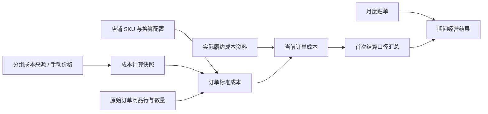

# SKU 成本与订单核算

核对日期：2026-11-12。本文替代早期“利润、实际出库成本尚未实现”的设计状态说明；当前已有成本表、独立手动成本、SKU 关联、订单成本、实际履约成本及期间经营结果。通用公共费用分摊仍不能视为已完整启用。整体口径见[财务 BI](overview.md)，运行与恢复见[运维指南](../../guides/operations.md)。

## 当前功能与代码

| 功能 | 实现入口（`src/main/java/com/yingdao/aicommerce/finance/`） |
| --- | --- |
| 成本表解析、配置、映射 | `FinanceCostWorkspace`、`FinanceCostWorkbook`、`FinanceCostController` |
| 分组文件及独立手动价格 | `FinanceCostSources` |
| 订单商品行、标准成本、当前结果 | `FinanceOrderCosts`、`FinanceCostWorker` |
| 实际履约成本 | `FinanceActualCosts` |
| 按首次结算日期筛选与汇总 | `FinanceCostReport`、`FinanceSettlementDates` |
| 物流贴单 / 刷单费 | `FinanceLabelInvoice`、`FinanceLabelCosts`、`FinanceOrderCharges` |
| 千易收货及退回商品参考成本 | `FinanceQianyiReturns`、`FinanceQianyiReceipt`、`FinanceQianyiReturnCostSummary` |
| 经营结果 / 导出 | `FinanceProfitReport`、`FinanceCostExport` |
| 成本后台导出任务 | `FinanceCostExportJobs`、`FinanceCostExportController` |

成本配置和价格始终以公司、分组和成本仓为边界；店铺映射不能仅按同名 SKU 跨店套用。平台、店铺、订单号共同确定订单，不能只用订单号关联。

## 成本来源与导入

每个分组可维护多份 Excel / CSV，各文件独立保存和移除。同仓/型号/月的来源优先级沿用最后导入资料；删除来源后回退到仍有效的其他来源，没价格保持待补齐。`finance_cost_sources` 保存来源，`finance_manual_costs` 保存独立手动资料，`finance_cost_books` 保留计算快照。历史合并来源不能伪装成可逐份撤回的原始文件，见[来源说明](../../releases/finance/finance-cost-sources-20261026.md)。

同一上传中，仓库、型号、月份及**数值**单价一致时只保留一条，`2` 和 `2.00` 视为相同；不同仓或月独立，后续行可补其他月份。同键不同价仍拒绝整个导入并指出冲突行，原有公式、负价、精度及文件哈希验证保持，见[去重验收](../../finance-cost-dedupe-20261104.md)。

所有这些商品单价按人民币 CNY 原值保存，不随看板换算。文件更新时间不是成本生效月；按配置选择下单月或发货月价格，缺当月价格可使用最近更早月份并明确历史价估算，不用未来价；选择发货月但缺发货时间不能静默换成下单月。缺价、零价及未知成本分别处理。

独立手动成本与 SKU 关联原子保存，人工固定价格不被同名 Excel 覆盖。修改需版本校验；删除手动资料后原引用保持待核对，不自动换成其他同名来源或国家成本仓。

## GIFT 例外

商家 SKU 完整匹配 GIFT（去首尾空格、不区分大小写）时固定零成本且无需映射；混合订单其他商品仍按正常规则核算。原始 ERP 凭据保留，未知成本不按零处理。一次性历史扫描已完成，不重新运行；日期和维护边界见[当前财务规则](current-rules.md)。

## 商品 SKU / 平台 SKU 匹配

- 导入成本表的“型号”可填写商品 SKU 或平台 SKU。自动计算在当前公司、分组和成本仓内先用商品 SKU 匹配；商品 SKU 无法唯一命中后，再用平台 SKU 匹配。两者都未唯一命中才提示人工确认型号。已有人工关联及独立手动成本仍优先。
- 商品 SKU 阶段先用完整商家编码，再使用格式规范化后的唯一型号及既有组合装规则；外层括号、空格和乘号按现有规范处理。平台 SKU 阶段匹配完整或规范化后唯一的规格 ID，系数为 1，不从未匹配的商品 SKU 或商品标题推测包装倍数。
- Shopee 的平台 SKU 取 `model_id`，TikTok 取 `sku_id`；商品级 SPU（`item_id/product_id`）不再参与自动成本兜底。所有编号以文本比较和展示，避免长数字丢失精度；成本表里的长平台 SKU 也应按文本保存。
- 商品 SKU 和平台 SKU 都命中时使用商品 SKU。商品 SKU 已匹配型号但缺价、零价或数量不合法时，继续执行原来的价格/数量核对，不切换到另一个平台 SKU 价格来掩盖问题。无法确定成本仓时同样保留待补齐；关联页提示先选择成本仓，不计入自动完成的已关联 SKU，GIFT 固定零成本规则保留。
- 成本仓优先店铺配置，其次按国家唯一匹配；仓名可直接为“菲律宾”“泰国”“马来西亚”，无需包含“海外”。PH/TH/MY/VN/SG/ID 分别使用现有中文国家别名识别；同一国家有多个不同成本仓时保持待补齐，不能自行选择价格。只有一个成本仓时保留原有单仓回退。不宣称已识别真实出库仓。
- 完整组合装型号优先且系数 1；无独立整套价格时，以明确的基础型号和编码包装数量计算；人工关联及换算系数优先，避免整套与子件重复计入。
- 订单行保留平台商品/变体身份、商家 SKU、数量和原始资料；销售规格中的尺码文字不单独推翻商家 SKU 匹配。
- 订单成本表在“商品 SKU”右侧显示“平台 SKU”，同单多个平台 SKU 去重分行，缺失显示 `—`。平台 SKU 匹配不会补写原始商家 SKU；商家 SKU 缺失时原有商品识别卡片仍可用于核对。SKU 关联页明确显示按商品 SKU 或平台 SKU 自动匹配，已有自动关系会按最新成本表重新判断，人工确认关系继续保留。
- 既有 `SPU_CODE` 继续识别为历史自动关系，计算时按新规则重新判断，不会误作人工确认关系。新自动关系方法为 `PLATFORM_SKU_CODE`；自动关联接口按版本和自动方法条件刷新旧关系，人工确认和独立手动关系保留。
- 标准成本结果保存 `policyVersion`。每店铺、每策略版本保留一条小型系统排队回执；后台自动补排已经完成的旧历史，不依赖重新同步订单或人工改动成本表。每次最多补排 10 家店，沿用每页 500 笔扫描、每批最多 100 笔计算。活动扫描及贴单任务游标继续执行，到达完成状态后再安排必要的完整新规则重算；不清队列或重置活动检查点。
- 新规则重算尚未轮到的旧错误会显示“后台按商品 SKU、平台 SKU 重新计算”；计算完成后显示最新真实原因。当前国家成本仓的两个编码都缺失时保持待补齐，不能借其他国家价格或把未知成本当零；独立单品成本不自动推断 `+` 组合装成本。
- 已有商品目录及 SKU 来源有独立边界，不能把早期“最近 2,000 笔订单投影”当成今天的完整目录保证；查 `FinanceProductSkus` 与[商品 SKU 发布记录](../../releases/finance/2026-10-23-finance-product-skus.md)。

规则切换见[平台 SKU 兜底验收](../../releases/finance/platform-sku-cost-fallback-20261113.md)，历史结果及旧自动关系补齐见[成本匹配完整性修复](../../releases/finance/cost-policy-completion-20261113.md)。2026-11-12 的 SPU 方案属于历史行为，已由本规则替代。

采集新 SKU 的编码规则为 `COLOR-STYLE-SIZE-SUFFIX`，例如 `BK-A01-M-8F3A6C2D`；同源图案共享持久化 style/suffix，显式批量上传款号不改已发布历史。纯白选项和不同图案身份不能合并，V145/V146 及命名边界见[共享图案](../../sku-shared-cost-total-20261104.md)和[命名验收](../../product-sku-naming-20261104.md)。改变编码时还要检查既有成本映射。

## 计算与保存

订单同步及配置变化进入持久成本队列，内容未变化不重复追加。`FinanceCostWorker` 单线程、有界循环处理，失败保留工作项；当前每批最多 100 笔，循环有两秒预算和最多十批边界，不能使用旧文档的固定四批五十笔作为容量依据。页面读计算结果，避免临时解析全量原始 JSON。

SKU / SPU 匹配升级变更计算源哈希版本，旧算法结果在后续订单同步或既有后台重算时更新；成本表导入、设置及人工关联更新继续触发原有队列。页面查询不会直接全量重算历史数据，已经入库的旧成本结果需等对应队列处理后才反映新规则。运行新代码时如需立即处理存量，应协调使用既有按店铺/分组重算入口，不清空队列、检查点或原始记录。

成本管理预览与订单核算共用国家选仓规则，预览返回 `suggestedWarehouse`，不要求为已能唯一匹配的店铺重复保存配置。国家匹配修复的历史结果需在新代码激活后通过现有队列重算；发布一次性入队步骤及验收状态见[修复记录](../../releases/finance/country-warehouse-hotfix-20261110.md)。新订单及后续配置更新继续使用既有自动计算流程。

商品标准成本与实际履约成本有来源标识，不能把估算标准单价称作真实采购凭证。实际资料的更新、匹配与重算沿用现有服务，不修改平台本币金额、结算余额或对账差额。

自动重算更新当前结果、版本及队列状态，**不再追加整份 before/after JSON 快照**。人工配置、手动改动及显式导入记录继续保留；不得删除原始成本表或财务账本来节省空间。见[存储规则](../../storage-cleanup-20261102.md)。

## 全店待补齐与批量导出

“所有店铺待补齐”覆盖当前公司的全部店铺，保留结算日期和订单编号查询。点击“导出 Excel”后创建个人后台任务，页面“订单成本导出”显示生成进度；关闭面板后任务继续，重新打开可查看结果。任务的筛选在提交时固定，不随随后切换店铺或日期改变。

小范围直接生成 XLSX；超过每份 50,000 笔订单或 200,000 条 SKU 明细时，自动分成多份 XLSX 并打包一个 ZIP。每笔订单与它的 SKU 保持在同一文件，ZIP 的“导出清单”列出每份数量以便核对。各文件仍包含汇总说明、订单成本和 SKU 成本明细，期内退货参考附表只出现一次并注明独立期间范围，不能在各片重复累计。缺成本仍留空，原币逐行保留，不能跨原币相加。

后台导出使用同一只读数据库快照，生成期间的成本重算或新增结算不会令本次分页重漏。订单索引只聚合并流式读取一次，写入私有临时文件；关闭数据库结果流后，每次读取 500 笔订单内容，避免每页重新聚合全公司结算。索引临时文件最多 256 MiB，完成或失败后清理。仅任务所有者的同一公司与用户可查看或下载；切换登录信息后旧入口失效。文件保留 30 分钟，服务重启后任务及临时文件不保证继续保留，需重新生成。浏览器未接受自动下载时，可点击任务中保留的“下载 Excel / 下载 ZIP”，页面不把请求保存当成文件已经保存。

资源保护仍生效：单任务最多 1,000,000 单、输出最多 128 MiB、生成最长 10 分钟；单笔订单本身超过 SKU 分片上限会明确报错，不能截断。后台单工作器、有界队列，每人最多两项在途，已完成文件合计最多 256 MiB；只清理自身临时目录。实现及验收边界见[自动分批导出记录](../../releases/finance/cost-export-batches-20261110.md)。

贴单等独立更新保留已确认的商品/SKU 成本及其展示，不把整个订单误算为缺 SKU；最终贴单及营业利润在相关处理完成前保持待确认。来源哈希变化或缺少快照时才回到完整商品计算。任务提交与当前结果更新在有界事务内完成，失败保留检查点。

## 结算、取消、退款与利润

- 已结算商品成本按**首次平台结算日期**归属，每个订单只计一次。免费样品依据官方样品标记识别，已履约样品成本继续统计；刷单订单按既有规则从经营汇总排除。
- 全部源订单列表按店铺本地下单日查询，包含取消和未结算，只扩大查询可见范围；未结算订单不因此新增已确认商品成本。精确编号可跨创建日期，仍保持公司/店铺/分组限制，见[源订单规则](../../finance-source-orders-20261105.md)。
- 未付款、已取消订单及已取消商品行不计商品成本，不受是否发货影响；实际平台扣费继续保留。不要沿用旧版“已发货取消仍计商品成本”的文字。
- 退款不能直接退回采购成本；千易符合收货条件的原币退款合计、CNY 退回商品参考成本与营业利润分别展示。收货时间不是结算时间，当前没有恢复退货成本冲回。
- 订单成本工具栏合计覆盖所有筛选页，跟随店铺、结算日期、编号及成本状态；不含贴单费用。“所有店铺待补齐”统一查看当前公司全部店铺、分组、平台和原币的已结算待补齐订单，保留日期和编号筛选，并解除原单笔记录范围；列表、合计和 Excel 导出范围一致。导出涵盖所有查询页，逐行保留店铺、分组、原币及缺失原因，不能跨原币直接相加。切回“全部订单”恢复原来源范围。待补齐时展示已计算部分与待补齐数，失败不伪造完整零值，见[筛选合计](../../sku-shared-cost-total-20261104.md)。
- 平台结算净额已扣佣金/物流/税费时只拆分展示，不能再次扣减。经营结果沿用[财务 BI](overview.md)的结算、广告、贴单及商品成本期间口径，不拿本期新下单商品成本减本期结算来代替利润。
- 缺成本/汇率时明确不完整；未配置部分支出时展示暂估。看板参考汇率重述不等于历史结汇或人民币会计账簿。

例如标准单价含采购 20 元、包材 1 元，数量 2 件则标准商品成本为 42 元。若额外运费 8 元另有明确来源并选择单独计入，则该订单直接成本为 50 元；已包含在其他来源的费用不能再重复录入。示例不是新的默认分摊规则。

## 贴单、刷单费及其他费用

月度仓库贴单通过专用账单导入，不使用已停用的固定贴单单价规则。原表明确数值 0 按真实零金额处理，计费状态文字不再单独否定该金额；空值、非法金额、冲突及无法唯一归属仍需核对，不能自动补零。明细保留已匹配/待匹配及金额冲突等状态；零金额后续修正见[验收记录](../../releases/finance/finance-label-zero-20261030.md)。刷单费使用[原始十一列模板](../../finance-brush-original-template-20261105.md)，`代刷费CNY` 对应已有内部 `service_fee_cny`，不能据字段名新增服务费。源订单金额用于识别/核验，保持原有去重、首次结算归属和经营排除规则。

刷单来源按公司、分组、精确订单号、店铺与原币金额核验，买家账号不作为店铺标识；同订单重复来源不重复计费，冲突金额待核对。移除来源只撤回该来源的标签/费用影响，最后一个有效来源移除后按现有规则恢复经营统计，不改写平台原始流水。

刷单成本页的「范围内刷单合计」统计订单核对表中本金原币非零的来源记录笔数；「范围内刷单费合计」对代刷费非零金额求和，单位为人民币。两项使用核对表相同的公司、费用分组、精确订单编号范围，覆盖全部分页；平台、店铺及结算日期不排除来源行。按来源行合计时重复文件中的来源各自保留，零本金不阻止该行非零代刷费计入。原有首次结算日期/店铺期间统计、累计去重刷单费和经营汇总排除仍独立保留，不以来源行合计替代。

其他费用台账检查来源编号、公司归属、真实订单、修改版本及原因。仅明确“单独计入费用”的记录进入现有外部成本；已包含或待核对金额不重复计入。自动成本计算不追加快照不影响这里的明确人工操作审计。

通用公共费用分摊仍是设计/待执行能力；保存规则或显示预览不代表已自动按订单结转。新增分摊前需明确基数、版本、尾差和来源去重，并追加独立验收，不能将早期设计段落当作已实现财务规则。

## 回归重点

修改计算时检查公司/分组/店铺隔离、同价去重及不同价冲突、手动资料保护、组合数量、历史价/缺价/零价、首次结算去重、取消与样品、实际成本来源、刷单排除、千易参考成本不冲回、筛选总额与明细导出一致。测试入口及隔离 MySQL 条件见[开发指南](../../guides/development.md)，API 入口见[接口导航](../../guides/api.md)。
