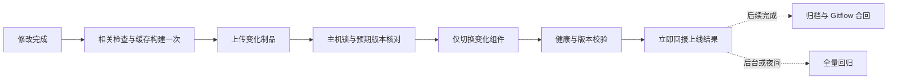

# 小团队高频热修复的发布方式决策

更新：2026-11-11。依据用户最新要求，先将旧流程完整上线并完成收尾，再实施新的快速交付方式；以最快完成开发响应和版本上线为目标，不追加流程选择或审批问题。

**决定：固定运行环境，按应用文件发布；一次定向验证、一次缓存构建、一次增量上传、一次组件切换。** GitHub 保存源码并承担后台全量回归，不再成为普通热修复必须走完的多阶段发布平台。

状态：本文确定后续按文件交付的方向，**新的生产文件发布入口尚未实现或切换**。旧流程 `v2026.11.10.7` 已健康上线，后续验收与 Gitflow 收尾继续按原流程完成；真实成本修复 `v2026.11.11.1` 已启动发布命令，等待后续窗口及实际回执，不能视为已上线。旧流程完整交付后再实施本文方案，不将 .7 成功或本机分层实验称为新入口上线。

## 依据：项目真正的交付单位

清点了 2,523 个 Git 受控文件，并按主应用、静态前端、独立服务、客户端、工程脚本与运维分组审查。深入检查运行与构建入口、全部根 Compose/Dockerfile、CI/CD、部署/恢复、任务租约、静态打包及相关源码。第三方资源和全部业务类没有逐行语义审计；私有配置、凭据、业务导出不属于本次输出。

- 主后端是一个 Maven / Spring Boot 应用，业务域共用 JVM，交付一个 JAR。没有必要先拆微服务或 Maven 多模块才改善上线速度。[pom.xml](../../pom.xml)
- Web 是原生 HTML/JS/CSS，已有引用校验、资源清单和 gzip 打包，不需要每次运行 Java 构建。[静态打包](../../frontend/package.py)
- MySQL、Redis、Pi、文档转换、图片服务、ERP、桌面与扩展各有独立边界。普通财务/页面修复只影响 app 或 frontend，不能捆绑全仓服务重建。[项目结构](../guides/project-structure.md)
- 生产为 8 核、约 32 GB 内存的单机，9 个常驻容器；现有网络、卷、私有配置、备份和后端任务门控可以继续使用。

## 实测说明主要浪费在哪里

以下是单次实测，不是新方案的承诺或持续性能统计。

| 内容 | 证据 |
| --- | --- |
| .7 最后一轮 PR 触发至正式 CD 完成 | 28 分 55 秒，期间包含流程修复后的重新验证和人为/编排空档 |
| .7 正式 CD | 11 分 01 秒；run `42840120637` |
| 完整上传 | 489,285,387 字节；客户端 SSH 写入 508.959 秒 |
| 服务器在线来源/证明核验 | 75.326 秒，与接收阶段部分重叠，不能再与上传简单相加 |
| 真正的服务器切换及验收 | 23 秒；operation `ea92503d10945dcda97ff53eb6a90b65` |
| 其中业务排空 | 4.486 秒；不应为了提速牺牲在途工作 |
| 该版本可信 CI 的 Java 编译步骤 | 44 秒 |
| 同轮单元任务工具准备 | 159 秒，其中 FFmpeg 安装约 147 秒 |
| 本机至服务器有界上传样本 | 8 MiB 不可压缩数据、SSH 压缩关闭，7.233 秒，约 1.16 MB/s；未在服务器落盘 |

本机直连也不能把大包传输变成零成本。**最重要的是少传，而不是换一个地方传同样大的包。**

11 月 11 日已用原生 ARM64 JDK 21 对已有 76,960,232 字节 JAR 执行标准分层提取，耗时 **0.670 秒**；实际生成应用 JAR **3,351,543 字节**，其 tar.gz **3,113,779 字节**，157 个依赖合计 **73,262,630 字节**。157 个依赖及 1,176 个应用类/资源均与原包逐字节一致。输入是旧的未认证审查产物，不能上线；未启动应用或部署。前端既有统计为频繁变化文件 2,900,236 字节、稳定资源 32,993,885 字节。这些样本支持少传稳定依赖，不代表当前正式制品或端到端提速已验收。

## 选定的日常上线链路

### 前端修复

1. 只运行静态引用、语法和相关页面测试；只生成静态发布目录。
2. 上传变化的 HTML/JS/CSS、配套 gzip 和资源清单，稳定 vendor、下载包和图片复用。
3. Nginx 保持运行，完整发布父目录只读挂载，切换其中的版本目录入口。普通页面修复不重启 Java，也不排空 Java 的后台任务。
4. 校验实际 HTTP 返回的版本、原文件和 gzip。保留旧资源与版本引用，处理浏览器跨请求缓存；仅切换 symlink 不能宣称浏览器绝不会混用版本。

Nginx 同时承担 API/招聘/ERP 反向代理，反复重建它会影响无关连接。只有改 Nginx 配置时才执行 `nginx -t` 和优雅重载。

### 后端修复

1. 缓存编译完整主应用一次，执行本次缺陷及受影响行为的测试。正常修复不安装 FFmpeg、不构建桌面客户端、不重建数据库。
2. 固定 JRE、FFmpeg、字体和依赖。优先复用已验证可提取的 Spring Boot 标准分层，依赖指纹不变时只传应用部分；必要时以完整 JAR 直传作为兼容过渡。不要手工替换几个 `.class` 拼出不可复现的 JAR。
3. 服务器接收至新的不可变目录，核对提交、制品哈希、依赖指纹和预期运行版本后再激活。常规发布不传完整源码仓库，不在服务器临时上网安装包。
4. 使用现有稳定 Docker 运行环境，仅重启 app。版本化产物只读挂载后可取消每次业务镜像构建；初次需单独登记配置与回滚基线。
5. 后端进程启动时解析到不可变版本路径，避免运行中的 JVM 后续通过可变 `current` 路径加载到另一版本的资源。Java 普通类变更仍需受控重启，不采用不可靠的在线热替换。

标准 tools 提取已成功，未执行普通应用启动。小 JAR 的 manifest 引用相对 `lib/*.jar`，应用 JAR 与依赖目录必须组合到同一不可变运行根；不能把两层分开放置后假定可运行。无需开发 thin-JAR 下载器。实测回执为本地审查目录的 `native-toolchain-layer-probe.md`；Linux 启动、媒体行为、挂载、任务恢复及正式回滚仍待新入口验收。

### 构建位置

当前 Mac 已在私有工具缓存安装并核验原生 ARM64 Temurin JDK `21.0.9+10`，未改全局 PATH；固定 Maven 与持久依赖缓存仍待补齐，尚未执行当前正式源码的原生构建。日常优先原生编译；Java 制品及平台相关依赖仍须匹配生产环境，媒体/原生依赖变化增加 Linux 验证。

GitHub 作为备用构建入口时只运行一个连续任务，产出的同一制品直接交给同一主机执行器。开发机与备用入口共用命令和清单，不能再形成两套发布协议。生产服务器保持业务运行职责。

## 发布前检查按影响选择

| 变更 | 上线前必要检查 |
| --- | --- |
| CSS、文案、普通页面 | 静态引用/语法、对应页面行为、实际资源版本 |
| 财务展示、查询、导出格式 | 缺陷复现测试、相关查询/导出测试、公司与店铺隔离；涉及 SQL 时用隔离库验证 |
| 金额计算、成本归集、权限、租约 | 扩大到对应计算/权限/工作器专项回归，不因此运行无关视频和桌面测试 |
| 共享框架、依赖、迁移、runtime | 专门验证兼容性、启动及恢复，不承诺与普通修复相同耗时 |

全 Java、全数据库、全 UI、旧接管恢复和完整故障注入移到夜间或后台。失败按受影响模块处理；无关套件失败或“48 小时没有全量记录”不应阻止所有热修复。未知影响先扩展相关检查，不能简单把所有 finance 文件都判为整个平台全量。

## 从日常关键路径移除

- 多次 PR/develop/trusted CI 对同一有效代码树重复编译和回归。
- 独立 Candidate 发布、等待候选的 Release readiness runner、再开工作流取得五分钟主机证明。
- 每次上传/拉取完整业务镜像、约 30 MB 源码包、重复访问 GitHub/GHCR 查询同一证明链。
- 单元测试默认安装媒体工具；普通代码修改重复安装 runtime 系统包。
- 因启用快速模式再增加 v2 首发、bootstrap、额外资格发布等日常步骤。

一次 SSH 认证传输、一份绑定提交与内容哈希的小清单、一份服务器执行回执即可保留本项目需要的可追溯性。验证源和制品要在真实信任边界完成，不接受任意文件自称 `passed=true`；无需沿每个编排节点重复联网证明。

## 继续保留的必要保护

保留串行部署锁、预期版本比较、制品校验、后端安全排空、健康/鉴权/版本检查、仅回退变化组件，以及当前和两个已验近期回滚。业务数据库、Redis 状态、文件卷、密钥、租约和检查点不随发布清理。迁移继续新增 Flyway 文件；应用回滚不冒充数据回滚。

Gitflow 是用户已明确的协作规则，本次不擅自重命名共享分支或改写历史。将其 Git 操作自动化：热修复从生产基线进入生产，普通功能从 develop 发布，均 no-ff、打标签；上线成功立即回报，合回与归档随后完成。合回出现冲突单独记录处理，不把已经上线说成尚未上线，也不遗忘回合。**Gitflow 不要求每个合并再跑一遍完整 CI。**

现有分支保护与旧工作流须和新入口一起迁移。先验证新入口的源/制品/版本控制和恢复，再移除过重的必需检查；不通过管理员 bypass 临时上线，也不在替代入口尚不存在时关闭全部约束。

## 落地顺序与验收目标

1. 先完成旧流程完整交付：保留已健康运行的 .7 与恢复材料，完成既定验收和合回；真实成本修复 .11.11.1 依原流程推进，按实际发布回执确认结果。
2. 旧流程收尾后，在合法 feature 分支补齐固定 Maven/缓存，验证正式源码构建与标准分层 Linux 启动；把构建/定向验证/上传/激活收敛为一个入口，复用现有锁、预期版本、排空、回执和恢复核心。
3. 先独立静态发布，再接后端文件发布；每次只迁移一个组件并验回退。固定 runtime、不可变版本根及依赖指纹，登记挂载基线；历史镜像发布保留作迁移期恢复。
4. 以一次真实页面修复和一次真实后端修复验收；记录“验证、构建、上传、激活、总用时”五项，确认后台任务恢复。仅补现有执行器缺口，不建设新的证明平台、调度层或依赖下载器。
5. 将全量回归移到后台/夜间，移除旧候选、就绪等待器和重复构建门禁，完成常驻说明与 Gitflow 合回。

性能验收以同类真实修复的端到端测量为准：当前已观测应用层提取 0.670 秒、压缩包 3,113,779 字节，尚无新入口发布耗时。不能从包大小推导秒级或 1–3 分钟上线承诺；依赖升级、数据迁移和长时间在途业务单独计时。

## 当前状态与证据入口

主会话最新核对：生产 `.7` 健康，源码 `3ac4963`，生产 Git 合并 `dbf7613`；控制面安装源码 `b051317`、运维输入 `f066004b…` 与 .7 一致，已确认维护关闭且操作队列为空。PR #47 已合并，`develop` 为 `4c995` 前缀提交；祖先关系和最终合回结果仍待主会话复核。成本修复 `.11.11.1` 发布命令已启动，后续结果以其回执为准；新文件发布入口仍未实现。

原始本地审查材料在 `.superpowers/sdd/2026-11-10-cicd-network-acceleration/`：`whole-project-inventory.json`、`lean-runtime-audit.md`、`lean-build-audit.md`、`lean-workflow-audit.md`、`local-upload-sample.json`、`native-toolchain-layer-probe.md`、`deployment-v7/`。它们包含覆盖范围、实际运行编号和测量边界；不含凭据或业务导出。
