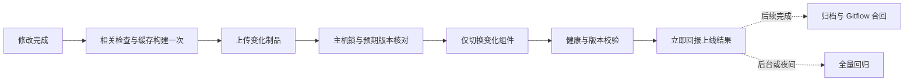

# 小团队高频热修复的发布方式决策

更新：2026-11-11。依据用户要求，先完成旧流程上线与收尾，再根据整个项目确定适合小团队的快速交付方式。本文给出选型结论和最短迁移顺序，以最快完成开发响应和版本上线为目标。

**决定：固定运行环境，按应用文件发布；一次定向验证、一次缓存构建、一次增量上传、一次组件切换。** GitHub 保存源码并承担后台全量回归，不再成为普通热修复必须走完的多阶段发布平台。

状态：本文完成新运维方式的选型，**新的生产文件发布入口尚未实现或切换**。旧流程已发布 `v2026.11.10.7`，并由真实成本修复 `v2026.11.11.1` 完成首次 v2/full、缺失层传输与统一 CLI 的正式交付验证；后者已在生产激活，业务验收和 Gitflow 合回完成，原 journal 为 `complete`。旧流程的上线不等于本文的新通道已上线；完整结果查 [旧流程验收记录](../releases/infrastructure/cicd-acceleration-20261110.md)。

## 依据：项目真正的交付单位

清点了 2,523 个 Git 受控文件，并按主应用、静态前端、独立服务、客户端、工程脚本与运维分组审查。深入检查运行与构建入口、全部根 Compose/Dockerfile、CI/CD、部署/恢复、任务租约、静态打包及相关源码。第三方资源和全部业务类没有逐行语义审计；私有配置、凭据、业务导出不属于本次输出。

- 主后端是一个 Maven / Spring Boot 应用，业务域共用 JVM，交付一个 JAR。没有必要先拆微服务或 Maven 多模块才改善上线速度。[pom.xml](../../pom.xml)
- Web 是原生 HTML/JS/CSS，已有引用校验、资源清单和 gzip 打包，不需要每次运行 Java 构建。[静态打包](../../frontend/package.py)
- MySQL、Redis、Pi、文档转换、图片服务、ERP、桌面与扩展各有独立边界。普通财务/页面修复只影响 app 或 frontend，不能捆绑全仓服务重建。[项目结构](../guides/project-structure.md)
- 生产为 8 核、约 32 GB 内存的单机，9 个常驻容器；现有网络、卷、私有配置、备份和后端任务门控可以继续使用。

## 实测说明主要浪费在哪里

以下是单次实测，不是新方案的承诺或持续性能统计。

| 内容 | 证据 |
| --- | --- |
| .7 最后一轮 PR 触发至正式 CD 完成 | 28 分 55 秒，期间包含流程修复后的重新验证和人为/编排空档 |
| .7 正式 CD | 11 分 01 秒；run `42840120637` |
| 完整上传 | 489,285,387 字节；客户端 SSH 写入 508.959 秒 |
| 服务器在线来源/证明核验 | 75.326 秒，与接收阶段部分重叠，不能再与上传简单相加 |
| 真正的服务器切换及验收 | 23 秒；operation `ea92503d10945dcda97ff53eb6a90b65` |
| 其中业务排空 | 4.486 秒；不应为了提速牺牲在途工作 |
| 该版本可信 CI 的 Java 编译步骤 | 44 秒 |
| 同轮单元任务工具准备 | 159 秒，其中 FFmpeg 安装约 147 秒 |
| 本机至服务器有界上传样本 | 8 MiB 不可压缩数据、SSH 压缩关闭，7.233 秒，约 1.16 MB/s；未在服务器落盘 |
| 后续真实成本修复 .11.11.1 的 delta 传输 | 复用 390,325,271 字节，实际仍上传 98,906,578 字节（含源码）；客户端写入累计 568.308 秒 |
| .11.11.1 的正式 CD / 主机操作 | 约 12 分 48 秒 / 44 秒；排空 26.131 秒、启动 1.293 秒、后验 13.967 秒 |

本机直连也不能把大包传输变成零成本。**最重要的是少传，而不是换一个地方传同样大的包。**

delta 已真实节省约 390 MB，但上述单次发布的总耗时没有随字节数同比下降。`sshUpload` 只计输入流写入，会受 SSH 建连、接收端核验和背压影响，不能直接当纯网络带宽；两个版本也不是可控 A/B 实验。大陆服务器访问境外服务、重复证明与编排均需从关键路径减少，不能把全部延迟归咎于服务器重启或一个网络节点。

11 月 11 日在提交 `452d03c` 的源码上补做原生构建，固定工具和缓存的实测如下。每项都是一次样本，不是长期速度保证。

| 本机实验 | 用时或体积 | 边界 |
| --- | --- | --- |
| 空依赖缓存、编译全部 495 个主源码并打包 | 43.087 秒 | 跳过测试，另有定向测试 |
| 依赖已缓存、空 classes 完整编译打包 | 6.311 秒 | 独占源码副本、离线模式 |
| 改一个副本源码注释、实际重新编译 495 个文件 | 5.088 秒 | 不是无变化重复打包 |
| 运行导出测试类的 11 项测试 | 10.506 秒，全部通过 | 含首次编译测试源码；不连数据库 |
| 标准 Boot 分层提取 | 1.104 秒 | 仅工具模式，未启动应用 |
| 完整 JAR / 应用层压缩包 | 76,996,371 / 3,144,881 字节 | 157 个稳定依赖共 73,262,630 字节 |

依赖锁校验通过，提取的 157 个依赖和 1,189 个应用类/资源均与当前 JAR 逐字节一致。前端既有统计为频繁变化文件 2,900,236 字节、稳定资源 32,993,885 字节。这些样本支持少传稳定内容；未证明 Linux 启动、正式发布资格或新通道的端到端耗时。

## 为什么选这个方式

| 选择 | 对本项目的判断 |
| --- | --- |
| 固定 Compose 运行环境、直接发布版本化应用文件 | **选用。** 延续现有单机服务边界，去掉每次镜像和候选编排；能独立发布前端与后端 |
| 继续优化 GitHub 多阶段镜像发布 | 保留为迁移期恢复入口；已验证能运行，但 runtime 缓存包本身约 835 MB，单次下载仍需 144 秒，不能解决根本开销 |
| 在生产服务器拉源码并编译 | 构建与业务争资源，也把依赖下载和构建失败带到生产；不作为日常默认入口 |
| 增加 Kubernetes、Jenkins 或新的常驻 runner | 当前单机、小团队和交付单位不需要这些层次，不投入这项迁移 |

第一步使用标准完整 JAR 与既有已验收 runtime，先获得一条可运行的短链路。约 3.14 MB 的标准应用层作为同一入口的后续优化，不能为了先得到最小包又建设一套复杂发布平台。

## 选定的日常上线链路

### 前端修复

1. 只运行静态引用、语法和相关页面测试；只生成静态发布目录。
2. 上传变化的 HTML/JS/CSS、配套 gzip 和资源清单，稳定 vendor、下载包和图片复用。
3. Nginx 保持运行，完整发布父目录只读挂载，切换其中的版本目录入口。普通页面修复不重启 Java，也不排空 Java 的后台任务。
4. 校验实际 HTTP 返回的版本、原文件和 gzip。保留旧资源与版本引用，处理浏览器跨请求缓存；仅切换 symlink 不能宣称浏览器绝不会混用版本。

Nginx 同时承担 API/招聘/ERP 反向代理，反复重建它会影响无关连接。只有改 Nginx 配置时才执行 `nginx -t` 和优雅重载。

### 后端修复

1. 缓存编译完整主应用一次，执行本次缺陷及受影响行为的测试。正常修复不安装 FFmpeg、不构建桌面客户端、不重建数据库。
2. 固定 JRE、FFmpeg 和字体，首版直传标准完整 JAR；Linux 启动和现有维护脚本兼容性通过后，在同一入口使用 Spring Boot 标准分层，依赖指纹不变时只传应用部分。不要手工替换几个 `.class` 拼出不可复现的 JAR。
3. 服务器接收至新的不可变目录，核对提交、制品哈希、依赖指纹和预期运行版本后再激活。常规发布不传完整源码仓库，不在服务器临时上网安装包。
4. 使用现有稳定 Docker 运行环境，仅重启 app。版本化产物只读挂载后可取消每次业务镜像构建；初次需单独登记配置与回滚基线。
5. 后端进程启动时解析到不可变版本路径，避免运行中的 JVM 后续通过可变 `current` 路径加载到另一版本的资源。Java 普通类变更仍需受控重启，不采用不可靠的在线热替换。

标准 tools 提取已成功，未执行普通应用启动。小 JAR 的 manifest 引用相对 `lib/*.jar`，应用 JAR 与依赖目录必须组合到同一不可变运行根；不能把两层分开放置后假定可运行。历史维护脚本及现有依赖校验器使用 `BOOT-INF` 路径，切换布局前须明确适配。无需开发 thin-JAR 下载器。最新实测回执为本地审查目录的 `native-build-probe.md`；Linux 启动、媒体行为、挂载、任务恢复及正式回滚仍待新入口验收。

### 构建位置

当前 Mac 已在私有工具缓存安装并核验原生 ARM64 Temurin JDK `21.0.9+10`、Maven `3.9.11` 和持久依赖缓存，未改全局 PATH；已在明确提交的源码上完成上表构建与定向测试。日常优先原生编译；Java 制品及平台相关依赖仍须匹配生产环境，媒体/原生依赖变化增加 Linux 验证。

GitHub 作为备用构建入口时只运行一个连续任务，产出的同一制品直接交给同一主机执行器。开发机与备用入口共用命令和清单，不能再形成两套发布协议。生产服务器保持业务运行职责。

## 发布前检查按影响选择

| 变更 | 上线前必要检查 |
| --- | --- |
| CSS、文案、普通页面 | 静态引用/语法、对应页面行为、实际资源版本 |
| 财务展示、查询、导出格式 | 缺陷复现测试、相关查询/导出测试、公司与店铺隔离；涉及 SQL 时用隔离库验证 |
| 金额计算、成本归集、权限、租约 | 扩大到对应计算/权限/工作器专项回归，不因此运行无关视频和桌面测试 |
| 共享框架、依赖、迁移、runtime | 专门验证兼容性、启动及恢复，不承诺与普通修复相同耗时 |

全 Java、全数据库、全 UI、旧接管恢复和完整故障注入移到夜间或后台。失败按受影响模块处理；无关套件失败或“48 小时没有全量记录”不应阻止所有热修复。未知影响先扩展相关检查，不能简单把所有 finance 文件都判为整个平台全量。

## 从日常关键路径移除

- 多次 PR/develop/trusted CI 对同一有效代码树重复编译和回归。
- 独立 Candidate 发布、等待候选的 Release readiness runner、再开工作流取得五分钟主机证明。
- 每次上传/拉取完整业务镜像、约 30 MB 源码包、重复访问 GitHub/GHCR 查询同一证明链。
- 单元测试默认安装媒体工具；普通代码修改重复安装 runtime 系统包。
- 因启用快速模式再增加 v2 首发、bootstrap、额外资格发布等日常步骤。

一次 SSH 认证传输、一份绑定提交与内容哈希的小清单、一份服务器执行回执即可保留本项目需要的可追溯性。验证源和制品要在真实信任边界完成，不接受任意文件自称 `passed=true`；无需沿每个编排节点重复联网证明。

## 继续保留的必要保护

保留串行部署锁、预期版本比较、制品校验、后端安全排空、健康/鉴权/版本检查、仅回退变化组件，以及当前和两个已验近期回滚。业务数据库、Redis 状态、文件卷、密钥、租约和检查点不随发布清理。迁移继续新增 Flyway 文件；应用回滚不冒充数据回滚。

Gitflow 是用户已明确的协作规则，本次不擅自重命名共享分支或改写历史。将其 Git 操作自动化：热修复从生产基线切 hotfix，普通功能从 develop 切 release，完成相应验证后均以 no-ff 合入生产并打标签；上线成功立即回报，必要合回与归档随后完成。合回出现冲突单独记录处理，不把已经上线说成尚未上线，也不遗忘合回。**Gitflow 不要求每个合并再跑一遍完整 CI。**

现有分支保护与旧工作流须和新入口一起迁移。先验证新入口的源/制品/版本控制和恢复，再移除过重的必需检查；不通过管理员 bypass 临时上线，也不在替代入口尚不存在时关闭全部约束。

## 落地顺序与验收目标

1. 完成旧流程交接：.7 与真实成本修复 .11.11.1 的实际回执、开关与合回如实归档。后续自然样本继续观察，不为凑性能样本或资格记录额外发布。
2. 在合法 feature 分支实现一个薄发布入口，使用已准备的固定 Maven/缓存，将构建、定向验证、上传、激活收敛为一次命令，复用现有锁、预期版本、排空、回执和恢复核心。
3. 先独立静态发布，再接后端文件发布；每次只迁移一个组件并验回退。固定 runtime、不可变版本根及依赖指纹，登记挂载基线；历史镜像发布保留作迁移期恢复。
4. 以一次真实页面修复和一次真实后端修复验收；记录“验证、构建、上传、激活、总用时”五项，确认后台任务恢复。仅补现有执行器缺口，不建设新的证明平台、调度层或依赖下载器。
5. 将全量回归移到后台/夜间，移除旧候选、就绪等待器和重复构建门禁，完成常驻说明与 Gitflow 合回。

日常目标是前端修复分钟内、普通后端修复数分钟内完成必要验证和上线；这是实施目标，**当前尚无新入口端到端验收，不能称为已经达到**。验收用一次真实修复记录验证、构建、上传、激活和总用时；不额外制造发布。依赖升级、数据迁移和长时间在途业务单独计时。

## 当前状态与证据入口

2026-11-11 主会话只读核对：生产 `v2026.11.11.1`，源码 `53d9685`，生产 Git 合并 `80e8a11`；CD `42940211574` 成功，维护关闭且操作队列为空。控制面仍为已安装的 `b051317`，运维输入 `f066004b…`。PR #47 已将 .7 正式历史合回 develop，广告 PR #49 随后合入；成本 PR #50 以 `c030455` 合回 develop，保留广告改动，同 journal 已 `complete`，`HEYI_V2_BOOTSTRAPPED=true`。后续精确分支与现场结果查对应回执，不能将本段历史快照当成下一次操作的基线。新文件发布入口仍未实现。

原始本地审查材料在 `.superpowers/sdd/2026-11-10-cicd-network-acceleration/`：`whole-project-inventory.json`、`lean-runtime-audit.md`、`lean-build-audit.md`、`lean-workflow-audit.md`、`local-upload-sample.json`、`native-build-probe.md`、`deployment-v7/`。它们包含覆盖范围、实际运行编号和测量边界；不含凭据或业务导出。
