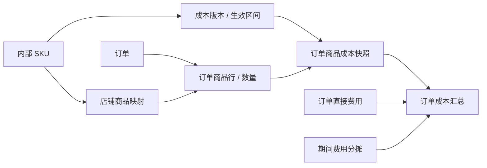

# SKU 成本与实际订单的关联方案（待实现）

目前财务同步保留 Shopee 的 `item_list` 和 TikTok 的 `line_items` 原始订单商品数据，页面仅提取商品行数与名称。外部成本已支持 CSV / XLSX 导入，但还没有 SKU 成本版本、商品映射和订单成本快照。以下是建议方案，不代表这些功能已经上线。

## 用户怎么配置

在财务模块增加「成本管理」，分为 SKU 成本、店铺商品映射、订单成本、其他费用四个页签。财务数据沿用现有组织共享和角色权限。

| 配置 | 用户填写 | 关联方式 |
| --- | --- | --- |
| SKU 成本 | 内部 SKU、商品名称、规格、采购单价、币种、生效日期；可选单件包材、头程单位成本 | 每条订单商品按数量计算 |
| 店铺商品映射 | 平台、店铺、平台商品/变体、内部 SKU | 同一内部 SKU 可以对应多个店铺商品 |
| 订单其他成本 | 店铺、订单编号、费用类型、金额、币种、凭证/来源编号 | 直接归入指定订单，例如额外包装、外部运费、仓库操作费 |
| 公共费用 | 店铺或分组、期间、费用类型、金额、币种、分摊方式 | 租金、人工等按订单数、数量或净销售额分摊；可以选择不分摊到订单 |

成本表支持批量导入。系统只在同一平台、店铺下对唯一且明确的 SKU 匹配自动建立映射；重码、空 SKU、组合装留给用户确认，不能仅凭商品名称自动认定。

## 数据关系

- 订单主键以组织、平台、店铺、平台订单编号共同确定，不能跨店只用订单号。
- 商品映射以组织、平台、店铺、平台商品 ID 和变体 ID 确定，商家 SKU 用于辅助确认。
- 商品行保留平台行标识和数量。同步更新做幂等覆盖，不能将同一行重复追加；无稳定行标识时先验证平台的行结构再确定归并键。
- 成本版本保存币种、生效起止时间、成本组成；同一 SKU 的有效区间不重叠。
- 第一版按下单时间选取当时有效的标准成本版本，冻结单价、数量、成本组成、原币和汇率快照。没有库存出库数据时明确标记「标准成本估算」，不称为实际采购成本。
- 后续接入采购批次/出库单后，允许用真实出库成本补齐。历史调整需保留调整人、原因、旧值和新值；修改今天的成本价格不应静默重算旧订单。
- 组合装使用组件及数量清单计算，防止整套成本与子件成本同时累计。

## 示例

内部 SKU `TEE-BLACK-M` 的采购成本为 ¥20/件、单件包材 ¥1/件。某店铺订单包含该 SKU 2 件，另有外部订单运费 ¥8：

`订单商品成本 = (20 + 1) × 2 = ¥42`

`订单直接成本 = 42 + 8 = ¥50`

订单中另一个 SKU 单独按其数量和对应成本版本计算。第二天采购价改为 ¥23，不会自动改变这张订单已冻结的 ¥20。

## 利润口径与异常处理

1. 以订单为单位关联平台结算交易。一个订单可能分多次结算，也可能产生退款或后续调整，不能只取一条结算记录。
2. 「订单利润」要关联同一批订单的结算、成本及退款调整；「期间经营结果」则按期间确认的收入成本计算。不能直接把本周结算总额减去本周新下单商品成本。
3. 平台结算净额已扣收的佣金、物流、税费等只做拆分展示，不再次扣减。广告、外部物流、采购等也必须有来源编号和是否已计入结算的标记，避免 API、手工导入及分摊重复记账。
4. 广告及公共费用只有明确关联或按用户选定规则分摊后，才进入订单利润；估算分摊与直接归属分别标识。分摊尾差确定性分配，分摊合计必须等于原始费用。
5. 「待结算预计利润」和「已结算利润」分开显示。尚未结算、缺成本、缺汇率的订单标明不完整，不能按零成本显示虚高利润；同时给出成本匹配覆盖率。
6. 退款不必然冲回采购成本。取消且未出库的订单取消预计成本；退款但未退货的订单保留已发生商品成本；退货收回且确认可再次销售后再调整商品成本，已发生的包材、运费按实际处理。
7. 原币金额始终保留，跨币种计算使用明确日期的汇率快照。历史成本及利润不能因查看页面时的新参考汇率而静默变化。

## 实施顺序

第一阶段：标准 SKU 成本导入、店铺商品映射、订单商品行解析、历史成本快照、缺成本清单和订单直接费用。先确保每笔订单能解释出「哪个商品、多少件、按哪个价格、发生什么费用」。

第二阶段：组合装、广告及公共费用分摊、退货成本调整和结算利润核对。同步时只更新受影响的订单及汇总，复用现有数据库和后台增量同步，不让页面查询临时扫描全部原始订单 JSON。
