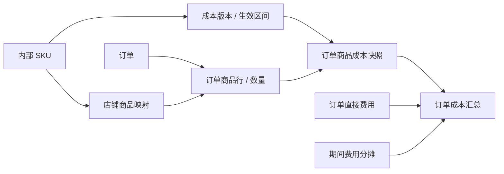

# SKU 成本与实际订单的关联方案

目前财务同步保留 Shopee 的 `item_list` 和 TikTok 的 `line_items` 原始订单商品数据。成本表版本、店铺 SKU 关联和费用台账已接入；订单成本快照、利润和费用分摊仍是后续设计。

## 当前设计状态

2026-10-22：按用户反馈简化为「成本表」「SKU 关联」两个主要入口，成本仓和计价单位单独设置。关联页面按「店铺 → SPU（平台商品 ID）→ SKU（平台规格 ID）」展开，SPU 汇总成功、未关联和需核对数量，分别用绿、红、橙标识。相同商家 SKU 编码自动关联成本型号，人工修改不会被自动覆盖；跨店铺不复用关联。所有成本文件按用户确认使用人民币 CNY，保持原金额。SKU 从最近最多 2,000 笔已同步订单投影，不额外请求平台；这不是全量商品目录。

2026-10-23：成本明细展示「币种／人民币 CNY」；SPU 在桌面每行四张卡片，选中卡片下方用整行展示 SKU 表。自动关联兼容中英文外层括号、空格及乘号。优先匹配完整组合装成本；没有独立组合装时关联唯一基础型号，并单独保留编码中的 `bundleQuantity`。原始单价和人工关系不变，`factor` 仍待确认，不据此自动生成财务成本。

本地设计预览可注入已提供成本文件的解析结果、已同步订单中的商品规格样本。样本不是全店商品目录，所有修改只保留在内存；生产入口不包含客户成本文件、价格或店铺样本。预览以「设计预览」明确标识，缺成本时不生成利润数值。

订单成本、利润、分摊等预留入口已从页面移除。自动编码关联只建立关系，不猜测单位换算，也不产生订单成本或利润。新录入的订单/店铺费用仅在选择「单独计入费用」时，按明确的「计入财务日期」写入现有 BI 外部成本；其他已含费用或待核对记录不再计入。

商品同步需要保留平台、店铺、商品 ID、规格 SKU ID、商家 SKU、销售规格、图片、销售单位、可识别的包装数量和同步时间。订单商品行另外保留下单时的规格、数量和行 ID，避免商品后来改名或改规格影响旧订单。完整商品目录同步与订单增量同步分离；已下架但历史订单仍引用的 SKU 保留。

## 用户怎么配置

成本表导入后自动选择有成本资料的店铺，SKU 按同编码自动关联。以下表格保留后续成本核算的设计约束，当前界面只展示已启用的成本表、SKU 关系和费用记录。

| 配置 | 用户填写 | 关联方式 |
| --- | --- | --- |
| SKU 成本 | 内部 SKU、商品名称、规格、成本仓、单位成本、币种、计价单位、生效月份；可选已包含的包材、头程、入仓费用 | 每条订单商品按销售数量与单位换算计算 |
| 店铺商品映射 | 平台、店铺、平台商品/变体、内部 SKU | 同一内部 SKU 可以对应多个店铺商品 |
| 订单其他成本 | 店铺、订单编号、费用类型、金额、币种、凭证/来源编号 | 直接归入指定订单，例如额外包装、外部运费、仓库操作费 |
| 公共费用 | 店铺或分组、期间、费用类型、金额、币种、分摊方式 | 租金、人工等按订单数、数量或净销售额分摊；可以选择不分摊到订单 |

成本表支持批量导入。相同编码自动保存关联，独立保留各成本仓对应关系，不自动选择实际使用的成本仓。完全相同编码优先，其次使用格式规范化后的唯一型号；存在规范化重码时不猜测，显示橙色需核对。组合装按上述完整型号优先、基础型号加组合数量兜底；规格冲突仍显示橙色。空编码或找不到型号的显示红色未关联。

文件更新时间不等于成本生效月份。原表币种已确认为人民币，单价对应包/片/箱/套及成本组成尚未确认，不据此生成订单成本。历史零值不默认代表商品免费。

## 数据关系

- 订单主键以组织、平台、店铺、平台订单编号共同确定，不能跨店只用订单号。
- 商品映射以组织、平台、店铺、平台商品 ID 和变体 ID 确定，商家 SKU 用于辅助确认。
- 商品行保留平台行标识和数量。同步更新做幂等覆盖，不能将同一行重复追加；无稳定行标识时先验证平台的行结构再确定归并键。
- 成本版本保存币种、生效起止时间、成本组成；同一 SKU 的有效区间不重叠。
- 按确认的成本归属规则选取发货月份或下单月份有效的标准成本版本，冻结单价、数量、换算系数、成本组成、原币和汇率快照。预览默认展示发货月份，正式启用前需确认；缺少发货时间时不静默改用下单时间。没有库存出库数据时明确标记「标准成本估算」，不称为实际采购成本。
- 后续接入采购批次/出库单后，允许用真实出库成本补齐。历史调整需保留调整人、原因、旧值和新值；修改今天的成本价格不应静默重算旧订单。
- 成本表已有独立组合装型号时优先使用其单位成本，换算系数为 1；没有整套成本时，才允许用户确认组件及数量。不能默认多包装成本等于单包成本倍数，不能同时累计整套和子件成本。

## 示例

内部 SKU `TEE-BLACK-M` 的采购成本为 ¥20/件、单件包材 ¥1/件。某店铺订单包含该 SKU 2 件，另有外部订单运费 ¥8：

`订单商品成本 = (20 + 1) × 2 = ¥42`

`订单直接成本 = 42 + 8 = ¥50`

订单中另一个 SKU 单独按其数量和对应成本版本计算。第二天采购价改为 ¥23，不会自动改变这张订单已冻结的 ¥20。

## 利润口径与异常处理

1. 以订单为单位关联平台结算交易。一个订单可能分多次结算，也可能产生退款或后续调整，不能只取一条结算记录。
2. 「订单利润」要关联同一批订单的结算、成本及退款调整；「期间经营结果」则按期间确认的收入成本计算。不能直接把本周结算总额减去本周新下单商品成本。
3. 平台结算净额已扣收的佣金、物流、税费等只做拆分展示，不再次扣减。广告、外部物流、采购等也必须有来源编号和是否已计入结算的标记，避免 API、手工导入及分摊重复记账。
4. 广告及公共费用只有明确关联或按用户选定规则分摊后，才进入订单利润；估算分摊与直接归属分别标识。分摊尾差确定性分配，分摊合计必须等于原始费用。
5. 「待结算预计利润」和「已结算利润」分开显示。尚未结算、缺成本、缺汇率的订单标明不完整，不能按零成本显示虚高利润；同时给出成本匹配覆盖率。
6. 退款不必然冲回采购成本。取消且未出库的订单取消预计成本；退款但未退货的订单保留已发生商品成本；退货收回且确认可再次销售后再调整商品成本，已发生的包材、运费按实际处理。
7. 原币金额始终保留，跨币种计算使用明确日期的汇率快照。历史成本及利润不能因查看页面时的新参考汇率而静默变化。

## 实施顺序

第一阶段：标准 SKU 成本导入、店铺商品映射、订单商品行解析、历史成本快照、缺成本清单和订单直接费用。先确保每笔订单能解释出「哪个商品、多少件、按哪个价格、发生什么费用」。

第二阶段：组合装、广告及公共费用分摊、退货成本调整和结算利润核对。同步时只更新受影响的订单及汇总，复用现有数据库和后台增量同步，不让页面查询临时扫描全部原始订单 JSON。

## 费用与调整的配套设计

`frontend/finance-expenses-design.js` / `.css` 支持显式本地预览与正式数据两种上下文。「费用与调整」默认展示原有平台费用（`#finance-fees`，兼容 `#finance-fee-records`），保留原有日期筛选、字段选择、导入和导出。「其他费用与调整」（`#finance-expense-ledger`）单独展示手工费用和调整记录。分摊及来源说明页签已移除。新台账服务端检查来源编号、公司归属、真实订单编号、修改版本与调整原因，事务内更新外部成本和审计记录。

- 费用台账：费用类别、日期/期间、订单/店铺/分组归属、金额、币种、来源编号、计入方式、说明。商品采购单价不在这里重复导入。
- 分摊规则：按有效订单数、出库商品数量、净销售额，或仅保留期间费用。先预览基数、覆盖订单、已分摊与未分摊金额，再确认；没有基数时保持待处理。规则需要版本和生效日期。
- 调整记录：原记录保持可追溯，保存调整前后金额、归属、计入方式、原因、操作人和时间。平台原始数据不直接改写。
- 来源与口径：平台费用、广告消耗、商品单位成本、额外费用各自保留来源，区分已包含和额外计入，避免重复扣减。

费用来源编号应使用唯一费用行编号，同一类别下大小写归一后由公司级唯一键查重；已有外部费用导入的相同记录编号也禁止再次计入。同一单据有多项费用时应补充行号；未来跨店分摊引用同一原始费用，不新增重复总额。币种分别合计，汇率转换和尾差分配沿用明确的快照与最小货币单位。
