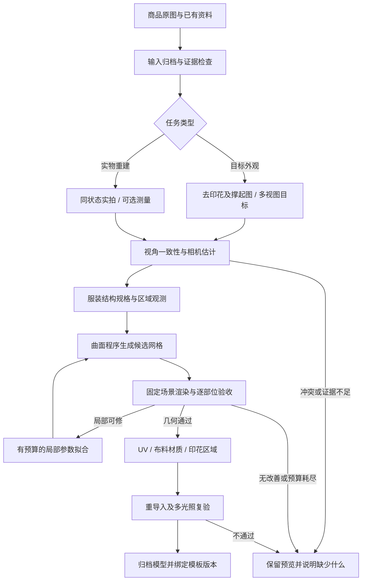

# 服装参考图重建：项目设计

日期：2026-09-11。状态：**目标工程设计；已有部分可运行原型，但商品目标验证未通过，完整工程尚未实现。**

实测更新：[2026-09-11 验证报告](/Users/heyi/Documents/ChatGPT/code-ai-pla/docs/garment-reconstruction-validation-20260911.md)。已测试薄壳、轮廓拟合及部分结构检查；以下全部能力不应视为已实现。

后续 [v2.1 升级复测](/Users/heyi/Documents/ChatGPT/code-ai-pla/docs/garment-reconstruction-upgrade-20260911.md) 已改进肩袖、分区体积、领口约束并补充限定范围袖身求交。正面、背面轮廓通过，右侧仍未通过；完整工程和实物重建验收仍未完成。

参考项目：[img2threejs](https://github.com/img2threejs/img2threejs)，本次审阅版本 `6e60b5e22419464b4853e01ddb6c0e6f6659a733`。

## 1. 要做成什么

在现有系统中增加服装专用的代码建模服务：输入商品图，生成可旋转、可检查结构、可设置前后左右印花的三维服装，并说明哪些部位有参考依据、哪些属于推断。AI 负责识别和提出修改，固定的几何程序负责生成网格，独立验收器决定是否通过。

**不能承诺用单张照片百分百还原真实物品。** 看不到的背面、内侧、真实厚度、尺寸和布料物性没有唯一答案。多张 AI 补图仍然是一组假设。能够承诺的是：按冻结的标准检查；证据不足明确标记；失败保留失败状态；每个通过结论可追溯到模型和参考图。

“所有必检项通过”也不等于“现实物品还原率 100%”。没有可靠的统一百分比能同时代表轮廓、版型、体积、褶皱、材质和物理属性。

首版只支持**普通、不透明、无复杂叠层的短袖 T 恤，静态撑起展示**。短袖衬衫、针织镂空、蕾丝、透明面料、复杂外套等需单独的结构模型和样本，不能沿用一个 T 恤模板后宣称支持所有服装。

## 2. 当前模型为什么不满意

问题主要出在建模和验收方法，而不是缺少一个材质参数。

| 当前尝试的问题 | 后果 | 新工程的处理 |
| --- | --- | --- |
| 衣身、袖子主要用手写曲线和截面拼接 | 外形像衣服，但袖根、肩部和领口的关系不对 | 使用服装曲面控制网、共享缝线和局部约束 |
| 看过六个视角，没有把轮廓和关键点变成实际拟合目标 | 增加参考图后，程序仍按主观参数生成 | 每张有效参考产生相机、轮廓、关键点和区域观测 |
| 肩部和胸部共用影响范围过大的深度参数 | 修肩膀时胸口被压扁，修袖子牵连衣身 | 参数登记影响区域，修改后对其他区域做回归检查 |
| 面数、法线或连通性检查被当作还原验收 | 网格合法，视觉上仍然不对 | 结构合法性、几何相似、材质表现分别检查 |
| 靠纹理、灯光补偿几何缺陷 | 线框看似有细节，材质一上就显得平 | 灰模先通过；大褶皱必须有实际几何 |

当前原商品照片是衣物搭在椅子上的状态；后来要求的是无印花、撑起来的商品图。两者姿态已经变化，不能用原照片的每条褶皱考核新姿态。当前 AI 上下图也有斜视成分，不能直接当作精确正交投影。

## 3. 两种任务必须分清

| 任务 | 可以输入什么 | 验证什么 | 结果如何标记 |
| --- | --- | --- | --- |
| `DESIGN_MATCH`：按目标外观建模 | 原商品图及经过选择的 AI 无印花、多视图 | 是否符合选定目标图，以及三维结构是否合理 | 目标外观模型；未实拍区域为推断 |
| `REAL_RECONSTRUCTION`：实物重建 | 同一件服装、同一支撑状态的实拍，多角度及可选量尺/扫描 | 已观测外形；有测量才验证真实尺寸 | 按证据列明验证范围和误差 |

你现在的“去印花 → 撑起来 → 四面/六面图 → 3D”属于第一种。默认按此创建任务，不额外增加运营人员的必填项。切换到实物重建后，系统先检查输入是否足够，不会把缺图默认为成功。

原商品图继续保留为身份、款式、颜色参考；去印花区域和姿态变换是明确的设计修改。未经确认的 AI 新增口袋、领型变化、袖长变化应作为目标图冲突，不进入建模。

## 4. 从输入到成品的流程



### 4.1 输入归档：先判断参考能说明什么

每张图片保存原文件哈希、来源、父图片、生成模型/提示词版本（如适用）、服装状态、裁切变换、视角标签和证据用途。

- 原始实拍、去印花编辑图、AI 新视角分别标记；所有派生图保留来源链。
- 四宫格裁切保存各格坐标和留白变换；不把生成图的四个裁片记成四张独立实拍。
- 从图片提取前后轮廓、领口、肩点、袖根、袖口、下摆和可见缝线；每个观测有可见性、误差估计和证据图片。
- 正反面领型不一致、左右袖长互相矛盾、支撑姿态变化时产生冲突记录，不能直接平均掉。
- 没有比例尺时只生成相对尺度；导出若需要默认尺寸，明确标为假设，不能用于生产尺寸验收。
- 材质类型可以从“棉针织”“涤纶”等商品资料或预设推断；未测量的弹性和粗糙度不能被说成识别出的真实值。

AI 识别结果是待验证观测，不是自带真值的标签。低置信度关键点需要复查或保留未知，不能因为模型给出小数分数就进入硬约束。

### 4.2 相机匹配：先解决照片与模型怎么对齐

商品图可能带透视，不能统一套正交相机计算误差。先估计投影类型、焦距/尺度、旋转、平移和可见区域。初始拟合允许有限次数交替优化相机与粗形体，保留多个合理解及歧义。

进入候选模型比较前冻结相机、裁切和参考掩膜。候选之间不能单独移动相机、缩放局部区域或改变曝光来“提高还原度”。必须修正相机时，创建新的评估版本，并对旧候选重新评估；跨版本分数不能直接比较。

实物验证尽量保留至少一个未参加形状拟合的同状态真实视角。其相机独立校准，或在候选冻结后按预先规定的有限规则注册；不可再把该视角的误差反馈给同一轮拟合。没有真实留出视角时，报告相应验证缺口。

AI 生成的图不一定存在严格一致的三维相机。多视图无法同时解释时，返回 `REFERENCE_CONFLICT` 并指明冲突区域。重新生成目标图意味着新任务版本，不能替换验收目标后沿用旧结果。

## 5. 几何核心：AI 输出曲面规格，程序构建网格

### 5.1 表达方式

采用服装专用的 `SurfaceIR`（结构化曲面规格）：

| 信息 | 内容 |
| --- | --- |
| 部件 | 前衣片、后衣片、左右袖、领边、袖口和下摆；标明实际连接关系 |
| 曲面 | 样条/细分控制网，参数域及边界曲线；局部编辑范围 |
| 缝线 | 两侧曲面边、统一采样参数、方向、连接方式、允许的折角 |
| 开口 | 领口、袖口、下摆的合法开口与可见内壁要求 |
| 约束 | 参考关键点、轮廓、可测尺寸、截面、对称先验及适用区域 |
| 材质槽 | 面料、领边等语义区域；首次建模阶段只使用中性灰材质 |
| 不确定区域 | 缺少证据的表面及其生成依据 |

首版采用固定拓扑的短袖服装控制网作为初始化，**不是直接套一个不可变的通用模型作为最终结果**。控制点、曲率、袖根位置和局部体积都需拟合。无法表达目标结构时判为不支持，增加相应模型族后再处理。

AI 只可输出经过 schema 和语义校验的参数/控制点修改，不允许改验收程序或提交任意可执行脚本。几何内核是可测试的确定性程序：相同输入、版本和随机种子生成相同逻辑网格。渲染像素允许的硬件差异另行记录。

### 5.2 解决领口、袖根和扁平问题

1. **缝线真正连接。** 衣身与袖片共享缝线主曲线、采样站点和逻辑顶点。不能只验证两条解析曲线接近，就宣称离散网格已经缝合。UV 接缝导致渲染顶点重复时保留逻辑顶点映射，分别检查拓扑和贴图接缝。
2. **连接处分类型。** 平滑连接检查位置与切向/法线关系；缝制折边允许指定折角。不要为消除接缝把所有折线过度磨平。
3. **袖子有独立体积。** 肩、上臂段、袖口采用局部曲面控制；核查袖根连续性、截面面积、袖口贯通和腋下穿插。避免把袖子做成与衣身重叠的实心管。
4. **领口是合法开口。** 领窝和领边分别建模，核查前后领深、可见内壁、开口轮廓以及肩面过渡，不能用浮在衣身上的圆环代替整个结构。
5. **防止局部塌陷。** 监控胸、腰、肩及袖子的截面和控制网 Jacobian/退化情况。下限来自目标或结构先验，并标记来源；不能用任意“最小厚度”把所有衣物吹成气球。
6. **限制改动范围。** 每个参数登记影响部位及允许的附带变化。修袖口后，胸部轮廓、领口及其他已通过项必须仍在容差内，否则拒绝候选。

普通装配 T 恤薄壳通常有领口、下摆和两个袖口，但开口数量来自所选结构规格，不硬编码成所有服装都必须有四个。

薄壳可以有合法边界；加厚后衣料本体可以成为封闭实体，而供头和手穿过的通道仍必须存在。两种表达分别验收。`DoubleSide`、零边界边或“水密”都不能独立证明服装结构正确。

### 5.3 褶皱的层级

- 轮廓、肩塌落、袖根聚褶及明显垂坠属于几何。移动相机后仍须存在。
- 中等褶皱由参考折线、缝线、支撑点及曲面局部编辑形成，受光后要有对应法线变化。
- 织纹和纤维尺度使用 normal/roughness 等贴图；不能通过贴图伪装缺失的袖口或大褶皱。

不再用重复正弦噪声代替整件衣服的褶皱。布料仿真放到后续阶段；它需要纸样、缝合、碰撞体、支撑姿态和材料参数，不能凭“棉”一个词保证真实垂坠。

### 5.4 可选初始化的边界

多视图轮廓可用于粗视觉外壳初始化，但轮廓交集不能恢复领窝、内壁等凹陷，也不能解释互相矛盾的生成图。首版以曲面控制网为主，视觉外壳只作为粗体积约束，不作为自动完成建模的捷径。

## 6. 参数拟合与独立验收

### 6.1 先粗后细，保留最佳版本

拟合顺序：整体比例和轮廓 → 衣片/袖根/领口 → 局部体积与褶皱 → 灰模验收 → UV 与布料 → 印花及导出。

每次只优化一个小参数组，以轮廓距离、关键点偏差、缝线误差、形变正则等组成拟合目标。硬结构错误优先拒绝，不能让加权平均分抵消它。优化可先使用有界坐标搜索；后续是否需要可微渲染，根据真实耗时和收敛结果决定。

每次候选记录参数差异、受影响区域、拟合指标、独立验收结果和资源用量。保留通过硬检查的最佳版本；没有候选通过则保留失败预览，不制造“最佳即合格”的状态。

作业开始冻结 `maxCandidates`、`maxAiCalls`、`maxRenderEvaluations`、墙钟预算和无改善停止窗口。先在基准集标定合理值，不能现在保证几分钟内完成。达到预算、连续无有效改善或所有候选结构失败时终止，并给出具体区域和原因。

### 6.2 验收器的权限和证据

验收器是与生成 worker 分开的进程/服务，使用只读版本化标准，直接加载实际构建产物重新渲染。生成器不能提供最终 `pass`、截图或“准确率”作为验收结果。

参考文件、相机、渲染场景、评价程序、阈值、IR、几何内核和产物均绑定版本与哈希。哈希用于发现混用；防止伪造仍依赖独立执行、产物权限及后端只接收可信验收器结果。

统一使用固定分辨率、色彩管理、曝光、背景和一组固定灯光；每张参考使用已冻结的匹配相机。另有前后左右和斜角检查视图，检验结构是否只在参考相机下成立。

验收状态限定为 `passed / failed / unevaluated / not_applicable`。缺少测量实现或证据必须是 `unevaluated`。`not_applicable` 由任务契约预先决定，不能由生成器随意跳过。必检项未评估，当前契约就不通过。

### 6.3 首版检查表

下列数值是**待用样本校准的候选阈值，不是已达到的准确率**。参考分割、相机误差和标注误差必须同时报告。

| 检查 | 方法 | 候选规则 / 适用边界 |
| --- | --- | --- |
| 网格可用 | 索引、有限数、退化面、逻辑拓扑、方向检查 | 无非法索引/非有限数；退化容差与尺度绑定 |
| 缝线与开口 | 逻辑顶点连接、边界归属、局部连通、内壁和通道检查 | 所有规定缝线连接；无非预期开口/封口；不能只数孔 |
| 穿插 | 三角形相交与区域语义检查 | 无未获规格允许的穿插；相邻面接触/真实缝边有明确规则 |
| 逐视角轮廓 | 固定相机二值轮廓 IoU、对称边界距离 | IoU ≥ 0.95；边界距离 P95 ≤ 图像中服装框对角线的 1.5% |
| 关键点 | 领窝、肩点、袖口端点、下摆点的投影误差 | 可见且可靠的关键点误差 ≤ 服装框对角线的 1% |
| 关键部位 | 领型、袖长/袖型、腋下、胸部截面等分别评价 | 每个必检部位通过，不能用整体平均掩盖错误 |
| 真实尺寸 | 网格测量与量尺/标定数据对比 | 有独立测量才设物理容差；无测量为未验证 |
| 真实三维误差 | 与独立扫描按预定规则配准后比较表面距离 | 有扫描才报告；同时披露扫描误差，不能用像素 IoU 代替 |
| 灰模质量 | 去除纹理后的多视图与固定斜光检查 | 领口、袖根、大褶皱须由网格表达；无对应参考时仅作合理性审查 |
| 材质表现 | 中性光、侧光下的分区比较 | 先验收颜色/织纹表现；无受控测量不宣称真实 PBR 参数已还原 |
| 印花与导出 | 棋盘格、文字方向、接缝检查；GLB 重导入再渲染 | 无意外镜像/串面/贴图丢失；版本绑定完整 |

领型等语义检查可用视觉模型辅助，但不能让生成模型自评成为唯一的放行依据。首版保留灰模对照复核；如果人工发现自动检查漏过，应将样本加入失败集并修复验收器，而不是只为这件衣服改参数。

在缺少真实多视图时，可通过“目标图匹配”的检查，但报告必须写明未验证的实物形状。禁止显示一个没有定义的“还原度 99%”。

### 6.4 先证明检查能识别错误

冻结一组应当失败的样本：贴着照片的平板、缺领口、袖子粘进衣身、压扁胸部、背面空壳、镜像印花、断裂缝线、纹理丢失、旧模型搭配新截图、修改阈值后重放报告。

每项检查要有观测生产器、预期失败样本和端到端记录。检查项只有名字、没有实现时不能标绿。浮点渲染差异用明确容差处理，不能靠扩大到失去检测力的阈值让测试稳定。

## 7. 材质与四面印花

灰模接受后锁定几何版本，才进入材质。采用可编辑布料预设，保存基础颜色、粗糙度、织纹尺度、normal 强度及可选织物 sheen，并标明资料来源或人工选择。标准 GLB 无法表达的自定义效果需要烘焙或明确降级，不能只在当前浏览器里看起来正确。

商品照片带有原来的光照和阴影，不能直接整图作为基础颜色贴图。去光照也只是估计，必须与原图并排检验；撑起后的新模型更不能直接投射椅子上的褶皱阴影。

统一使用服装局部坐标：`+Y` 向领口，`+Z` 朝服装正面，`+X` 指穿着者左侧。左右名称以穿着者为准，并在编辑器画方向标记，避免正视图左右相反。

前/后/左/右是选择表面的入口，不等于四块平面贴图。印花位置用曲面参数或 UV 区域表示，限定到外表面、对应部件和法线方向；跨缝图案需处理两侧 UV 的连续关系。

每个印花配置至少绑定：

```text
modelArtifactId + geometryHash + uvHash + materialSlotSchemaVersion
regionId + artworkHash + placementTransform + clippingRegion
```

重拓扑或重新展开 UV 后，旧定位标为待迁移。必须经过显式映射、四视角和接缝复验才可复用。几何更新若保留 UV，也要产生新绑定并检查拉伸和实际位置，不能默默套用旧快照。

基础模型验收使用诊断棋盘格和方向文字检查 UV、接缝及导出，不代表未来任意印花已经通过。基础服装的 `ACCEPTED` 只覆盖该模型、UV、布料材质及诊断结果。

用户接受基础模型后再配置实际印花。每份印花设计另建不可变版本，按 `DRAFT → CHECKING → READY` 流转，失败为 `FAILED`；修改图案、位置、底色或模型绑定均创建新版本。只有该印花版本的定位、接缝及导出重导入检查通过，才能保存为合格模板；未通过的配置可以保存草稿，不能沿用基础模型的报告作为成品验收。

导出包括 GLB、IR/参数、可复建代码版本、UV/印花区域、材质和对应版本的验收报告。没有纸样、尺寸和工艺校验时，成品定位为展示与套版预览，不当作可直接裁剪生产的文件。

## 8. 工程模块与现有系统接入

建议作为现有仓库的独立模块开发；先用基准样本证明有效，再接模板编辑器。下列是**完整工程的目标结构**。现有 `garment-reconstruction` 目录仅含部分可行性原型，不具备这里列出的完整能力。

```text
garment-reconstruction/
  contracts/       输入、证据、曲面 IR、任务、产物和报告契约
  geometry/        服装控制网、曲面采样、共享缝线、UV 与导出
  worker/          作业阶段执行、AI 分析适配、局部拟合、检查点
  evaluator/       独立拓扑检查、固定场景渲染、指标及报告生产
  viewer/          白色线框、灰模、材质、参考叠加和印花交互
  benchmarks/     自有/获准参考数据的索引、冻结测试集与负样本
```

| 模块 | 实现选择 | 责任 |
| --- | --- | --- |
| 后端 | 现有 Java / Spring、MySQL | 企业隔离、API、任务状态、版本和模板绑定 |
| 调度 | 现有 Redis Stream 模式，独立 3D 队列 | 作业租约、重试、取消和进度；需核对现有任务限制后接入 |
| 几何内核 | TypeScript，纯数值计算和 Three.js 几何输出 | 固定程序构建网格，避免每件商品重写渲染代码 |
| 分析与拟合 | 现有 AI 网关；按需 Python 数值工具 | 输出受限观测/IR 修改，执行预算内优化 |
| 独立验收 | 单独进程的网格检查和固定 Three.js 浏览器渲染 | 从真实产物生产证据，固定版本且与生成器权限分离 |
| 可视化 | 现有 Three.js 预览扩展 | 拖转、白线框、灰模、材质、原图对照及四面印花 |

Three.js 在这里是几何运行和显示工具。高还原能力主要来自服装表达、实际拟合与验证，换成其他渲染引擎不会自动修好袖根。

现有接入点：

- [CommercePrintTemplateController.java](/Users/heyi/Documents/ChatGPT/code-ai-pla/src/main/java/com/yingdao/aicommerce/product/web/CommercePrintTemplateController.java)：沿用底图资产和模板入口，增加模型作业引用；原有已接受的纯色图可直接作为目标。
- [CommercePrintTemplateService.java](/Users/heyi/Documents/ChatGPT/code-ai-pla/src/main/java/com/yingdao/aicommerce/product/application/CommercePrintTemplateService.java)：模板快照扩展为绑定不可变模型、UV、印花区域和材质版本。
- [commerce-print-editor.js](/Users/heyi/Documents/ChatGPT/code-ai-pla/frontend/commerce-print-editor.js)：现有前后左右编辑流程接入模型和真实曲面坐标。
- [print-preview.js](/Users/heyi/Documents/ChatGPT/code-ai-pla/frontend/vendor/three/print-preview.js)：加载版本化服装资产，增加灰模对照；现有通用示意模型仍需明确区分。

### 8.1 API 草案

| 接口（拟新增） | 行为 |
| --- | --- |
| `POST /api/v1/garment-reconstructions` | 输入资产 ID、任务类型、目标变换及质量契约；返回 `202 + jobId`，使用幂等键 |
| `GET /api/v1/garment-reconstructions` | 按企业/商品分页查询，不受某一批作业卡住影响 |
| `GET /api/v1/garment-reconstructions/{id}` | 当前阶段、尝试次数、检查点、错误、候选/接受版本 |
| `GET /api/v1/garment-reconstructions/{id}/events` | SSE；携带事件序号，刷新可继续读取，查询接口可兜底 |
| `GET /api/v1/garment-reconstructions/{id}/candidates` | 版本、区域差异、检查和参考对照资产 |
| `POST /api/v1/garment-reconstructions/{id}/retry` | 从可重试检查点恢复；变更输入或标准则创建新版本 |
| `POST /api/v1/garment-reconstructions/{id}/cancel` | 取消排队或在阶段边界取消；不删除已生成资产 |
| `POST /api/v1/garment-reconstructions/{id}/accept` | 引用通过必检项的候选；人工确认也不能绕过硬失败 |
| `POST /api/v1/garment-print-designs` | 基于已接受的基础模型创建实际印花版本，异步校验定位、接缝和成品导出 |
| `GET /api/v1/garment-print-designs/{id}` | 查询当前印花版本的状态、产物和专属验收报告 |

在模板保存请求中增加 `modelArtifactId`、`geometryHash`、`uvHash` 和 `printDesignVersionId` 等绑定，服务端重新校验企业归属与有效状态。合格模板要求基础模型已接受、当前实际印花版本为 `READY`；草稿与合格模板分开标记。资产引用使用内部 ID，不让生成模型任意读取服务器文件或外部地址。

### 8.2 作业状态与断线恢复

```text
QUEUED → CHECKING_INPUT → ANALYZING → FITTING_GEOMETRY
       → CHECKING_GEOMETRY → PREPARING_MATERIAL → CHECKING_EXPORT
       → REVIEW_READY → ACCEPTED

阶段异常：RETRY_WAIT / NEEDS_INPUT / FAILED / CANCELED
```

上述是基础服装模型的状态，不包含后续实际印花成品的状态。`CHECKING_EXPORT` 检查基础模型和诊断图案；`REVIEW_READY` 只代表当前契约的自动必检项已过、等待灰模/外观确认；`ACCEPTED` 仍须携带任务类型和证据范围，不能变成“真实还原完成”。关键未知项阻断当前契约，不能通过勾选人工确认消除。实际印花成品按第 7 节独立验收，失败不抹掉有效的基础模型版本。

阶段和步骤分别保存状态，恢复从最后一个有效检查点开始。使用数据库状态与 outbox 协调投递、租约心跳、阶段幂等键和条件更新，避免 Redis 重投造成重复产物或旧 worker 覆盖新结果。

外部 AI 请求保存调用记录和供应商任务 ID；断线后优先查已有任务。供应商没有查询或幂等能力且提交状态未知时，标为待协调，不能声称重试一定不重复计费。恢复策略和最大额外调用预算在作业创建时固定。

3D 渲染/拟合与已有图片任务分开限流，按测得的 CPU、显存、内存和供应商限额调度。用户此前要求的图片最大并发 500，不直接套用为 500 个同时进行的三维重建。新任务可继续入队，网页关闭不取消后台作业。

### 8.3 最小持久化记录

| 记录 | 必需内容 |
| --- | --- |
| 作业 | 企业、商品、类型、输入清单、标准版本、预算、状态、租约和阶段 |
| 参考 | 文件哈希、实拍/派生来源、父引用、姿态、相机版本、用途 |
| 观测 | 区域/关键点、可见性、标注来源、不确定度、参考版本 |
| 候选 | 父候选、IR 哈希、几何内核版本、参数差异、产物引用 |
| 验收 | 独立验收器版本、输入/产物/相机/阈值哈希、逐项结果和截图 |
| 接受版本 | 模型/UV/材质/报告引用、确认人或策略、验证范围 |
| 印花版本 | 基础模型绑定、印花素材及变换、状态、成品资产和专属验收报告 |

配置、模型和报告均不可原地覆盖；清理孤立中间产物可按保留策略进行，但已绑定模板或报告的资产必须保留。API Key 沿用现有加密配置，不写入 IR、日志、GLB 或浏览器代码。

## 9. 页面设计

沿用现有黑白风格。中间是主要三维区域，默认白色线框，可切灰模和布料；支持旋转、缩放及前后左右视角。右侧是紧凑操作栏：参考图、局部问题、修复版本和印花位置，不再把控件散在整个页面。

查看领口问题时，同步定位参考图区域、模型相机和问题标记。可切叠加轮廓及上一版对比。任务卡片显示商品主图、当前真实步骤和失败原因，例如“正在拟合右袖 · 第 3 个候选”，不显示虚构的进度或还原百分比。

正常运营流程只需：选商品/底图 → 生成模型 → 查看灰模对照 → 接受后设置四面印花。技术参数留在诊断详情。输入不足时只展示影响结果的缺项，提供补图或保留近似预览；近似预览不能被混入已接受模型列表。

## 10. 开发顺序与完成标准

### 阶段 A：证明几何程序可靠

先实现普通短袖结构、曲面采样、共享缝线、开口、局部参数和 UV。使用已知几何合成参考，验证能拟合回去；同时加入与默认控制网不同的形状，避免只测试自己生成的最容易样本。

通过条件：能发现缺领口、粘袖子、塌胸、断缝等错误；相同输入可复建；修改局部不会无声破坏其他已检查部位。此阶段不接商品批量，也不做布料写实。

### 阶段 B：证明参考图确实驱动结果

建立开发集与冻结测试集，包含不同领深、落肩、袖长、宽松程度的普通 T 恤。真实多视图须来自同一状态；单图和 AI 生成图另列，不计入实物重建结果。

每个样本保存全部候选、耗时、失败原因和留出视角结果。开发集用于选择阈值和预算，测试集在冻结后才使用。不能看完测试结果反复改标准，然后把同一批称为独立测试。

通过条件：预先约定的关键结构与逐区域视觉要求达标，失败情况可解释；报告所有样本分母、输入类型和算力。小样本即使全部成功也只证明该样本集，不证明所有商品稳定可用。不预设未经依据的“百分之几成功即可上市”。

### 阶段 C：材质和印花

使用已通过几何的模型，校准布料预设、去光照、UV、四面印花与 GLB 导出。加入换灯、换视角、文字图案方向、接缝和重导入测试。

通过条件：材质不会遮住硬结构问题；印花旋转后贴在正确表面；重新加载和导出后效果可解释且资产齐全；更新模型后旧 UV 绑定会失效或经过验证迁移。

### 阶段 D：接入现有系统

接后台队列、任务列表、恢复、企业隔离、模板快照和前端对照。测试刷新网页、服务重启、重复投递、AI 超时、导出失败与取消作业，确保状态可恢复且不会一直显示“处理中”。

通过条件：一个真实商品完成输入归档 → IR → 运行网格 → 灰模/材质验收 → 四面印花 → 导出重导入 → 模板保存的完整链路。报告必须来自本次实际产物。

先完成 A、B，再决定是否需要引入纸样/布料仿真或其他几何算法。当前失败模型可作为负样本和对照，不作为已经通过验收的基础。

## 11. 免费与运行成本

这条路线不需要强制购买 Tripo 等三维生成 API。img2threejs 为 Apache-2.0；参考或复用其代码时保留相应许可与声明，并逐项检查实际引入依赖和数据的许可。

几何计算、浏览器渲染和部分数值拟合可以本地运行。已有项目的图像/分析模型调用仍按供应商规则消耗额度；改用本地模型可减少外部调用费，但有硬件、算力和效果成本。当前还没有本方案的实测耗时、峰值内存或每件成本，不能给出虚假的单件价格。

每次测试记录 AI 调用数、渲染次数、CPU/GPU 时间、峰值内存和资产大小；据此选质量档位和并发。提高效率优先使用内容哈希缓存、分阶段低分辨率拟合、局部修复和已合格模型复用，而不是无上限重复生成。

## 12. 参考项目的采用范围

| img2threejs 中的做法 | 本项目决定 |
| --- | --- |
| 规格、细节清单、分阶段构建和状态恢复 | 保留思想，收敛到服装部件和证据契约 |
| 有界参数拟合与真实渲染回调 | 可参考实现；必须接实际图像目标，不能把演示目标函数当还原算法 |
| 材质分区、受控相机和证据清单 | 保留，增加灰模阻断与跨版本检查 |
| 自由生成程序化对象 | 收紧为服装 SurfaceIR 和经过测试的几何内核 |
| 通用/角色的全部工作流阶段 | 不照搬；首版不要求骨骼动画、爆炸拆解等无助于服装还原的功能 |
| 自动审核结果 | 核查每项实现与证据，不因为文档列出 gate 就认定已具备能力 |

依据：

- [README：能力定位与单图还原限制](https://github.com/img2threejs/img2threejs/blob/6e60b5e22419464b4853e01ddb6c0e6f6659a733/README.md)
- [Analysis-by-synthesis：有界拟合及实际渲染目标](https://github.com/img2threejs/img2threejs/blob/6e60b5e22419464b4853e01ddb6c0e6f6659a733/grimoire/build/analysis_by_synthesis_fitting.md)
- [Quality contract：质量契约](https://github.com/img2threejs/img2threejs/blob/6e60b5e22419464b4853e01ddb6c0e6f6659a733/grimoire/intake/quality_contract.md)
- [Gates reference：检查与证据](https://github.com/img2threejs/img2threejs/blob/6e60b5e22419464b4853e01ddb6c0e6f6659a733/grimoire/review/gates_reference.md)
- [Stage R test plan：部分检查项的实测实现缺口](https://github.com/img2threejs/img2threejs/blob/6e60b5e22419464b4853e01ddb6c0e6f6659a733/docs/STAGE_R_TEST_PLAN.md)

**当前交付边界：已完成工程方案、验收设计及部分可运行验证原型；还没有生产几何服务，商品目标实测未达到上述轮廓阈值，没有把预览模型判为合格。**
