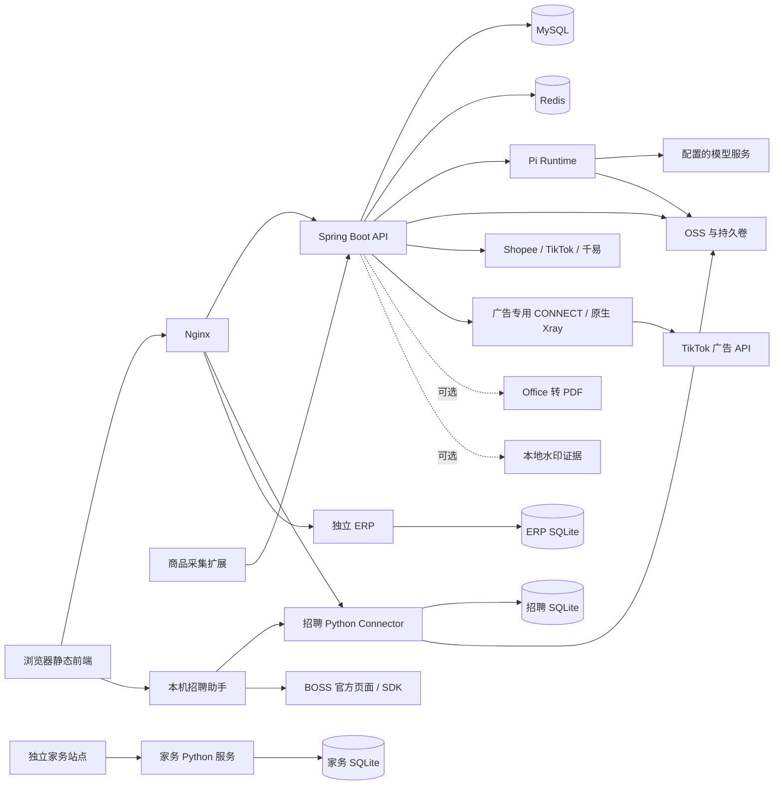

# 架构与代码导航

主体架构核对日期：2026-11-05；广告连接边界补充于 2026-11-07。版本依据为根目录 `pom.xml`、Compose、Nginx、各模块源码和迁移。

仓库目录树及模块组织图见[项目组织结构](project-structure.md)，版本及清单来源见[技术栈](technology-stack.md)。

## 服务拓扑

这张图表示仓库中的集成边界，不表示默认 Compose 已启动所有服务。`compose.yaml` 只包含 `app`、`frontend`、`mysql`、`redis`、`services/pi-runtime`。招聘服务、ERP、下载服务、可选转换及水印服务独立部署。

广告授权、账户发现和报表通过 `FinanceAdHttp` 使用服务器上的专用连接，仅允许官方广告 HTTPS 域名，TLS 由 Java 与官方终点完成。节点凭据由原生服务独立读取，应用只读取私网地址/端口；普通店铺客户端沿用既有通道。部署与验证见[广告连接验收](../releases/finance/finance-ad-connection-acceptance-20261107.md)。

生产 `frontend/nginx.conf` 将 `/api/v1/hr/` 代理给宿主侧招聘服务，将 `/erphoyee/` 代理给 ERP；其余主业务 API 交给 Java。`frontend/nginx.local.conf` 只代理主应用 API，不包含生产 HR/ERP/安装包下载的完整路由。在本地看见招聘菜单并不代表招聘服务已连接。

## 代码位置

Java 包根目录为 [`src/main/java/com/yingdao/aicommerce/`](../../src/main/java/com/yingdao/aicommerce)。部分领域使用 `web/application/domain/mapper` 分层，财务等领域直接按功能类组织。

| 目录 / 文件 | 职责与修改入口 |
| --- | --- |
| `auth/`、`config/SecurityConfig.java` | 登录、Redis Session、插件凭证、HTTP 路由鉴权 |
| `saas/` | 企业、部门、用户、角色、数据范围、模型配置和首次初始化 |
| `shop/` | 商品运营店铺、官方 OAuth、凭证加密、平台适配及发布配置 |
| `product/` | 采集、SKU、图片/视频归档、水印任务、模板/批次、审核和商品发布 |
| `video/` | 脚本分析、分镜、AI/通用视频、恢复、监控及素材引用 |
| `workflow/`、`task/` | 通用任务、Redis Stream 调度、运行记录、事件、活动任务锁和容量限制 |
| `finance/` | 独立财务授权、同步、账本、成本、千易、广告和导出 |
| `knowledge/`、`storage/` | 知识库附件、预览与 OSS 对接 |
| `recruitment/` | 招聘 AI 的 Java 入口；招聘主体业务另在 Python |
| `frontend/app.js`、`frontend/index.html` | 页面入口、状态与公共导航；其他功能按脚本拆分 |
| `frontend/finance-*.js`、`frontend/commerce-*.js`、`frontend/hr-*.js` | 财务、电商及招聘工作区与专用交互 |
| `services/pi-runtime/src/server.js` 及同目录模块 | 模型传输、分析、生图、进度、图片操作持久化 |
| `services/recruitment/connector.py` 及同目录模块 | 招聘平台业务、数据存储、桌面配对、人才/入职/BI |
| `apps/hr-desktop/`、`apps/hr-desktop/client-workbench/` | 招聘桌面壳与 Ai boss 工作台；须按目标系统构建 |
| `apps/automation-agent/`、`apps/browser-extension/` | 通用桌面执行程序与商品采集扩展，分别发布 |

前端没有 React/Vue 工程或根目录 npm 构建链。修改 JS/CSS 后需检查 `index.html` 引用、缓存版本及两个前端 Dockerfile 的 COPY 输入；新增静态资源只放进源码目录不会自动进入镜像。

## 主要数据流

**登录与权限**：`AuthController` 接收企业编码、手机号、密码，`AuthenticatedSessionService` 建立 Redis 会话。账号、角色与权限保存在 MySQL；HTTP 路由权限和业务范围校验共同生效。同一账号再次建立登录会话会使此前会话失效。

**通用工作流**：`workflow_jobs` 保存任务，入队后由 Redis Stream 调度，`WorkflowSkillExecutor` 实现负责实际执行。运行尝试及事件写入 MySQL，前端以 SSE 订阅事件。没有对应执行器的任务进入 `WAITING_EXECUTOR`。专用电商、视频及财务任务另有持久任务状态，不能把所有异步工作都当作同一条 Stream。

**电商**：扩展读取当前商品页并上传完整性证据；Java 存储采集与媒体、排队处理图片、调用 Pi Runtime/模型、保留审核和批次状态。发布通过服务端官方客户端，受提供方和真实发布开关控制。目标店铺类目、仓库、物流与必填规格以该店铺返回值校验。

**财务**：`FinanceShopAuthorization` 保存独立财务连接，`FinanceSync`、`FinanceSyncClaims`、`FinanceSyncPlan`、`FinanceSyncMonth` 管理分页、租约、优先级和月完成证明；`FinanceMarketplace`/`FinanceShopeeIncome` 处理官方数据。`FinanceRepository` 提供受公司/店铺/分组限制的读写，`FinanceService` 组织页面结果。`FinanceOrderCosts`、`FinanceActualCosts`、`FinanceLabelCosts` 和 `FinanceCostWorker` 计算成本；`FinanceQianyiWorker` 获取售后及收货证据。页面读取已保存结果，不通过打开页面触发千易远程查询。

**招聘**：网页由平台登录态进入 Python Connector 管理需求、简历、人才、面试和报表；本机招聘助手持有独立设备执行凭证及本机 BOSS 会话。Java 招聘 AI 入口借助 Pi Runtime 分析。未连接本机助手不能视为服务器可代替用户执行 BOSS 操作。发送结果未知的记录必须保留并核对，不能自动重放。

## 数据及持久化边界

| 存储 | 主要内容 | 交接含义 |
| --- | --- | --- |
| MySQL `mysql_data` | 租户/RBAC、采集/任务、财务原始账本、同步检查点、成本及导入 | 必须保留结构、数据和加密配置；不以清理为由删原始财务数据 |
| Redis `redis_data` | Session、通用调度/容量状态、缓存等 | 不是纯粹可随意清空的页面缓存；会影响会话和任务 |
| `automation_skill_data`、`automation_attachment_data` | 自动化技能及附件 | 各自挂到 `/data/automation-skills`、`/data/automation-attachments` |
| `video_script_data` | 视频脚本/分析素材 | App 可写，默认 Pi Runtime 只读挂载 |
| `ai_video_task_data` | 视频任务文件 | 与数据库任务引用一起保留 |
| `image_operation_data` | Pi Runtime 图片操作及中间状态 | 由 Runtime 持久保存，用于恢复而非普通临时缓存 |
| OSS | 商品/知识库/视频/简历等按配置分属不同存储实现 | Java OSS 与 Python 招聘 OSS 需分别确认；备份 MySQL 不等于备份这些文件 |
| 招聘 Python 私有存储与本机 Profile | 业务 SQLite、附件追踪、设备身份、招聘浏览器登录态 | 与 MySQL 分开备份；不把 Cookie 复制进源码或跨设备迁移 |
| ERP / 家务 SQLite | 独立子项目业务 | 按各自 README 维护，不与主平台数据混用 |

数据库结构以 [`src/main/resources/db/migration/`](../../src/main/resources/db/migration) 为准。当前最高 V148（广告自动化候选）；迁移序列有历史缺号，不能用最大编号推断实际已执行条数。重点域包括 `organizations`/RBAC、`workflow_*`、`captured_*`/`commerce_*`、`ai_video_*`、`finance_*`、`knowledge_*`。查表与索引应读迁移和 SQL，不把本文当作完整 ERD。

广告自动化由 `FinanceAdAutomation` 在既有单线程、账户租约内执行：店铺发现 → 同公司官方 ID 匹配 → 普通报表和各店 GMV Max 独立进度 → 分页暂存 → 完整窗口事务发布 → 覆盖状态。`finance_ad_stores` 保存访问与匹配关系，`finance_ad_streams` 保存游标及退避，`finance_ad_report_stage` 暂存未完成分页，`finance_ad_coverage` 区分空报表与未获取数据。公司账本中的 GMV Max 记录身份与本地归属解耦，账户访问关系不用于推定普通费用归属。实现与边界见[开发验收](../history/finance-ad-automation-20261109.md)。

## 保持不变的业务边界

- 财务连接、广告授权和商品运营店铺分开管理；店铺 ID 与授权 AAD 不能混用。
- 全部源订单按店铺本地下单日查询，首次结算日期用于结算核算；千易收货按北京时间真实收货日。三者不能合并为一个日期字段。
- 确认收货与展示退货成本不恢复成本冲回。平台费用已经包含在净结算时不重复扣减；刷单费模板字段不代表增加费用种类。
- 自动成本重算更新当前结果，不追加完整前后 JSON；手动配置和显式导入记录保留。
- 模型结果、实验原型、接口模拟测试与真实业务验收分别记录；没有执行证据时不宣称已上线或已完整对账。

进一步规则见[财务 BI](../business/finance/overview.md)、[开发指南](development.md)及[运维指南](operations.md)。
