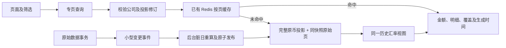
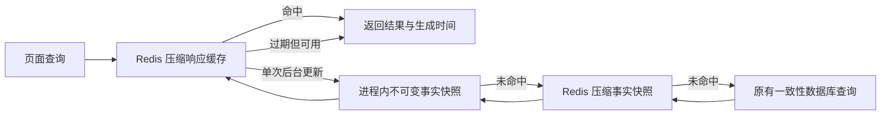

# 财务 BI 性能：原因、方案与验证

核查日期：2026-11-06（北京时间）。第一轮核查基线为 `brush-source-summary-20261106`，缓存与队列优化见[第一轮回执](../releases/finance/finance-bi-performance-20261106.md)。用户随后报告 9 月总览超过三分钟，第二轮直接优化冷查询；制品、上线状态与边界见[冷查询回执](../releases/finance/finance-cold-queries-20261106.md)。

## 2026-11-12：专页读取与 Redis 按页缓存（实施中）

本轮先消除串行依赖和大表扫描，再复用已有 Redis；没有增加新的 Redis 实例。当前实现与本地验证状态见[实施计划](../superpowers/plans/2026-11-12-finance-bi-performance.md)。11 月 12 日后端和 V155 已生效；11 月 13 日事件批量解析和缓存元数据读取修复也已受控生效，既有积压已开始推进，仍待排空及真实金额核对。两份性能前端已在 11 月 13 日后续阶段受控切换，5 秒验收尚未完成，以下不是全页性能承诺。

- 费用、结算、订单和对账通过 `/api/v1/finance/workspace/query` 一次获取本页上下文和 `records`；广告主表返回 `adSpend`、`adAccounts`，辅助核对首次展开才查询。
- `finance_query_partitions` 持久保存按公司、平台、月份区分的原币事实；完整月与非完整月首日分别处理，保留人工归属月、首次结算、刷单排除和未知值。金额采用保留精度的 JSON 文本保存。源表事务只追加小型变更事件，后台按脏日重算，租约和修订条件控制原子发布。事件工作器在首次运行、每小时和业务月切换时，先为各公司准备上月，再准备本月的三种平台分区，重复预热不重写已完成修订；无需每月人工建缓存。
- 只有无相关未处理事件的完整投影可用作精确分页计数；原始页与投影校验处于同一只读可重复读事务。编号搜索保留自己的精确计数，缺失或脏投影继续权威原查询并明确 `readModel.status=PENDING`，不返回伪零。
- 已有 16 列索引在 MySQL 8.4 的主键排序识别上存在实测限制。新增较窄的 `idx_finance_page`，先取有序页 ID 再读取原始 JSON；旧聚合索引保留。
- 广告主表先在既有有界、压缩的事实缓存中按完整条件和投影修订复用整期结果，分页只切取明细，保留原计算时间；Redis 的页缓存地址包含公司、筛选、视图、页码、编号、广告搜索/归属、展示币种、FX 快照和投影修订；不与总览或其他页串用。缓存命中前只读取修订、必要内容是否存在及相关事件，避免提前解码整月 JSON；未命中时在原只读可重复读事务内读取事实并再次校验修订，变化则回退权威查询。个人字段偏好在共享财务缓存之后单独读取。沿用原 15/60 秒新鲜期与 60/180 秒过期上限，保留原生成时间。
- 冷缓存查询也按用途选择投影列：广告主表只读取独立广告事实，财务明细页只读取经营事实及精确计数；原完整 `find` 入口继续用于兼容调用和真实等价核对。三份必要内容的存在性、月份版本、相关事件及同快照复核仍全部检查。此项已通过真实数据库读取预算回归，11 月 13 日已受控生效，端到端耗时仍须实测。
- 成本默认月度账单和订单子页只取轻上下文，需要映射/成本目录时才加载完整资料。范围请求与子面板有独立代次，切组后旧自动关联响应不得恢复旧范围。
- 历史 FX 的读取不持全局锁等待外网，缺率和行情由有界后台队列补齐；历史公布日、覆盖边界和已冻结映射不变，同一页面响应复用同一个 Quote。提供方整套币种在短事务中原子保存，旧不完整或来源混合的公布批次继续未知。
- `/api/v1/finance/workspace/status` 返回投影修订及独立的 `operations` 心跳、同步和成本任务状态；金额版本不变时只更新任务指示区，保留表格与未提交输入，发现新完整修订才重新读取财务结果。个人字段和结算计算心跳在缓存后刷新，任务状态不继承金额快照的版本或生成时间。状态轮询不重复解码整期报表，也不把后台处理中视为完整结果。
- 事件处理按公司批量解析记录 ID、去重订单及账单编号，单事务最多领取 2,000 个具体可见事件；确认受影响日期并登记修订后才删除所领取的 ID。账单查询复用 `idx_finance_reconcile_bill`，通过覆盖索引枚举真实历史用户及来源，再使用完整等值前缀查询；不依赖当前店铺授权用户，也不假设只有 API/导入两种来源。相关事件检查对不同用户/来源分别做等值探测，避免多个用户的 `IN` 条件使关联查询退化。超大结果保守标记整公司重建，晚提交事件继续保留，不清空队列或跳过事件水位。
- 单公司可见积压超过 2,000 条时，构建工作器暂缓领取该公司的分区，让事件处理优先使用查询资源，避免反复构建随后被修订作废的事实；其他公司及较小的正常变更仍可构建。积压探测以该公司索引中第 2,001 个可见身份是否存在为判断，不做全队列计数。此调度调整已在本地验证，11 月 13 日已受控生效。
- 大积压批次按公司合并为所有既存分区的完整重建请求，跳过逐历史订单/账单日期解析；请求修订和本批具体事件 ID 的确认仍在同一事务中。尾批恢复精确日期处理，晚提交事件和以后新增分区继续通过原事件及完整构建路径覆盖。此保守策略可能多重建未受影响月份，金额计算不变；已通过三个月份的原生事实等价回归，11 月 13 日已受控生效。
- 追赶时采用有界连续小批：每笔事务仍最多确认 2,000 个实际可见事件，一个工作器周期最多处理 8 批，批次结束后达到 250 毫秒预算就让出执行；单个慢事务仍沿用既有事务超时，250 毫秒不是硬中断保证。维护门关闭或线程中断后不启动后续批次及默认预热，失败由持久事件重试。此项 11 月 13 日已受控生效。
- 生产采样中单批约 300 毫秒，超过上述周期预算，固定等待 1 秒仍限制追赶。因此事件工作器改为一条执行完成后再安排的调度链：成功且最后一批满 2,000 条时等待 100 毫秒，空批、不足批、维护或失败时等待 1 秒；等待期间不持维护许可，关闭或中断不再安排。构建工作器仍保持原 1 秒间隔，不增加并行度。此自适应等待增补 11 月 13 日已受控生效。后台追赶期间，店铺管理页 30 次真实刷新 P50 320 毫秒、P95 397 毫秒、最大 469 毫秒，0 读取错误；该结果只覆盖店铺页。

11 月 13 日进一步发现，历史业务日 FX 引入的 `FinanceCostReport.dashboardFacts` 仍单次聚合整月，未接回既有每日扫描；后台构建事务现场已运行约 160 秒，活动查询执行计划估算扫描约 60 万行并使用临时表。修复仅在保留完整语义筛选的查询后追加每日扫描边界，再按原完整月执行一次 FX 纠正；同一只读可重复读事务、首次结算去重与未知成本规则不变。已通过隔离数据库单日预算、整月等价、第二日失败和并发写入回归。真实同一只读快照下，10 月整月 21,595 组成本事实逐字段规范化哈希相同，原整月查询 17.466 秒、按日候选 16.304 秒；10 月 1—2 日为 1.390 / 0.986 秒。上述约 160 秒是整个派生事务观测，其他构建步骤仍须逐项定位；此成本路径修复 11 月 13 日已受控生效。

精确页数的原始记录分组也存在优化器误选：生产选择店铺前缀索引，仅限定公司、遍历全部历史；隔离 MySQL 回归亦复现公司前缀 144 字节。该查询明确复用 V125 已有公司与日期覆盖索引，日期范围前缀为 147 字节，字段、广告费用标识、可见性和分组均不变，无新增索引或 DDL。真实同一快照下 10 月 11,801 组计数逐字段哈希一致，原查询 23.525 秒、候选 19.656 秒；此项 11 月 13 日已受控生效，不能视为页面 5 秒验收。

Redis 加快的是相同查询的重复读取。首次查询、切换筛选和缓存不可用时，仍需索引、持久投影和较短加载链路共同控制耗时；不能只用缓存命中的均值证明 5 秒目标。

## 2026-11-13：保留构建基线（已生效，收敛验收中）

正常同步持续推进请求修订，整月计算可能在完成时因修订变化而被全部丢弃。用户已批准[基线调整设计](../superpowers/specs/2026-11-13-finance-projection-baseline-design.md)，以 V157 在两张派生元数据表中增加全量失效修订和脏日修订。实现、隔离数据库验证和独立审查已完成；11 月 13 日 V157 与两份相关 Java 源码已在共享服务器受控生效。迁移历史前缀、受保护表元数据及有界哨兵、其他会话源码、配置、容器及鉴权检查通过。后台已保存出新的内部基线，持续同步下的追平、真实完整结果等价和五秒验收仍在进行。

工作器保存已完成的内部基线 R，后续仅补算修订晚于 R 的脏日；更晚的全量失效继续要求完整重建。租约身份、期限及原子保存校验保留。只有请求与已构建修订相同、正文完整、无相关未处理事件并通过同快照复核后，页面才可读取 READY 结果。内部基线未追平仍为 PENDING，不作为完整报表或真实零值展示。

专页遇到 PENDING 时，在两秒等待预算内每隔 100 毫秒读取轻量版本；READY 暖路径沿用原读取链路。逻辑预算耗尽后保持原权威回退；新轮询中的真实 JDBC 执行超时返回 503，中断保留中断标志并返回 503，其他数据库故障沿原错误路径传播。等待预算从原首次元数据返回 PENDING 后开始；连接池获取仍沿用原 30 秒上限，获取连接后重新检查剩余预算，JDBC 取消也存在调度开销，因此不是整个 HTTP 请求的硬两秒保证。等待、回退和未完成结果均不算五秒验收通过。固定迁移工具只接受已封存的唯一 V157 SQL，在维护锁、门控、安全点和源码 CAS 下执行；保护既有历史、配置及原始表元数据和有界主键哨兵，哨兵不等于全部业务行审计。上线、真实同快照等价和各页耗时见[本轮回执](../releases/finance/finance-workspace-performance-20261113.md)。

持续同步验收还捕获到广告店铺发现的无变化失效：先全部停用、再逐店写回会触发全量事件，即使最终资料相同。本次定位已用实际消费事务证据确认，已在隔离库通过 87 项相关回归及独立审查，只写入最终状态确有变化的店铺；该单文件增补已受控生效。相同资料的店铺保留其原 `observed_at`，账户的成功发现状态和下一次检查计划继续更新；店铺资料、匹配、可用性或访问范围有实际变化时仍须失效，不改财务计算、同步计划或租约。

随后现场发现按最后 `requested_at` 排队会把持续有新变更的月份反复推后。领取顺序调整为无内部基线优先，其余按最早的 `generated_at` 轮转，请求时间及完整分区身份仅作为并列条件；已保存但仍脏的分区会给较旧快照让出一轮。只改变单工作器领取优先级，原资格、积压保护、重试时间、租约、原子保存和读取完整性保持。该排序增补已通过 47 项相关隔离数据库回归及独立审查，并于 11 月 13 日受控生效；10 月三个平台及 11 月全平台已有新内部基线，持续同步下的 READY 与五秒验收仍未完成。

## 2026-11-13：店铺可见性的主键查找（已生效）

费用明细的权限子查询原使用店铺公司分组索引逐笔检查，真实计划估算每笔检查 87 行。仅将同一可见性条件改为主键 `EXISTS` 后，变为 `PRIMARY/eq_ref/1`；公司、移除状态、未分配记录、参数和其他筛选保持单语句校验，不缓存或预取权限 ID。真实同一只读重复读快照下，9 月 TikTok 费用页的精确总数 922,406 及有序 50 行哈希相同，原页 27.107 秒、候选 3.788 秒；五组事实哈希也相同，事实计算为 13.991/16.397 秒，未证明汇总加速。隔离数据库 123 项相关回归通过（含 2 项新增测试），独立审查无阻塞项。该访问路径增补已于 11 月 13 日受控生效，编译、新上下文、配置及其他源码保护检查通过，不构成全页五秒承诺。

成本表导入、SKU 关系及成本规则仍在真实修改，所触发的重算与失效必须保留。内部候选计算只用于同快照一致性诊断；只有通过公共完整性围栏的已发布结果才能证明缓存就绪。正常重算负载下另一次店铺管理页验证有 30 个完整样本，P50 0.696 秒、P95 1.000 秒、最大 1.489 秒；31 次尝试中有一次自动化等待超时且耗时未知，不能宣称全部尝试通过。

性能前端已按冻结哈希受控生效，现代入口接入及其他源码保留，公开 HTTPS 字节与 `no-store` 核对通过；前端更新没有重启后端。后续真实浏览器仍须分别验证各页主表和关键汇总完成，不以减少请求数或状态提示替代五秒验收。

## 2026-11-13：大投影单包边界（已生效，真实收敛中）

10 月全平台缓存不是单纯算不完：约 84 秒的计算能成功，三份结果一起绑定后合计 68,882,987 字节，超过 64 MiB 发送单包。只读等价绑定复现 `PacketTooBigException/S1000`，与后台异常一致。修复保持既有 JSON、租约/版本 CAS、行锁和事务，将三份正文分三条 UPDATE 发送；全部与元数据一起提交，后段失败或脏日清理失败则整笔回滚。不增加全局包预算、内存或存储编码，不改变 claim/read 协议。实际隔离服务器 64 MiB 预算下，约 69 MB 的三份正文能拆写并通过原完整读取与后续增量；人为更小连接预算不作为修改生产读路径的依据。

相关 66 项隔离库回归通过；测试增强后新增类 8 项再次通过，三段新旧正文均不同，真实原生财务查询和高精度/未知值哨兵保留。独立原审及限定复审无阻塞项；既有 Java agent/Netty 环境告警另记。该单 Java 修复已受控生效，源码编译、新上下文、原配置及鉴权检查通过；10 月全平台内部基线已推进且失败计数归零，仍有新的整月失效，完整可读与页面五秒验收未完成。

## 2026-11-13：账单来源计数工作集（已审查，待生效）

成本默认账单页另有来源计数瓶颈。只对最终行条件精确为 `1=1` 的 COUNT 指定既有 `uk_label_file_event`，文件授权与逐文件 `import_id` 仍先确认；有状态、编号、店铺、平台、分组或移除店铺条件时，保留原查询。没有新索引、缓存或期间口径变更。该已有窄索引叶子页为 9,879，原聚簇索引为 52,976；实际同快照热样本为 135/107 毫秒，不能将早前 8.611 秒样本与 107 毫秒拼成配对冷加速。145 次相关隔离测试执行通过（含继承通用测试，新增 3 个场景），真实计划 RED/GREEN、精确跨文件分页及权限/筛选矩阵通过，独立审查无阻塞。待受控生效和页面复测；不宣称该提示独立解决所有筛选延迟。

## 第二轮：冷查询与反复失效

- **账本按最多七天聚合。** 原整月聚合会创建磁盘临时表。`FinanceRepository.dashboardBuckets` 在同一个只读重复读事务内执行分段查询和刷单扣除，结果仍按原日期、店铺、币种和费用分类分组。只追加内部扫描边界，保留原始筛选条件；归属月校正仍按用户选择的完整区间判断。
- **首次结算成本按一天去重汇总。** 订单身份临时表比每日指标宽，七天仍会落盘，现缩小为一天并合并各店计数与金额。只处理每单归属一个首次结算日的关系；发生日退款及显式账单的整段去重保留。任一分段失败则整次查询失败，不返回半个月的金额。
- **移除无用的回表字段。** 已确认结算已经要求订单号非空，因此成本关联直接读取订单号，去掉 `external_id` 备用表达式，避免为每笔结算读取包含原始 JSON 的主表记录。
- **后台同步只推进数据版本。** 千易同步/成本提交使用 `FinanceService.refreshAfterCommit`，成功提交后推进现有数据版本并标记更新中；回滚不推进。配置、授权、删除继续硬失效。沿用第一轮历史新鲜期 60 秒、最大过期展示 180 秒，不延长时间、不更新旧快照的生成时间。

同一只读数据库快照、无 Redis/进程结果缓存的后台服务对比（1 CPU / 1 GiB 独立探测容器；MySQL 缓冲池没有清空）：

| 总览范围 | 原版 | 候选 | 财务指标 |
| --- | ---: | ---: | --- |
| 2026 年 8 月 | 78.710 秒 | 27.882 秒 | 相同 |
| 2026 年 9 月 | 57.301 秒 | 20.724 秒 | 相同 |
| 2026 年 10 月 | 46.982 秒 | 26.063 秒 | 相同 |

9 月结算成本整月候选为 10.093 秒，30 个日查询均无磁盘临时表；9 月 1—2 日原版与候选在同一快照下为 10.600 / 1.440 秒，结果相同。旧逻辑加七天窗口仍在首个窗口触及 120 秒语句上限，未采用。

浏览器复现中，旧版 9 月总览返回 26.64 秒，结算中心曾等待超过 190 秒；线程快照定位到成本汇总的数据库读取，采样时连接池未耗尽。用户报告的三分钟总览等待没有在该次浏览器复现中重现；不能把任何单次耗时视为上限。

新增 `FinanceColdReadProbe` 用两个隔离类加载器和同一个持有的只读事务比较实际类与候选类；指标按键和无序行规范化后比较哈希，不输出金额、订单或凭据。需显式设置 `FINANCE_PERF_READ_ONLY=true`，使用已有汇率快照，不启动应用工作器。

验证包含 35 项单元检查和 10 项隔离 MySQL 检查，覆盖分段等价、月归属、租户/分组/币种、刷单扣除、重复结算、未知金额、跨段并发写入一致性、失败不返回部分结果、提交/回滚与人工硬失效。没有新增数据库结构、全局内存参数、持久日志或磁盘扩容。

## 已确认的原因

1. **响应缓存失效于大小边界。** 真实 2026 年 10 月响应约 685 KB，超过原 512 KiB 原文上限，因此没有保存响应。首次后台服务计算为 48,176 ms；立即重复仍需 1,938 ms，重复解码大快照并构造全部结果。
2. **历史事实缓存复用时间过短。** 原事实快照仅复用 15 秒。模拟 20 秒后切换店铺并推进后台数据版本，会重新执行一次账本和一次成本扫描。冷启动的窄查询还可能等待正在预热的全公司查询。
3. **成本队列领取锁范围过大。** 现场观察到 `finance_order_cost_jobs.idx_cost_job_time` 的间隙锁，多个同步入队操作等待 3～5 秒。这些写操作与页面查询共享连接资源。
4. **批次内重复准备相同数据。** 多店铺共用同一分组目录时重复读取和解析成本簿；每笔订单重新构造同一 SKU 查找索引，增加 CPU、分配和事务持锁时间。

核查时根盘约 99 GB、可用约 20 GB，内存可用约 11 GB。未发现必须通过增加磁盘才能解决这些问题的证据。MySQL 主财务表已有较多覆盖索引，本次不再增加大索引或重建大表。

## 查询方案

- 响应原文上限 4 MiB，大响应压缩后仍受 **512 KiB** 存储上限约束；每个范围最多保留 64 个响应。
- 共享事实仍限制为解码 16 MiB、存储 2 MiB、每个范围最多 16 份，Redis 保留 5 分钟。
- 新增进程内 LRU 层，最多 4 份事实、解码 JSON 合计最多 16 MiB。缓存对象不可变，金额保持 BigDecimal。此处为 JSON 体积边界，Java 对象实际堆占用会更高，仍须观察运行内存。
- 当前月份和实时页面保持 15 秒新鲜期、最多 60 秒过期展示；已结束月份使用 60 秒事实复用期、最多 180 秒过期展示。后台数据版本变化立即标明更新中，历史请求在短时间内合并重算；空闲预热按历史新鲜期执行。
- 过期展示保留原始生成时间，切换币种/店铺不会刷新旧数据年龄。权限、配置和删除等硬失效仍立即更换地址；缓存或失效失败按原有保护回退，不伪造完整数据。
- 预热人民币实时页和上月总览两种默认视图。原币展示复用同一事实，不再占用另一个工作线程等待相同的大查询。
- 店铺/分组查询优先复用已有全公司事实；若全公司首次计算尚未完成，窄查询直接查询自己的范围，避免等待宽范围计算。

15 秒前端轮询叠加请求耗时，可能反复超过原 15 秒事实复用窗口；响应缓存缺失时会再次触发大查询。

缓存只是现有结果的有界复用，未改变公司/店铺/分组权限、原币金额、利润公式、首次结算归属、GIFT、未知成本或千易口径。

## 成本队列方案

排序索引只用于无锁查找候选，主键查询负责领取。并发工作器最多尝试四页候选；同一订单仍串行，不相关新订单可入队。候选枚举必须在计算事务之前完成，避免重复读快照先于领取建立而遗漏已提交更新。

保留单批最多 100 项、原 30 秒事务边界和正常关闭后的回滚/续跑。目录与索引仅在当前批次内共享，下一批重新读取配置，跨公司不共享。原有显式修复程序的事务入口保持兼容；没有清空积压、重置游标或修改平台限流。

## 测量与边界

下表为 1 CPU / 1 GiB 临时只读探测容器中的后台服务调用，使用真实 10 月数据、已有汇率快照及独立临时 Redis 命名空间；不是浏览器端到端指标。

| 操作 | 修改前 | 最终候选 | 大账本/成本扫描 |
| --- | ---: | ---: | --- |
| 首次计算全公司月份 | 48,176 ms | 51,163 ms | 两者各 1 / 1 次 |
| 立即重复同一月份 | 1,938 ms | 167 ms | 两者均 0 / 0 次 |
| 20 秒及后台版本推进后切换店铺 | 1,209 ms | 209 ms | 1 / 1 次降为 0 / 0 次 |

候选约 685 KB 响应压缩为约 76 KB，重复读取财务指标哈希一致。**首次计算未缓存的新范围仍可能较慢**；本次主要消除重复计算、宽查询等待和任务锁争用，不把单次样本称为延迟保证。

另在同一只读重复读快照比较了仅将聚合语句临时表预算从 16 MiB 提至 64 MiB：28,388 ms 对 33,777 ms，两者都落盘一次、28,088 个分组结果相同。该调整未改善性能，未采用；全局 MySQL 参数保持现状。

上线后实际运行制品复测为：重复月查询 **171 ms**、切店 **204 ms**，缓存指标一致且两者无大扫描；首次全月仍为 49,697 ms。14:44 成本队列由切换前 71,753 项降至 0、锁等待为 0。详见[上线回执](../releases/finance/finance-bi-performance-20261106.md)。

## 验证与接手

- 54 项 Java 单元测试通过，包括压缩大小、金额精度、内存淘汰、不可变事实、租户隔离、硬失效、原始生成时间、冷窄查询、目录版本及 SKU 结果。
- 隔离 MySQL 中 4 项并发队列检查通过：不相关入队、并行领取、同单更新持久保留、枚举与领取之间提交的更新可见。另 3 项既有成本/结算/去重回归通过。
- query-speed、long-wait、profit、source-orders 四项 UI 回归通过。query-speed 的固定日期与新默认月份相同，现改为当前筛选开始日期的前一天，确保测试真正触发筛选切换。
- 四个原始类族在匹配的 Java 21 编译参数下与运行制品逐字节一致，再用相同参数编译候选；打包核对所有无关 JAR 条目。

入口：`FinanceReadCache`、`FinanceService.prewarm`、`FinanceOrderCosts`、`FinanceCostWorker`；可销毁队列测试为 `FinanceCostQueueIntegrationTest`。只读探测程序位于 `scripts/qa/java/FinanceBiPerformanceProbe.java`，必须显式设置 `FINANCE_PERF_READ_ONLY=true`，只输出耗时、大小、计数和哈希，并清理自己的 Redis 命名空间。

共享服务器源码变更前后按[运维指南](operations.md)核对其他会话、配置、后台工作和安全点；Java 编译成功后受控重启并保存小型回执，不执行日常 JAR/镜像发布。历史工具 `scripts/release/release-finance-bi-performance.py` 仅用于追溯当时上线。测试账号、测试库、临时类和上传物清理后保留小型回执；不新增持久诊断日志，不扩盘。
