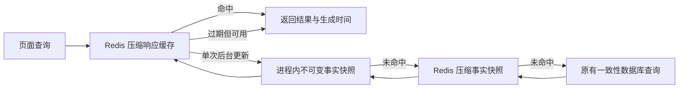

# 财务 BI 性能：原因、方案与验证

核查日期：2026-11-06（北京时间）。服务器 `8.163.34.81`，核查基线为 `brush-source-summary-20261106`。本说明记录代码方案和实际测量；上线状态及最终制品见[发布回执](../releases/finance/finance-bi-performance-20261106.md)。

## 已确认的原因

1. **响应缓存失效于大小边界。** 真实 2026 年 10 月响应约 685 KB，超过原 512 KiB 原文上限，因此没有保存响应。首次后台服务计算为 48,176 ms；立即重复仍需 1,938 ms，重复解码大快照并构造全部结果。
2. **历史事实缓存复用时间过短。** 原事实快照仅复用 15 秒。模拟 20 秒后切换店铺并推进后台数据版本，会重新执行一次账本和一次成本扫描。冷启动的窄查询还可能等待正在预热的全公司查询。
3. **成本队列领取锁范围过大。** 现场观察到 `finance_order_cost_jobs.idx_cost_job_time` 的间隙锁，多个同步入队操作等待 3～5 秒。这些写操作与页面查询共享连接资源。
4. **批次内重复准备相同数据。** 多店铺共用同一分组目录时重复读取和解析成本簿；每笔订单重新构造同一 SKU 查找索引，增加 CPU、分配和事务持锁时间。

核查时根盘约 99 GB、可用约 20 GB，内存可用约 11 GB。未发现必须通过增加磁盘才能解决这些问题的证据。MySQL 主财务表已有较多覆盖索引，本次不再增加大索引或重建大表。

## 查询方案

- 响应原文上限 4 MiB，大响应压缩后仍受 **512 KiB** 存储上限约束；每个范围最多保留 64 个响应。
- 共享事实仍限制为解码 16 MiB、存储 2 MiB、每个范围最多 16 份，Redis 保留 5 分钟。
- 新增进程内 LRU 层，最多 4 份事实、解码 JSON 合计最多 16 MiB。缓存对象不可变，金额保持 BigDecimal。此处为 JSON 体积边界，Java 对象实际堆占用会更高，仍须观察运行内存。
- 当前月份和实时页面保持 15 秒新鲜期、最多 60 秒过期展示；已结束月份使用 60 秒事实复用期、最多 180 秒过期展示。后台数据版本变化立即标明更新中，历史请求在短时间内合并重算；空闲预热按历史新鲜期执行。
- 过期展示保留原始生成时间，切换币种/店铺不会刷新旧数据年龄。权限、配置和删除等硬失效仍立即更换地址；缓存或失效失败按原有保护回退，不伪造完整数据。
- 预热人民币实时页和上月总览两种默认视图。原币展示复用同一事实，不再占用另一个工作线程等待相同的大查询。
- 店铺/分组查询优先复用已有全公司事实；若全公司首次计算尚未完成，窄查询直接查询自己的范围，避免等待宽范围计算。

缓存只是现有结果的有界复用，未改变公司/店铺/分组权限、原币金额、利润公式、首次结算归属、GIFT、未知成本或千易口径。

## 成本队列方案

排序索引只用于无锁查找候选，主键查询负责领取。并发工作器最多尝试四页候选；同一订单仍串行，不相关新订单可入队。候选枚举必须在计算事务之前完成，避免重复读快照先于领取建立而遗漏已提交更新。

保留单批最多 100 项、原 30 秒事务边界和正常关闭后的回滚/续跑。目录与索引仅在当前批次内共享，下一批重新读取配置，跨公司不共享。原有显式修复程序的事务入口保持兼容；没有清空积压、重置游标或修改平台限流。

## 测量与边界

下表为 1 CPU / 1 GiB 临时只读探测容器中的后台服务调用，使用真实 10 月数据、已有汇率快照及独立临时 Redis 命名空间；不是浏览器端到端指标。

| 操作 | 修改前 | 最终候选 | 大账本/成本扫描 |
| --- | ---: | ---: | --- |
| 首次计算全公司月份 | 48,176 ms | 51,163 ms | 两者各 1 / 1 次 |
| 立即重复同一月份 | 1,938 ms | 167 ms | 两者均 0 / 0 次 |
| 20 秒及后台版本推进后切换店铺 | 1,209 ms | 209 ms | 1 / 1 次降为 0 / 0 次 |

候选约 685 KB 响应压缩为约 76 KB，重复读取财务指标哈希一致。**首次计算未缓存的新范围仍可能较慢**；本次主要消除重复计算、宽查询等待和任务锁争用，不把单次样本称为延迟保证。

另在同一只读重复读快照比较了仅将聚合语句临时表预算从 16 MiB 提至 64 MiB：28,388 ms 对 33,777 ms，两者都落盘一次、28,088 个分组结果相同。该调整未改善性能，未采用；全局 MySQL 参数保持现状。

## 验证与接手

- 54 项 Java 单元测试通过，包括压缩大小、金额精度、内存淘汰、不可变事实、租户隔离、硬失效、原始生成时间、冷窄查询、目录版本及 SKU 结果。
- 隔离 MySQL 中 4 项并发队列检查通过：不相关入队、并行领取、同单更新持久保留、枚举与领取之间提交的更新可见。另 3 项既有成本/结算/去重回归通过。
- query-speed、long-wait、profit、source-orders 四项 UI 回归通过。query-speed 的固定日期与新默认月份相同，现改为当前筛选开始日期的前一天，确保测试真正触发筛选切换。
- 四个原始类族在匹配的 Java 21 编译参数下与运行制品逐字节一致，再用相同参数编译候选；打包核对所有无关 JAR 条目。

入口：`FinanceReadCache`、`FinanceService.prewarm`、`FinanceOrderCosts`、`FinanceCostWorker`；可销毁队列测试为 `FinanceCostQueueIntegrationTest`。只读探测程序位于 `scripts/qa/java/FinanceBiPerformanceProbe.java`，必须显式设置 `FINANCE_PERF_READ_ONLY=true`，只输出耗时、大小、计数和哈希，并清理自己的 Redis 命名空间。

生产发布前后按[运维指南](operations.md)核对其他会话、镜像、配置链、后台工作和空间；发布工具为 `scripts/release/release-finance-bi-performance.py`。测试账号、测试库、临时类、JAR 和上传物清理后保留小型回执；不新增持久诊断日志，不扩盘。
