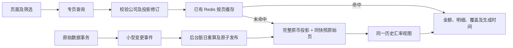
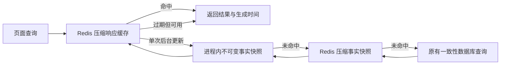

# 财务 BI 性能：原因、方案与验证

## 2026-11-19：全月写入下的回退查询

候选将增量账本、精确计数和首次结算成本定位到受影响的店铺和业务日，使用现有公司、店铺、日期覆盖索引。疑似全店变更及超预算范围继续执行权威日期扫描。全部订单的就绪路径只读取精确计数，待补算时按下单日期读取当前数据。分页和汇总在同一个只读快照读取店铺可见范围。费用菜单将投影等待预算由 2 秒缩短至 250 毫秒，随后读取当前权威结果。历史汇率在同一请求内按业务日换算后复用于多个汇总维度。

本轮实施在隔离环境验证。规模、九页耗时、剩余慢页及写入后的追平结果见[隔离验收回执](../releases/finance/finance-bi-indexed-fallback-20261119.md)。

## 2026-11-19 10 月全平台上线跟进

生产首次结算成本和账本的 10 月全平台修订曾对齐，持续同步时仍有短暂积压。追平后线上九页均可打开，4 页在 5 秒内完成。后续候选合并脏店铺日期读取，并根据变更类型分别补算账本和已结算订单。费用和结算只发生数值变化时由 V165 登记单条日级事件，日期、身份、币种和归属变更继续保留两侧的失效事件。

真实脱敏库冷 Redis 五路并发通过 9 页。单店和全月持续写入各通过 7 页，结算中心和费用页仍超出 5 秒。生产当前运行 V164。见[上线跟进与九页压测](../releases/finance/finance-bi-followup-20261119.md)。

## 2026-11-19：首次结算成本的店铺和业务日投影

结算明细首屏通过同一只读快照获取表格与首次结算成本。成本按公司、平台范围、店铺和业务日存储，跨币种合计和单币种各自保持首次结算同日去重。部分月使用独立的首日事实。旧月投影可只补算成本，账本正文与生成时间继续可用。

事件保留受影响的店铺和日期。普通费用变更只更新对应账本片段，订单、结算、成本任务和贴单变更还会定位原始订单跨日的成本片段。投影构建中，交互查询可在同一快照内补算少量脏片段，再与已发布的干净片段合并。全局配置变化、范围不明或补算超出预算时执行原权威查询。版本围栏与晚提交事件的可见性仍适用。详见[第三阶段验收回执](../releases/finance/finance-bi-incremental-20261119.md)。

## 2026-11-19：持续写入与权威回退

事件工作器按主键锁定已读取的候选 ID。确认事件与登记脏日仍在同一事务，账本触发器可并发追加事件。投影补算合并相邻脏日，并把实际 SQL 限制在该时间段。整月皆脏时复用整月原生重算。晚提交事件仍阻止对外读取内部基线。

结算和费用首屏回退复用同一账本快照收集的原始精确计数。对账首屏回退直接查询账单及所需成本、覆盖和筛选上下文。同条件并发回退仅在数据库快照开启前合并。隔离大样本的九页数据、持续写入分区水位和剩余耗时见[第二阶段验收回执](../releases/finance/finance-bi-scale-20261119.md)。

## 2026-11-19：总览、结算与九页基线

候选分支将总览接到完整已发布投影，Redis 缓存按权限和投影版本复用。缺少有效投影时，从当前账本快照计算。投影正文保持十进制文本，总览跳过无需反序列化的明细计数，整月专页跳过部分月份首日载荷。结算保留专页明细和原精确计数，PENDING 轮询预算为 250 毫秒。浏览器恢复财务深链接时会等待财务模块就绪，再按现有权限进入。

隔离环境及改造前的线上样本、可复跑脚本见[九页验收回执](../releases/finance/finance-bi-latency-20261119.md)。2026-11-19 三阶段改造已在生产源码环境生效，九页经复查均可打开，五秒目标仍待验收。详见[生产上线回执](../releases/finance/finance-bi-production-20261119.md)。

首次核查：2026-11-06；最近增补：2026-11-15（北京时间）。第一轮核查基线为 `brush-source-summary-20261106`，缓存与队列优化见[第一轮回执](../releases/finance/finance-bi-performance-20261106.md)。用户随后报告 9 月总览超过三分钟，第二轮直接优化冷查询；制品、上线状态与边界见[冷查询回执](../releases/finance/finance-cold-queries-20261106.md)。

证据复核说明（2026-11-15 恢复时）：本机 `/tmp/finance-bi-performance-qa` 已被清空，文中位于该目录的历史原始 JSON/日志当前无法重新读取；已提交的说明、计划工作区的冻结报告/哈希及 `target/ci-reports` 的历史 XML 仍在。历史结果保留其当时的测量范围，不能据此推断当前线上状态。后续新实验须保留新的原件和清理回执；缺失的旧原件不通过重建摘要或重跑旧档冒充恢复。

## 当前实施状态

2026-11-19 上线时，Flyway 由 V160 升到 V164，其中生产 V160 用于商品采集。运行源码继续由共享开发分支和定向合并的财务文件提供。上线数据只适用于回执时点，后续操作须重新核对现场。

| 范围 | 状态 |
| --- | --- |
| V155–159、完整贴单只读RR及既有专页优化 | 已有受控生效回执；仍须逐页验收长尾 |
| V161身份与币种字节事件、重建页精确币种计数 | 已在生产生效；V161 含候选 V160 的财务身份事件改动 |
| V162来源条件计数窄索引 | 已在生产安装 |
| V163–V164首次结算成本、店铺与日期增量 | 已在生产生效，后台按分区构建。已有成本事实落库，构建中的分区仍按权限及原口径回退 |
| 独立费用计数、精确金额贡献、完整缓存依赖与21面五秒 | 继续实施和验证；没有全系统达标结论 |

## 全页面五秒目标与当前验收范围

按当前本地导航及实际组件清点，排除财务总览、实时大屏后，仍须验收 7 个一级入口的 **21 个页面或页签状态**。当前尚未完成全部页面的五秒验收。

| 一级入口 | 需要验收的界面 | 数量 |
| --- | --- | ---: |
| 结算中心 | 结算明细、结算账单、待结算 | 3 |
| 对账中心 | 账单对账 | 1 |
| 订单与退款 | 订单（ALL/SETTLED 分别作为条件）、退款 | 2 |
| 费用与调整 | 平台费用、物流贴单成本、贴单成本、刷单成本 | 4 |
| 成本管理 | 月度贴单账单、商品成本表、手动管理、SKU 关联、订单成本、成本表设置 | 6 |
| 广告分析 | 广告资金消耗主表、普通独立广告消耗、平台账单广告费、GMV Max 明细 | 4 |
| 财务店铺管理 | 店铺管理 | 1 |

贴单成本与月度贴单账单共用一个数据组件，21 个入口对应 20 套独立数据实现；两个入口的父级导航和预取生命周期不同，仍须分别测试。每页记录真实首入、日期/分组/店铺/平台/币种/编号筛选及分页，区分缓存冷暖、READY/PENDING、持续同步、导入和成本重算。主表、关键汇总、覆盖/未知状态与渲染完成共同构成结束点；状态提示或已接受后台任务不代表完整页面完成。

本表来自本地源码，服务器工作区差异尚未逐文件核对，当前 21 个界面的端到端矩阵仍待补齐。既有单页样本、后端服务探针和以下隔离 SQL 实验均保留各自日期与范围，不能合并成全站达标结论。导入、授权、导出等业务操作另记完成时间，同时保留它们给查询带来的真实负载。

## 2026-11-12：专页读取与 Redis 按页缓存（实施中）

本轮先消除串行依赖和大表扫描，再复用已有 Redis；没有增加新的 Redis 实例。当前实现与本地验证状态见[实施计划](../superpowers/plans/2026-11-12-finance-bi-performance.md)。11 月 12 日后端和 V155 已生效；11 月 13 日事件批量解析和缓存元数据读取修复也已受控生效，既有积压已开始推进，仍待排空及真实金额核对。两份性能前端已在 11 月 13 日后续阶段受控切换，5 秒验收尚未完成，以下不是全页性能承诺。

- 费用、结算、订单和对账通过 `/api/v1/finance/workspace/query` 一次获取本页上下文和 `records`；广告主表返回 `adSpend`、`adAccounts`，辅助核对首次展开才查询。
- `finance_query_partitions` 持久保存按公司、平台、月份区分的原币事实；完整月与非完整月首日分别处理，保留人工归属月、首次结算、刷单排除和未知值。金额采用保留精度的 JSON 文本保存。源表事务只追加小型变更事件，后台按脏日重算，租约和修订条件控制原子发布。事件工作器在首次运行、每小时和业务月切换时，先为各公司准备上月，再准备本月的三种平台分区，重复预热不重写已完成修订；无需每月人工建缓存。
- 只有无相关未处理事件的完整投影可用作精确分页计数；原始页与投影校验处于同一只读可重复读事务。编号搜索保留自己的精确计数，缺失或脏投影继续权威原查询并明确 `readModel.status=PENDING`，不返回伪零。
- 已有 16 列索引在 MySQL 8.4 的主键排序识别上存在实测限制。新增较窄的 `idx_finance_page`，先取有序页 ID 再读取原始 JSON；旧聚合索引保留。
- 广告主表先在既有有界、压缩的事实缓存中按完整条件和投影修订复用整期结果，分页只切取明细，保留原计算时间；Redis 的页缓存地址包含公司、筛选、视图、页码、编号、广告搜索/归属、展示币种、FX 快照和投影修订；不与总览或其他页串用。缓存命中前只读取修订、必要内容是否存在及相关事件，避免提前解码整月 JSON；未命中时在原只读可重复读事务内读取事实并再次校验修订，变化则回退权威查询。个人字段偏好在共享财务缓存之后单独读取。沿用原 15/60 秒新鲜期与 60/180 秒过期上限，保留原生成时间。
- 冷缓存查询也按用途选择投影列：广告主表只读取独立广告事实，财务明细页只读取经营事实及精确计数；原完整 `find` 入口继续用于兼容调用和真实等价核对。三份必要内容的存在性、月份版本、相关事件及同快照复核仍全部检查。此项已通过真实数据库读取预算回归，11 月 13 日已受控生效，端到端耗时仍须实测。
- 成本默认月度账单和订单子页只取轻上下文，需要映射/成本目录时才加载完整资料。范围请求与子面板有独立代次，切组后旧自动关联响应不得恢复旧范围。
- 历史 FX 的读取不持全局锁等待外网，缺率和行情由有界后台队列补齐；历史公布日、覆盖边界和已冻结映射不变，同一页面响应复用同一个 Quote。提供方整套币种在短事务中原子保存，旧不完整或来源混合的公布批次继续未知。
- `/api/v1/finance/workspace/status` 返回投影修订及独立的 `operations` 心跳、同步和成本任务状态；金额版本不变时只更新任务指示区，保留表格与未提交输入，发现新完整修订才重新读取财务结果。个人字段和结算计算心跳在缓存后刷新，任务状态不继承金额快照的版本或生成时间。状态轮询不重复解码整期报表，也不把后台处理中视为完整结果。
- 事件处理按公司批量解析记录 ID、去重订单及账单编号，单事务最多领取 2,000 个具体可见事件；确认受影响日期并登记修订后才删除所领取的 ID。账单查询复用 `idx_finance_reconcile_bill`，通过覆盖索引枚举真实历史用户及来源，再使用完整等值前缀查询；不依赖当前店铺授权用户，也不假设只有 API/导入两种来源。相关事件检查对不同用户/来源分别做等值探测，避免多个用户的 `IN` 条件使关联查询退化。超大结果保守标记整公司重建，晚提交事件继续保留，不清空队列或跳过事件水位。
- 单公司可见积压超过 2,000 条时，构建工作器暂缓领取该公司的分区，让事件处理优先使用查询资源，避免反复构建随后被修订作废的事实；其他公司及较小的正常变更仍可构建。积压探测以该公司索引中第 2,001 个可见身份是否存在为判断，不做全队列计数。此调度调整已在本地验证，11 月 13 日已受控生效。
- 大积压批次按公司合并为所有既存分区的完整重建请求，跳过逐历史订单/账单日期解析；请求修订和本批具体事件 ID 的确认仍在同一事务中。尾批恢复精确日期处理，晚提交事件和以后新增分区继续通过原事件及完整构建路径覆盖。此保守策略可能多重建未受影响月份，金额计算不变；已通过三个月份的原生事实等价回归，11 月 13 日已受控生效。
- 追赶时采用有界连续小批：每笔事务仍最多确认 2,000 个实际可见事件，一个工作器周期最多处理 8 批，批次结束后达到 250 毫秒预算就让出执行；单个慢事务仍沿用既有事务超时，250 毫秒不是硬中断保证。维护门关闭或线程中断后不启动后续批次及默认预热，失败由持久事件重试。此项 11 月 13 日已受控生效。
- 生产采样中单批约 300 毫秒，超过上述周期预算，固定等待 1 秒仍限制追赶。因此事件工作器改为一条执行完成后再安排的调度链：成功且最后一批满 2,000 条时等待 100 毫秒，空批、不足批、维护或失败时等待 1 秒；等待期间不持维护许可，关闭或中断不再安排。构建工作器仍保持原 1 秒间隔，不增加并行度。此自适应等待增补 11 月 13 日已受控生效。后台追赶期间，店铺管理页 30 次真实刷新 P50 320 毫秒、P95 397 毫秒、最大 469 毫秒，0 读取错误；该结果只覆盖店铺页。

11 月 13 日进一步发现，历史业务日 FX 引入的 `FinanceCostReport.dashboardFacts` 仍单次聚合整月，未接回既有每日扫描；后台构建事务现场已运行约 160 秒，活动查询执行计划估算扫描约 60 万行并使用临时表。修复仅在保留完整语义筛选的查询后追加每日扫描边界，再按原完整月执行一次 FX 纠正；同一只读可重复读事务、首次结算去重与未知成本规则不变。已通过隔离数据库单日预算、整月等价、第二日失败和并发写入回归。真实同一只读快照下，10 月整月 21,595 组成本事实逐字段规范化哈希相同，原整月查询 17.466 秒、按日候选 16.304 秒；10 月 1—2 日为 1.390 / 0.986 秒。上述约 160 秒是整个派生事务观测，其他构建步骤仍须逐项定位；此成本路径修复 11 月 13 日已受控生效。

精确页数的原始记录分组也存在优化器误选：生产选择店铺前缀索引，仅限定公司、遍历全部历史；隔离 MySQL 回归亦复现公司前缀 144 字节。该查询明确复用 V125 已有公司与日期覆盖索引，日期范围前缀为 147 字节，字段、广告费用标识、可见性和分组均不变，无新增索引或 DDL。真实同一快照下 10 月 11,801 组计数逐字段哈希一致，原查询 23.525 秒、候选 19.656 秒；此项 11 月 13 日已受控生效，不能视为页面 5 秒验收。

Redis 加快的是相同查询的重复读取。首次查询、切换筛选和缓存不可用时，仍需索引、持久投影和较短加载链路共同控制耗时；不能只用缓存命中的均值证明 5 秒目标。

## 2026-11-13：保留构建基线（已生效，收敛验收中）

正常同步持续推进请求修订，整月计算可能在完成时因修订变化而被全部丢弃。用户已批准[基线调整设计](../superpowers/specs/2026-11-13-finance-projection-baseline-design.md)，以 V157 在两张派生元数据表中增加全量失效修订和脏日修订。实现、隔离数据库验证和独立审查已完成；11 月 13 日 V157 与两份相关 Java 源码已在共享服务器受控生效。迁移历史前缀、受保护表元数据及有界哨兵、其他会话源码、配置、容器及鉴权检查通过。后台已保存出新的内部基线，持续同步下的追平、真实完整结果等价和五秒验收仍在进行。

工作器保存已完成的内部基线 R，后续仅补算修订晚于 R 的脏日；更晚的全量失效继续要求完整重建。租约身份、期限及原子保存校验保留。只有请求与已构建修订相同、正文完整、无相关未处理事件并通过同快照复核后，页面才可读取 READY 结果。内部基线未追平仍为 PENDING，不作为完整报表或真实零值展示。

专页遇到 PENDING 时，在两秒等待预算内每隔 100 毫秒读取轻量版本；广告主表只读取首次版本，PENDING 时直接使用既定原生消耗查询，广告辅助页及其他页面保留等待。READY 暖路径沿用原读取链路。逻辑预算耗尽，包括自身截止时的 JDBC 取消，在事务清理后保持原权威回退；预算尚未耗尽的 JDBC 执行超时返回 503，中断优先保留中断标志并返回 503，其他数据库故障沿原错误路径传播。等待预算从原首次元数据返回 PENDING 后开始；连接池获取仍沿用原 30 秒上限，获取连接后重新检查剩余预算，JDBC 取消也存在调度开销，因此不是整个 HTTP 请求的硬两秒保证。等待结束、回退启动、PENDING 提示和未完成结果均不算五秒验收通过；完整权威原生结果须连同主表及关键汇总真实完成，单独记录耗时和缓存仍未发布的状态。固定迁移工具只接受已封存的唯一 V157 SQL，在维护锁、门控、安全点和源码 CAS 下执行；保护既有历史、配置及原始表元数据和有界主键哨兵，哨兵不等于全部业务行审计。上线、真实同快照等价和各页耗时见[本轮回执](../releases/finance/finance-workspace-performance-20261113.md)。

持续同步验收还捕获到广告店铺发现的无变化失效：先全部停用、再逐店写回会触发全量事件，即使最终资料相同。本次定位已用实际消费事务证据确认，已在隔离库通过 87 项相关回归及独立审查，只写入最终状态确有变化的店铺；该单文件增补已受控生效。相同资料的店铺保留其原 `observed_at`，账户的成功发现状态和下一次检查计划继续更新；店铺资料、匹配、可用性或访问范围有实际变化时仍须失效，不改财务计算、同步计划或租约。

随后现场发现按最后 `requested_at` 排队会把持续有新变更的月份反复推后。领取顺序调整为无内部基线优先，其余按最早的 `generated_at` 轮转，请求时间及完整分区身份仅作为并列条件；已保存但仍脏的分区会给较旧快照让出一轮。只改变单工作器领取优先级，原资格、积压保护、重试时间、租约、原子保存和读取完整性保持。该排序增补已通过 47 项相关隔离数据库回归及独立审查，并于 11 月 13 日受控生效；10 月三个平台及 11 月全平台已有新内部基线，持续同步下的 READY 与五秒验收仍未完成。

## 2026-11-13：店铺可见性的主键查找（已生效）

费用明细的权限子查询原使用店铺公司分组索引逐笔检查，真实计划估算每笔检查 87 行。仅将同一可见性条件改为主键 `EXISTS` 后，变为 `PRIMARY/eq_ref/1`；公司、移除状态、未分配记录、参数和其他筛选保持单语句校验，不缓存或预取权限 ID。真实同一只读重复读快照下，9 月 TikTok 费用页的精确总数 922,406 及有序 50 行哈希相同，原页 27.107 秒、候选 3.788 秒；五组事实哈希也相同，事实计算为 13.991/16.397 秒，未证明汇总加速。隔离数据库 123 项相关回归通过（含 2 项新增测试），独立审查无阻塞项。该访问路径增补已于 11 月 13 日受控生效，编译、新上下文、配置及其他源码保护检查通过，不构成全页五秒承诺。

成本表导入、SKU 关系及成本规则仍在真实修改，所触发的重算与失效必须保留。内部候选计算只用于同快照一致性诊断；只有通过公共完整性围栏的已发布结果才能证明缓存就绪。正常重算负载下另一次店铺管理页验证有 30 个完整样本，P50 0.696 秒、P95 1.000 秒、最大 1.489 秒；31 次尝试中有一次自动化等待超时且耗时未知，不能宣称全部尝试通过。

性能前端已按冻结哈希受控生效，现代入口接入及其他源码保留，公开 HTTPS 字节与 `no-store` 核对通过；前端更新没有重启后端。后续真实浏览器仍须分别验证各页主表和关键汇总完成，不以减少请求数或状态提示替代五秒验收。

## 2026-11-13：大投影单包边界（已生效，真实收敛中）

10 月全平台缓存不是单纯算不完：约 84 秒的计算能成功，三份结果一起绑定后合计 68,882,987 字节，超过 64 MiB 发送单包。只读等价绑定复现 `PacketTooBigException/S1000`，与后台异常一致。修复保持既有 JSON、租约/版本 CAS、行锁和事务，将三份正文分三条 UPDATE 发送；全部与元数据一起提交，后段失败或脏日清理失败则整笔回滚。不增加全局包预算、内存或存储编码，不改变 claim/read 协议。实际隔离服务器 64 MiB 预算下，约 69 MB 的三份正文能拆写并通过原完整读取与后续增量；人为更小连接预算不作为修改生产读路径的依据。

相关 66 项隔离库回归通过；测试增强后新增类 8 项再次通过，三段新旧正文均不同，真实原生财务查询和高精度/未知值哨兵保留。独立原审及限定复审无阻塞项；既有 Java agent/Netty 环境告警另记。该单 Java 修复已受控生效，源码编译、新上下文、原配置及鉴权检查通过；10 月全平台内部基线已推进且失败计数归零，仍有新的整月失效，完整可读与页面五秒验收未完成。

## 2026-11-13：账单来源计数工作集（已生效，页面待复测）

成本默认账单页另有来源计数瓶颈。只对最终行条件精确为 `1=1` 的 COUNT 指定既有 `uk_label_file_event`，文件授权与逐文件 `import_id` 仍先确认；有状态、编号、店铺、平台、分组或移除店铺条件时，保留原查询。没有新索引、缓存或期间口径变更。该已有窄索引叶子页为 9,879，原聚簇索引为 52,976；实际同快照热样本为 135/107 毫秒，不能将早前 8.611 秒样本与 107 毫秒拼成配对冷加速。145 次相关隔离测试执行通过（含继承通用测试，新增 3 个场景），真实计划 RED/GREEN、精确跨文件分页及权限/筛选矩阵通过，独立审查无阻塞。该单文件增补已受控生效，新上下文、编译、配置、其他源码及鉴权核对通过；页面和筛选尚待复测，不宣称该提示独立解决所有筛选延迟。

## 第二轮：冷查询与反复失效

- **账本按最多七天聚合。** 原整月聚合会创建磁盘临时表。`FinanceRepository.dashboardBuckets` 在同一个只读重复读事务内执行分段查询和刷单扣除，结果仍按原日期、店铺、币种和费用分类分组。只追加内部扫描边界，保留原始筛选条件；归属月校正仍按用户选择的完整区间判断。
- **首次结算成本按一天去重汇总。** 订单身份临时表比每日指标宽，七天仍会落盘，现缩小为一天并合并各店计数与金额。只处理每单归属一个首次结算日的关系；发生日退款及显式账单的整段去重保留。任一分段失败则整次查询失败，不返回半个月的金额。
- **移除无用的回表字段。** 已确认结算已经要求订单号非空，因此成本关联直接读取订单号，去掉 `external_id` 备用表达式，避免为每笔结算读取包含原始 JSON 的主表记录。
- **后台同步只推进数据版本。** 千易同步/成本提交使用 `FinanceService.refreshAfterCommit`，成功提交后推进现有数据版本并标记更新中；回滚不推进。配置、授权、删除继续硬失效。沿用第一轮历史新鲜期 60 秒、最大过期展示 180 秒，不延长时间、不更新旧快照的生成时间。

同一只读数据库快照、无 Redis/进程结果缓存的后台服务对比（1 CPU / 1 GiB 独立探测容器；MySQL 缓冲池没有清空）：

| 总览范围 | 原版 | 候选 | 财务指标 |
| --- | ---: | ---: | --- |
| 2026 年 8 月 | 78.710 秒 | 27.882 秒 | 相同 |
| 2026 年 9 月 | 57.301 秒 | 20.724 秒 | 相同 |
| 2026 年 10 月 | 46.982 秒 | 26.063 秒 | 相同 |

9 月结算成本整月候选为 10.093 秒，30 个日查询均无磁盘临时表；9 月 1—2 日原版与候选在同一快照下为 10.600 / 1.440 秒，结果相同。旧逻辑加七天窗口仍在首个窗口触及 120 秒语句上限，未采用。

浏览器复现中，旧版 9 月总览返回 26.64 秒，结算中心曾等待超过 190 秒；线程快照定位到成本汇总的数据库读取，采样时连接池未耗尽。用户报告的三分钟总览等待没有在该次浏览器复现中重现；不能把任何单次耗时视为上限。

新增 `FinanceColdReadProbe` 用两个隔离类加载器和同一个持有的只读事务比较实际类与候选类；指标按键和无序行规范化后比较哈希，不输出金额、订单或凭据。需显式设置 `FINANCE_PERF_READ_ONLY=true`，使用已有汇率快照，不启动应用工作器。

验证包含 35 项单元检查和 10 项隔离 MySQL 检查，覆盖分段等价、月归属、租户/分组/币种、刷单扣除、重复结算、未知金额、跨段并发写入一致性、失败不返回部分结果、提交/回滚与人工硬失效。没有新增数据库结构、全局内存参数、持久日志或磁盘扩容。

## 已确认的原因

1. **响应缓存失效于大小边界。** 真实 2026 年 10 月响应约 685 KB，超过原 512 KiB 原文上限，因此没有保存响应。首次后台服务计算为 48,176 ms；立即重复仍需 1,938 ms，重复解码大快照并构造全部结果。
2. **历史事实缓存复用时间过短。** 原事实快照仅复用 15 秒。模拟 20 秒后切换店铺并推进后台数据版本，会重新执行一次账本和一次成本扫描。冷启动的窄查询还可能等待正在预热的全公司查询。
3. **成本队列领取锁范围过大。** 现场观察到 `finance_order_cost_jobs.idx_cost_job_time` 的间隙锁，多个同步入队操作等待 3～5 秒。这些写操作与页面查询共享连接资源。
4. **批次内重复准备相同数据。** 多店铺共用同一分组目录时重复读取和解析成本簿；每笔订单重新构造同一 SKU 查找索引，增加 CPU、分配和事务持锁时间。

核查时根盘约 99 GB、可用约 20 GB，内存可用约 11 GB。未发现必须通过增加磁盘才能解决这些问题的证据。MySQL 主财务表已有较多覆盖索引，本次不再增加大索引或重建大表。

## 查询方案

- 响应原文上限 4 MiB，大响应压缩后仍受 **512 KiB** 存储上限约束；每个范围最多保留 64 个响应。
- 共享事实仍限制为解码 16 MiB、存储 2 MiB、每个范围最多 16 份，Redis 保留 5 分钟。
- 新增进程内 LRU 层，最多 4 份事实、解码 JSON 合计最多 16 MiB。缓存对象不可变，金额保持 BigDecimal。此处为 JSON 体积边界，Java 对象实际堆占用会更高，仍须观察运行内存。
- 当前月份和实时页面保持 15 秒新鲜期、最多 60 秒过期展示；已结束月份使用 60 秒事实复用期、最多 180 秒过期展示。后台数据版本变化立即标明更新中，历史请求在短时间内合并重算；空闲预热按历史新鲜期执行。
- 过期展示保留原始生成时间，切换币种/店铺不会刷新旧数据年龄。权限、配置和删除等硬失效仍立即更换地址；缓存或失效失败按原有保护回退，不伪造完整数据。
- 预热人民币实时页和上月总览两种默认视图。原币展示复用同一事实，不再占用另一个工作线程等待相同的大查询。
- 店铺/分组查询优先复用已有全公司事实；若全公司首次计算尚未完成，窄查询直接查询自己的范围，避免等待宽范围计算。

15 秒前端轮询叠加请求耗时，可能反复超过原 15 秒事实复用窗口；响应缓存缺失时会再次触发大查询。

缓存只是现有结果的有界复用，未改变公司/店铺/分组权限、原币金额、利润公式、首次结算归属、GIFT、未知成本或千易口径。

## 成本队列方案

排序索引只用于无锁查找候选，主键查询负责领取。并发工作器最多尝试四页候选；同一订单仍串行，不相关新订单可入队。候选枚举必须在计算事务之前完成，避免重复读快照先于领取建立而遗漏已提交更新。

保留单批最多 100 项、原 30 秒事务边界和正常关闭后的回滚/续跑。目录与索引仅在当前批次内共享，下一批重新读取配置，跨公司不共享。原有显式修复程序的事务入口保持兼容；没有清空积压、重置游标或修改平台限流。

## 测量与边界

下表为 1 CPU / 1 GiB 临时只读探测容器中的后台服务调用，使用真实 10 月数据、已有汇率快照及独立临时 Redis 命名空间；不是浏览器端到端指标。

| 操作 | 修改前 | 最终候选 | 大账本/成本扫描 |
| --- | ---: | ---: | --- |
| 首次计算全公司月份 | 48,176 ms | 51,163 ms | 两者各 1 / 1 次 |
| 立即重复同一月份 | 1,938 ms | 167 ms | 两者均 0 / 0 次 |
| 20 秒及后台版本推进后切换店铺 | 1,209 ms | 209 ms | 1 / 1 次降为 0 / 0 次 |

候选约 685 KB 响应压缩为约 76 KB，重复读取财务指标哈希一致。**首次计算未缓存的新范围仍可能较慢**；本次主要消除重复计算、宽查询等待和任务锁争用，不把单次样本称为延迟保证。

另在同一只读重复读快照比较了仅将聚合语句临时表预算从 16 MiB 提至 64 MiB：28,388 ms 对 33,777 ms，两者都落盘一次、28,088 个分组结果相同。该调整未改善性能，未采用；全局 MySQL 参数保持现状。

上线后实际运行制品复测为：重复月查询 **171 ms**、切店 **204 ms**，缓存指标一致且两者无大扫描；首次全月仍为 49,697 ms。14:44 成本队列由切换前 71,753 项降至 0、锁等待为 0。详见[上线回执](../releases/finance/finance-bi-performance-20261106.md)。

## 验证与接手

- 54 项 Java 单元测试通过，包括压缩大小、金额精度、内存淘汰、不可变事实、租户隔离、硬失效、原始生成时间、冷窄查询、目录版本及 SKU 结果。
- 隔离 MySQL 中 4 项并发队列检查通过：不相关入队、并行领取、同单更新持久保留、枚举与领取之间提交的更新可见。另 3 项既有成本/结算/去重回归通过。
- query-speed、long-wait、profit、source-orders 四项 UI 回归通过。query-speed 的固定日期与新默认月份相同，现改为当前筛选开始日期的前一天，确保测试真正触发筛选切换。
- 四个原始类族在匹配的 Java 21 编译参数下与运行制品逐字节一致，再用相同参数编译候选；打包核对所有无关 JAR 条目。

入口：`FinanceReadCache`、`FinanceService.prewarm`、`FinanceOrderCosts`、`FinanceCostWorker`；可销毁队列测试为 `FinanceCostQueueIntegrationTest`。只读探测程序位于 `scripts/qa/java/FinanceBiPerformanceProbe.java`，必须显式设置 `FINANCE_PERF_READ_ONLY=true`，只输出耗时、大小、计数和哈希，并清理自己的 Redis 命名空间。

共享服务器源码变更前后按[运维指南](operations.md)核对其他会话、配置、后台工作和安全点；Java 编译成功后受控重启并保存小型回执，不执行日常 JAR/镜像发布。历史工具 `scripts/release/release-finance-bi-performance.py` 仅用于追溯当时上线。测试账号、测试库、临时类和上传物清理后保留小型回执；不新增持久诊断日志，不扩盘。

## 2026-11-14：广告查询等待修复与真实复测

广告主表不再被全月 PENDING 的后续等待阻塞；自身等待预算到期的 JDBC 取消在事务清理后进入原权威查询，提前故障及中断仍返回 503。27 项相关隔离库测试和独立审查通过，单文件已受控生效。原报超时的真实接口现 3.218 秒成功，仍是 PENDING 的完整原生结果，不宣称投影已追平。

30 个混合加载与筛选样本覆盖刷新、平台、分组、店铺、月份、原币、展示币种和分页，P50 2.975 秒、P95 3.658 秒、最大 3.992 秒，无读取错误。不是每种条件各 30 次；此前首次导航守卫超时且完成时刻未知，另行保留，未计入这 30 次完整样本。数据覆盖及未知金额提示保留。

成本账单页本次完整加载 10.423 秒，期间汇总 SQL 约 3.908 秒；费用页 27.440 秒仍忙、82.091 秒观察已完成，精确完成时刻未知；订单默认页单次 8.616 秒。这些页面仍未达标，全部五秒验收继续进行。用户再次确认，持续导入期间仍需查询快照内已提交的变化，不采用旧完整结果暂显。

同快照账本七天／一天窗口为 19.082 / 19.021 秒，磁盘临时表均为零；缩小窗口未采用。单店日期原生补算与全公司当日过滤结果四类事实一致，计算范围缩小有实测收益；额外强制索引候选反而变慢，亦未采用。精准补算设计仍待审阅及实施，不能据此宣称全部页面达标。

## 2026-11-14：成本账单入口与首笔结算汇总

月度贴单入口省去未使用的成本导航请求；默认无分组、店铺及平台条件时，将新的账单查询与店铺导航查询并行。预取仅供相同查询使用一次，筛选不符、离页及取消后作废；保留其他子页按需读取和活动页面正常重试。汇总先按组织、店铺、订单选择最早有效结算，再应用日期、币种、权限、归属月和刷单排除，金额口径不变。

首笔结算、来源计数及原贴单相关隔离库共 211 次执行通过（包含重复继承场景），入口及生命周期 8 项 UI 脚本通过，独立审查通过。相关源码已定向生效；后续三份脚本更新未重启后端，配置、schema 和其他会话源码保持。

当前真实完整刷新为 4.682 / 4.533 / 4.809 秒，但整站重新加载 5.829 秒、导航进入 5.256 秒，均完整显示四项汇总、3 个文件及 50 条来源且无错误。**成本页尚未通过五秒验收**，未用重复慢查询凑足 30 样本。当前只读分段调用 4.423 秒，其中汇总 3.835 秒，仍是主要瓶颈；新的精准补算持久协议仍未实施。

## 2026-11-14：查询事实路线启动与分段观测

用户已将索引、查询事实、精确增量、完整版本 Redis 和逐页验收五步设为持续目标。[第一阶段计划](../superpowers/plans/2026-11-14-finance-query-facts-stage1.md)保留全部范围，本阶段不代表全目标完成。

新的 10 月全币种原生数据库页探针显示：订单有序 50 行查询 8.552 秒、精确计数 8.786 秒、成本附加 0.047 秒、结算归属附加 0.068 秒，总调用 17.663 秒。费用 50 行读取 0.085 秒，但精确计数触发 30 秒 JDBC 超时；费用页探针未完成，不能声称等价或页面加载成功。这些是只读数据库阶段，不是完整 HTTP 或浏览器时间。

同轮完整原生事实探针退出成功：账本五段 SQL 合计 19.547 秒、首次结算成本 31 段合计 16.633 秒；独立广告来源读取合计 0.315 秒。探针内部 EXPLAIN 被只读包装拒绝，只记录了可用时间和计数，未据此声称已取得这些语句的新计划。

最初“显式把 id 移到 record_date 后，保留全部覆盖字段”的索引候选在隔离 MySQL 8.4 上仍有 r0 filesort，未上线。最终隔离验证采用新增 11 列专用覆盖索引，并在 LATERAL 排序中显式列出每次调用固定的等值前缀；原 15 列索引保持。隔离运行实际生产路径，计划确认覆盖读取且无 filesort，9 组固定财务筛选结果及独立原查询一致；真正旧生产源码 RED 后，最终 146 项相关执行全通过（新类 1、原 first-row 66、原贴单 79，后两者含继承场景），独立审查通过。随后完成下述生产迁移和同快照测量。

查询事实后续需明确首笔日期与首笔单行的差别，并独立覆盖 RECORD/SETTLED 精确计数，不能仅增加首次结算指针就宣称全部提速。新[首次结算事实设计](../superpowers/specs/2026-11-14-finance-first-settlement-facts-design.md)已在设计层补齐初始化覆盖、模式升级及 adapter 边界；下一步只在通过独立审查和隔离/影子验证后启用。

### V159 已受控生效，完整五秒验收仍未通过

生产已新增 `idx_finance_first_settlement`，保留原索引；只定向添加 V159 和更新 `FinanceLabelCosts.java`。维护工具经 17 项本地检查和独立审查，按实际锁、门控、安全点、Flyway 验证及成功编译后重载执行。独立回执确认 schema159、watcher ready、维护已解除、健康 200、匿名财务 401，非 schema 配置、其他源码/暂存、容器和有界保护哨兵保持。操作及恢复入口见[上线记录](../releases/finance/finance-workspace-performance-20261113.md)。

保留旧索引后，在同一真实只读 RR 中比较旧/新实际 LATERAL，按旧→新、新→旧两轮执行：旧 4.672 / 3.799 秒，新 3.340 / 3.078 秒。四项汇总规范化哈希全部一致，原 r0 `filesort=true`，新 r0 `filesort=false` 且仍覆盖读取。两个样本均值减少约 1.027 秒（24.2%），不是长期吞吐或整页承诺；未清 MySQL 缓冲池，也未使用 Redis/进程结果缓存。

真实页面：首次完整刷新 9.640 秒，随后 4.051 / 3.863 秒；整站重载 4.342 秒，菜单重入 4.454 秒。完整样本均要求 root/content 结束、四指标及 3/50 两表齐备且无错误。服装组筛选观察 18.611 秒仍忙，后续动作替代了该请求，精确完成时间未知；随后的下一页触发了完整重新读取（17.311 秒），不作纯分页成绩。恢复全部分组 3.793 秒。这批样本未证明持续导入活动或 Redis 冷缓存覆盖，保留所有失败，不宣称成本页或整体五秒通过。

其他 10 月全币种数据库页：结算 2.128 秒，其中精确计数 1.095 秒；对账 3.540 秒，其中精确计数 2.817 秒。这些均非完整 HTTP/浏览器响应。贴单服装组另一次后台分段 3.790 秒，来源计数合计 0.671、期间汇总 3.037，没有复现 UI 十几秒等待；继续核对端到端链路和同窗负载，不能直接归因于来源计数。后续推进事实、独立精确计数和受影响范围更新。

后续完整 UI 复测又出现分组 30.097 秒反馈失败、恢复全组 9.427 秒；点击本身分别仅 35/43ms，不能归因于操作控件。另一次同窗只读线程观察下，筛选 4.981 秒、同组刷新 4.186 秒、已完成筛选后的纯分页 0.913 秒、恢复全组 4.448 秒。部分窗口实际成本/投影工作在运行，采样未见 Hikari 借连接等待；慢失败窗口未被同窗捕获，不能据此排除偶发连接等待或宣称根因已找到。14 个 UI 样本全部保留，未证明持续人工导入或全页冷缓存覆盖。

### 首次结算事实原型（仅隔离，未生产启用）

[原型计划](../superpowers/plans/2026-11-14-finance-first-settlement-facts-prototype.md)已限定复审通过；完整目标仍包括独立精确计数、金额贡献、广告依赖和完整版本 Redis。原型首段已提交 `bab01f3e`：三张专用派生/安装证明/初始化表、三个独立源事务登记触发器及公共类型，仅通过测试资源安装到可销毁库。隔离 77 次通过（14 个声明测试＋63 个继承基线），独立 spec/质量通过；未强制死锁重试分支，不代表生产查询事实已可用。

初始化/升级片段已提交 `8e5bd767`：自动发现公司、稳定种子/重入队游标、有效安装定义校验和持久维护状态 CAS；初始化最终 80 次执行（17 新声明＋63 继承）、schema 77 次均无失败、错误或跳过，独立 spec/质量通过。该片段仅在隔离库验证，其结果不单独证明实际读路由、吞吐或生产准入。SQL 事务回滚测试不等于操作系统崩溃恢复验证。

RR/CAS 工作器随后以 `ce2bc525` 完成本地隔离验证和独立审查：计算读取同一快照内实际修订 R 和完整历史首笔，短事务仅在模式、代次、安装证明、租约和 requested=R 均满足时原子发布；初始化和工作批次有界，不自动启动。审查发现的公司大小写/重音别名导致永久 pending 问题已由三个真实 RED 场景复现并修正为数据库列比较，真实跨公司 Guard 仍被拒绝。最终 Worker101次（38新声明＋63继承）、初始化80、schema77，共258次全部通过；物理扫描量、持续吞吐、崩溃恢复、实际读路由及生产启用仍未验收。工作周期预算是事务间的协作边界，不能当作整个周期的硬时限。

完整贴单 workspace 和 detailsOnly 的只读 RR 修复已提交 `8b5c657a`，实际两连接 RED 复现后，4 个新增测试及最终 149 次兼容执行通过。原查询正文保持，明确整体 30 秒兼容 deadline；这不是性能目标。该单文件修复随后已受控生效并独立验收：最终上下文 `89bb3740-4ade-4b59-9739-eb3d6b744bd3`，schema159 和配置、其他源码/暂存、容器保持，维护解除、watcher ready、健康200、匿名财务401。未向生产安装事实原型表/触发器，未改现有 Redis 配置。恢复及证据入口见[本轮上线记录](../releases/finance/finance-workspace-performance-20261113.md)。

生效后六个真实 UI 样本保留在 `labels-rr-actual-ui-20261114.json`：完整刷新3.816秒；服装组一次30.218秒出现反馈而未通过，精确提示在后续观察前已清空，未捕获其恢复时刻；之后全部组3.856秒、服装组4.569秒、完成筛选后的纯分页1.108秒、恢复全组4.311秒。后四次处于另一个60次只读线程采样窗口，成本工作器19次、投影工作器58次在运行，贴单借连接等待采样为零；该窗口未覆盖早先30秒失败，不能排除其等待或证明已找出根因。采样单位已正常结束、上下文保持。冷Redis和持续人工导入覆盖仍未证明，整体五秒验收未通过。

### 来源计数覆盖索引隔离实验（尚未生产安装）

新增 `FinanceLabelSourceCoveringIndexIntegrationTest`，仅在可销毁库安装 `(import_id,matched_shop_id,match_status)` 测试索引，真实调用原 `sourcePage`；应用、迁移和生产查询未改。34 组字面量预期覆盖筛选、权限、来源归属、跨文件分页及原有编号/CONFLICT 路径，完整页面与精确计数相同。最终新类 65 次执行（2 声明＋63 继承）及前一次原来源计数类 66 次均零失败/错误/跳过，独立 spec/质量审查通过；既存 JVM agent warning 单独记录，不称为无警告运行。

60,000 行合成样本中，原自然计划为 PRIMARY、非覆盖、每文件实际读取 20,000 行；安装候选后，原 SQL 自然选择覆盖索引，实际读取 6,000 行。计划估算与实际行数分别保留。两轮热配对中，显式强制旧 PRIMARY 的完整 sourcePage 为 19.247/19.543ms，强制候选为 8.236/8.611ms；安装后未改 SQL 的自然路径也已选择候选，因此该自然路径与候选的配对不能再次算作旧新加速。展示分页仍保留原 50 行排序/物化；编号和 CONFLICT 依赖额外字段，未宣称被三列索引覆盖。已有无条件 `uk_label_file_event` 提示保持。

新增索引后的总 INDEX_LENGTH 元数据增量为 6,864,896 字节，仅是该样本的元数据观察，不是生产容量或物理 IO 预测。没有冷内存、写入/重匹配吞吐或生产 DDL 证据，不能解释早前 30.218 秒失败或承诺整页五秒。生产索引仍需结合真实筛选频率、选择性、空间及协调维护另行验证；本实验不激活首次结算事实读路由。

### 贴单首笔事实消费者（仅隔离，默认关闭）

真实 `FinanceLabelCosts.workspace` 可按显式范围使用首笔事实：同一 30 秒只读 RR 内检查安装证明、公司代次与完整活动 totals 的 unresolved 集合；clean 使用已发布身份，dirty/missing/旧模式按完整历史重算，八列关系仍交由原权限、营销、归属月和期间条件过滤。局部预算或完整域 cap 不足时，仅在原事务仍可用的前提下整段回到原生查询；SQL 故障、原 holder 到期、rollbackOnly 或连接失效使整次 workspace 失败。公开 false 首日关系保持原实现，本阶段不增加整页 Redis。

配置默认为 `finance.first-settlement-facts.mode=OFF`、`allowed-ranges=[]`，三项毫秒预算未设置；因此既有环境不查询新表。启用候选需同时指定 `candidate-millis`、`native-reserve-millis`、`completion-reserve-millis`，总和严格小于 30000，具体值仍待服务能力实验。`dirty-cap` 接受 0..1000，默认 100 仅为原型边界，尚非生产推荐；0 能证明干净域完整，首个 unresolved 即整段原生。`allowed-ranges` 是 JSON 列表，每项精确包含 `organizationId,start,end,mode,schemaVersion,registrationVersion,evidenceId`；模式、公司、整个请求日期及版本均须匹配。新公司完成初始化不会自动取得范围授权。格式或数值配置错误只关闭候选并记录固定短错误码，不泄露配置正文或阻断原生查询。

隔离真实入口已覆盖 clean/known-empty/missing/dirty/旧模式、长 totals ID、完整域 cap、两连接并发、跨月、首日多币种、人工归属及权限。首轮广域回归为 573 次执行；后续审查修复了秒级取整阻止亚秒实验、零 cap 和 Spring 数值预转换问题，最终受影响两类共 173 次（consumer 106＝43 声明＋63 继承，FirstRow 67）零失败/错误/跳过，独立限定复审通过。100/250/500/1000ms 均在小样本实际到达 FACTS；延迟准备后 timeout 收紧及 ACTIVE/SHADOW 中 MySQL SLEEP 的自然驱动取消均有证据。573 次不是最终修复字节的重复全套验证。仍需 Task6 实际计划、吞吐与负载证据，以及 Task7 受控迁移、自动工作器 wiring、shadow 和范围准入；本片段未生产安装或激活。

为支持既定容量实验的 16/64/256 档，显式工作批次上界由 128 扩至 256，其他边界、默认和调度状态保持。真实 257 个 pending owner 的新增 RED 在旧构造器失败；修复后一次真实 tick 发布 256 个、保留最后 1 个未领取，并逐个核对原生首笔身份；257 配置仍拒绝。最终 Worker 102 次执行（39 声明＋63 继承）零失败/错误/跳过，独立审查通过。这仅使实验输入可执行，不是吞吐、可持续参数或生产启用证据。

首轮真实完整 workspace 基准使用 1000 个订单身份、每个 4 条候选结算、1 个授权文件与 1000 条来源记录；通过真实初始化及工作器完成发布，再交替测量原生与事实路径各 30 次，同一快照的两种原生对照均零差异。原始热基准 p95 为原生 12.878ms、事实 24.289ms，事实路径更慢，保持默认关闭。修复实验截止和异常回执后的独立功能回归为 66 次执行（3 个声明测试＋63 个继承测试）零失败/错误/跳过；该次新基准 p95 为 12.735/21.752ms，与原始基准分列。两个短控制验证真实 SQL 取消、已完成及中断尝试留存、没有后续派发和资源退出；600ms 截止的实际检测延迟 10.534ms、取消清理 18.398ms，未将其伪装成零开销截止。原始回执保留。此处不是冷缓存、较大数据量、并发或持续写入验收。

随后受限私有计量包装器的第一次真实烟测通过，原默认 runner 未改，仅本次可销毁 CI MySQL 获得五张计量表的读取权限及 instrumentation；同公司、固定种子和配置的独立仪表批次仍是各 30 次完成、零差异/错误/超时/回退，66 次功能执行通过。60/60 个测量样本的工作区 statement history 覆盖完整：原生每次 7 条 SQL、实际扫描 4159 行，事实每次 10 条 SQL、5161 行；该批次 p95 为 12.785/21.900ms。这里统计整个 workspace 的实际扫描量，不能替代单个算子计划或证明生产瓶颈。statement LOCK_TIME 是表锁计时；缺失的 Innodb_deadlocks 全局计数仍未补齐，错误汇总表尚未独立读取，不能宣称全部计量门通过。两种路径均无残留连接、语句或执行器，临时容器已由原 finally 清理；不将仪表样本与此前无仪表批次混合。

同一冻结实现的 10000 个订单身份、每个 4 条候选档也已完成独立仪表批次：各 30 次完成，同快照四值一致，60/60 history 完整；原生 p95 86.790ms、事实 141.488ms，实际扫描量每次 40159/50161 行，仍未准入。初始化约 5.538 秒、真实发布 67.571 秒、测量阶段 43.239 秒分别记录；发布成本不换算为持续吞吐。66 次功能执行通过、owned 资源归零，余下规模、持续负载及完整计量门继续验证，未据此选择生产参数。

50000 个订单身份、每个 4 条候选档保留了真实失败：66 次执行中 1 次断言失败、0 错误/跳过，原因是没有完成的 FACTS 样本。原生 30 次全部完成并通过各自同快照原生对照，p95 383.682ms；ACTIVE 的 30 次实际聚合均触发局部 SQL 超时，没有成功 p95、完整 history 或跨路径等价证明，也不是成功原生回退。60 次尝试在 83.296 秒测量阶段内结束，未触及 120 秒阶段或 540/600 秒整体截止；真实发布 50000 个身份耗时 356.596 秒另计。owned 资源归零、临时容器清理完毕；未放宽预算、减规模或重试，不以失败样本的缺失值充当成功统计。该组合不准入，事实路径仍默认关闭。

### 2026-11-15：静态候选、预算和并发边界未取得性能准入

六个独立档分别覆盖每订单候选数、1%/10% 脏身份以及 2/4 个并发读取者，共 364 个完成请求，同快照四值一致且工作区 statement history 完整；396 次类回归执行零失败/错误/跳过。10% 脏身份档的 ACTIVE 30 次全部完整回退原生，其余 ACTIVE 实际完成 FACTS 共 152 次。六档 ACTIVE 的 workspace p95 均未优于同档原生，不能把正确回退计为事实提速，也不能将不同负载汇总成一个加速比。

随后 15 个独立档覆盖 cap、干净域 cap0、候选预算及原生/收尾预留，每档仅执行一次，900 个请求均完成、同快照一致且 history 完整；15 份 XML 共 990 次执行零失败/错误/跳过。ACTIVE 实际 FACTS 420 次，脏域 cap0 的另外 30 次正确完整回退原生。逐档重算 p95 仍全部慢于对应原生；例如 clean-cap0 为 13.246/21.182ms，cap64 为 12.192/38.860ms。原生/事实路径的计量分列，五项冻结输入未变，没有重试、增资源或提高预算以取得通过。root 另核对全部 90 份日志/XML/JSON 引用哈希及 900 条原始样本，回执 `root-static-wave2-raw-audit-20261115.json`。

这些是隔离静态实验，不是持续写入、冷查询、生产参数或全页五秒证明。全局死锁/错误汇总等计量缺口、三个连续写入/发布窗口、日期 bulk 的选择性与计划、生产影子及激活仍未验收；其快照矩阵的后续隔离结果见下节。当前 totals 驱动消费者保持 OFF；继续验证日期选择性和完整关系实际工作量，保留原始财务公式与权威回源。

### 日期 bulk 的闭合关系：隔离正确性通过，性能仍待验证

新增 test-only `FinanceFirstSettlementDateBulkIntegrationTest`，默认只执行 closure；公开 reader、迁移和生产读路由不变。真实 RED 先证明：seed 完成后删除仍有有效源的事实行，日期支会漏行。加入同快照、全公司全历史源 missing 审计后，GREEN 64 次执行（1 声明＋63 继承）零失败/错误/跳过，独立规格和质量审查通过。完整源审计、pending 与旧模式完整域、先补齐后筛日期、winner 与完整 owner 复接当前源、跨月移入移出、多源精确 COUNT/排序页及未知/零/字节语义均有实际 SQL 与独立原生对照。

92 个登记用例中，52 次真实日期支、31 次正确原生回退、3 次首日多行 witness 分列；另 6 次预期事务/SQL 故障均整次失败，没有改成空审计或成功回退。83 个完成 true/SETTLED 用例及 3 个 false witness 保持同一物理快照与一次连接借用；有界清理确认连接、语句及执行器归零，临时测试容器已不存在。root 单独核对 XML、原始 JSON 和资源，回执 `root-date-bulk-closure-evidence-audit-20261115.json`。

随后 snapshot 首跑与唯一 closure 回归各 64 次执行（各 1 声明＋63 继承）零失败/错误/跳过，独立规格/质量审查通过。snapshot 的 38 个完成用例包含 28 次真实日期支、10 次正确原生回退；13 个 B 任务均在不同线程、不同物理连接实际提交。覆盖新增/迁移、U 枚举后工作器发布、clean 分类后跨月或删除、复制字段及 SQL 等价字节变化、真实初始化/版本升级及低 ID 晚提交。A 的证明、源审计、修复、当前源复接、精确 COUNT、有序页与两套原生对照都保持原 S；新的完整请求看到新状态。两个真实 fresh-S 负控制另证明，错误重开快照会读到不同源行。

root 独立解析两份 XML/JSON，并检查四个精确临时容器不存在，回执 `root-date-bulk-snapshot-evidence-audit-20261115.json`；连接、语句、执行器在共享 5 秒清理边界内归零。两连接正确性不代表持续写入的服务能力：选择性、执行计划、三个连续写入窗口和生产准入仍未完成。测试整段用时及到序列化时记录的 attempt elapsed 不能作为请求 p95 或页面提速证据，公开读路由保持原样。

随后单一 `selective-clean-1pct` 首跑得到负结果：固定 1000 个身份、各 4 条有效结算，9/10/11 月首笔身份分别 495/10/495；真实初始化与工作器发布 1000 个 clean 事实，源 missing 和 U 均为 0。三个小域正负控制通过后，大数据段只尝试一个配对：原生 25 条 SELECT 结束于 278.558ms；候选在第 17 条 SELECT 的有序页读取处触及冻结的 500ms 局部预算，506.082ms 后抛 SQL timeout，整个 RR 为 789.165ms。配对未完成，后置大数据等价验证未执行，没有 p50/p95/max 或完整候选样本；不能将小域 smoke 的 genuineDate=1 当作大数据成功。

完整源覆盖审计本次为 20.593ms，完整 resolve 为 28.724ms；候选已执行的 bag/page 片段合计 447.888ms，页计量含失败语句。这些仅是一次不完整的隔离运行，未取得实际 ROWS_EXAMINED 或计划，尚不能据此确定物理扫描根因。原始 XML 为 64/F0/E1/S0；同一源码的 closure、snapshot 各一次回归均 64/F0/E0/S0。没有提高预算或重跑选择性档。新日志、JSON、XML与源码已按哈希复制到本地计划工作区的 `evidence/20261115-selective-clean-1pct-run1`，root 独立核验清理和原件；后续先检查完整关系的实际执行计划，公开路由继续原生。

随后专用 `plan` 诊断完成五个独立只读 RR 配对、20 份 JSON/ANALYZE，均未截断；每对一次连接借用，普通结果与计划保持原 S。当前默认 fixture 已包含 V160，事实原型仅在隔离库使用 v161；这与旧 1% 失败样本的 baseline159/v160 不同，不重放或回填旧结果。候选 resolve 仍受 500ms 约束，普通验证和执行计划使用独立 5 秒诊断上限；没有放宽旧完整候选预算。plan、closure、snapshot 各 64 次执行（各 1 声明＋63 继承）零失败、错误或跳过，独立规格与质量审查通过，原件位于 `evidence/20261115-plan-clean-1pct`。首次诊断代码编译失败为 0 测试、0 EXPLAIN，另行保留，不算计划负结果。

实际计划显示，干净日期分支的自然计划也选择 `idx_fsf_date`；完整性审计约 19.2ms，源索引估算 5500 行、按索引条件后的实际输出 4000 行，并执行 4000 次事实主键查找。这里的算子输出不等于 statement ROWS_EXAMINED 或物理 IO。八列＋HEX 身份结果两侧均 10 行相等；完整 ORDER COUNT 均为 20，有序完整页均为 20 行相等。原生 COUNT/页单次普通查询为 1.093/1.288ms，候选为 12.552/54.757ms。原生关联源订单使用 `idx_finance_settled_order` 的完整订单/source 键，每次约 2 行、循环 10 次；候选未保留这个索引约束，COUNT/页分别自然选择 `idx_finance_cost_statement`/`idx_finance_cost_backfill`，每次先输出约 3000 行、循环 10 次，再筛到当前订单。两侧页仍有临时表和排序。这个隔离诊断定位了候选的不利访问路径，下一步先对照候选恢复原索引约束的效果；单次计划不生成请求 p95，也不改变公开读路由或生产准入。

后续新增显式 `order-index` 实验 selector，仅在候选关联源订单 `o` 时增加 `FORCE INDEX(idx_finance_settled_order)`。原 CURRENT、native oracle、数据、排序、字段、where/参数和预算保持。两个同 S 三方对照的 COUNT 均为 20，完整页均为同序 20 行；8 份 JSON/ANALYZE 未截断。HINTED 的 `o` 实际绑定公司/店铺/kind/order/source 五个键，算子由每次输出约 3000 行降为 2 行、均循环 10 次；实际 SQL 只有该 hint 差异。

固定 1000 身份、clean 1% 的新完整 cohort 达到 30/30 完成且逐对等价，0 回退、超时、失败或晚完成。原生每次 25 条 SELECT；HINTED 每次 31 条，包括完整 proof 2、全历史 audit 1、U 3，以及八列＋HEX identity 1、ORDER/REFUND×normal 四组合的 bag 4、真实 COUNT 4、全部四类分页共 16。候选 500ms 仍包含这些完整工作。nearest-rank p50/p95/max 为原生 **278.025/284.192/292.688ms**、HINTED **68.488/75.069/76.240ms**，本样本 p95 耗时减少约 73.6%；这是 native 与新 HINTED 的配对，旧 CURRENT 的 0/30 超时记录不回填为成功统计。

实验 plan、cohort、真实 HINTED closure/snapshot 四个 profile 各 64 次执行（同一个声明测试＋63 继承）零失败、错误或跳过，独立规格与质量审查通过；closure/snapshot 分别有 52/28 个完成 DATE probe 真实执行带 hint 的 SQL，构造计数不充当请求数。所有原件在 `evidence/20261115-order-index-experiment`，root 独立重算全部 30 个样本及 8 个实际计划。结果仅覆盖静态单读取者、固定 clean 1% 和隔离 V160→prototype v161；冷缓存、持续写入、其它选择性/规模、完整 HTTP/UI 与生产计划继续待验。公开 facts route 仍 OFF，生产 SQL 和 Redis 配置未改。

随后将同一 clean 1% 输入有限扩展到 10,000 个订单身份、40,000 条有效结算，首笔归属为九月 4,950、十月 100、十一月 4,950。1k 单次控制保持原插入顺序哈希和完整工作量；首次 10k 因测试预期没有处理同日多个订单的排序而失败，0 个已验证配对，无 p95。仅修正预期顺序后，10k 的 30/30 个同快照配对全部等价，0 回退、超时、晚完成或取消。每对仍执行原生 25、候选 31 条 SELECT，候选 500ms、phase 120 秒、RR 30 秒及内存边界保持。

10k 完整读取的 nearest-rank p50/p95/max 为原生 **2727.701/2757.362/2784.958ms**、HINTED **337.209/355.063/355.726ms**，本档 p95 耗时减少约 87.1%；最长配对 RR 为 3.177 秒。候选的全公司全历史覆盖审计仍实读 221.930–243.660ms，是主要剩余成本，没有裁成查询月份。真实初始化发布 10,000 个身份用时 55.681 秒，另列准备成本，不混作请求耗时。三次 XML 为 64/0/0/0、64/F1/E0/S0、64/0/0/0，失败原件保持；独立规格与质量审查通过。原件位于 `evidence/20261115-order-index-size-10000`，root 逐项校验 17 个文件并重算 30 组统计。该结果只闭合单读取者、静态 clean 1% 的 10k 规模点，不能外推持续写入、冷缓存、其它选择性、更大规模或真实页面五秒；公开路由和工作器继续关闭。

1k 静态混合档随后在一次真实事务中更新 10 个订单的 40 条结算：5 个订单移出十月，另外 5 个移入。月总笔数刻意保持不变，独立源查询核对实际新旧身份；候选每次仍从全历史修复全部 10 个待处理订单，包括最终不在十月的 5 个。30/30 个同快照完整配对均等价，实际每次原生 25、候选 41 条 SELECT；候选 p50/p95/max **78.984/86.921/94.231ms**，原生 **277.225/281.775/281.932ms**。原预算保持，XML 64 次执行零失败、错误或跳过，root 校验全部 6 份原件及 30 组统计。测量期间没有并发写入或工作器发布，事实数量、pending 和前后状态哈希保持；这证明限定静态跨月修正，不是持续负载或最终页面验收。原件位于 `evidence/20261115-selective-mixed-order-index`。

### 现有窄索引用于费用 COUNT：隔离实验未证明实用收益

新增 `FinanceRecordCountCoveringIndexIntegrationTest`，真实执行 `details`/`advertisingFeeDetails`，仅在测试 JdbcTemplate 中对比当前强制 16 列索引、现有 11 列 `idx_finance_page` 及取消该提示的自然路径，不改应用 SQL 或增加索引。38 组独立预期覆盖权限、归属、广告佣金、编号、部分月及兼容路由，完整页面一致；通过空的后续页、独立 repo 但同原始 DataSource/holder/物理连接，证明两边实际 COUNT 未被终页推断或同快照缓存隐藏。实际记录 246 次 COUNT、96 次推断；每次均说明是否执行。两次运行各 65 次（2 声明＋63 继承）零失败/错误/跳过，独立规格和质量审查通过；保留继承测试的既存 JVM warning。

100,000 行合成数据的真实计划否定了“当前 COUNT 未覆盖”的前提：旧 16 列和窄 11 列均为覆盖读取，两者账本索引算子均输出 90,000 行、可见性主键查询均循环 70,000 次。这里不是 statement ROWS_EXAMINED 或物理 IO。无提示自然选择另一个既有 `idx_finance_shop_dashboard`，不能计作窄索引替换收益。逆序热配对的首轮包含窄索引更慢样本，最终一轮 COUNT 仅相差约 0.58–1.41ms，未证明稳定实用改进。来源数据、全部计划和不利计时保留；无生产 hint/迁移变更，也不据此解释生产费用计数超时或宣称冷查询、全页五秒通过。

### 费用 COUNT 店铺集合：本地改善与历史反例并存

后续仅在测试中将相关店铺可见性 EXISTS 改为非相关 IN，保留全部其它条件、绑定、原索引和页面 SQL。48 组独立预期、204 次实际语义 COUNT、120 个逆序配对热样本及独立审查通过；66 次执行零失败/错误/跳过。100k 偏斜数据上，普通费用 COUNT p95 138.140→37.406ms，广告费用 179.397→64.846ms。实际计划仍读取 97000 个账本索引行；原路径 90000 次连接表查找，候选从 106 条连接一次物化 105 个可见 ID，再执行 20005 次 membership 查找。连续主店铺 ID 可能放大相邻值缓存收益，不能将总工作量描述为只有 105 行。

该本地结果不足以替换正式 SQL。历史 9 月 TikTok 同一只读快照曾得到完全相等的 922406 条费用记录：IN 为 25.841 秒，当前 EXISTS 为 3.801 秒；对应旧上下文的完整费用页为 27.107/3.788 秒。这是历史条件的相反证据，不是当前复测、冷查询或长期成绩。原始只读回执 `visibility-count-read-1794564014.jsonl`、`visibility-native-read-1794565145.jsonl` 保留于本机 QA 目录。当前正式实现继续使用 EXISTS；后续以实际数据分布、条件和计划决定，未将局部胜出写法直接推广至全系统。

### 费用 COUNT 先按店铺汇总：隔离改善，真实数据结果不稳定

后续测试保留原始记录的全部筛选，在原店铺列上先精确 COUNT，再对店铺组应用原有 UNASSIGNED/公司/未移除权限判断，最后 SUM；仅将该权限判断的组织参数移到末尾。金额、去重口径、页面 SQL 和其它绑定不变。48 组字面预期在三条实际路径、同一物理只读 RR 中一致，含 SQL 大小写/重音、空结果和真实双 COUNT；第二个 100k 档通过 ID 置换，将索引实际顺序的最大同店连续段由 60000 降至 4，未只依赖连续记录产生的缓存收益。

两档各自测量普通/广告、三模式各 30 次，共 360 个热样本，12 份实际计划、67 次执行（4 声明＋63 继承）零失败/错误/跳过及独立审查通过。分组路径的连接表查找为普通 104 次、广告 54 次，仍扫描 97000 个账本索引行并承担临时聚合成本。连续档 COUNT p95 原路径/分组为普通 151.291/38.156ms、广告 195.265/75.596ms；打散档为普通 240.875/60.398ms、广告 322.741/121.402ms。保留所有不利单样本，与此前 IN 档分列；不解释为逐次都更快、物理 IO 改善或生产收益。

2026-11-15 在当前正式 classpath 下，进一步对 10 月 TikTok/PHP 普通费用做三个独立只读探针。首次正序因 QueryTimeoutException 在 31.271 秒失败，没有分段记录，具体超时 SQL 未知；随后反序的原 COUNT/分组 COUNT 为 3.081/6.576 秒，再次正序为 3.183/1.938 秒。成功的每对均在同一物理 RR 中实际执行两个 COUNT，精确总数 532590、完整 50 行页面相等；跨快照页面哈希不同。两次配对的 repo.details 时间分别为原/分组 3.205/7.135 秒与 3.559/2.044 秒，包含 COUNT，但不是完整财务页或 HTTP/浏览器时间。

三次均确认原连接 rollback/close、前后源码/上下文保持且独立进程归零。未清数据库缓冲池或控制同期后台负载；后次回执文件名的 warm 不构成热缓存证明。两种估算计划都使用覆盖 `idx_finance_company_kind_date`，源估计 4091466 行，不是实际 ROWS_EXAMINED；生产未运行 ANALYZE。原始回执 `grouped-count-real-fix4-october-php-forward-20261115-021308.jsonl`、`grouped-count-real-october-php-reverse-20261115-022308.jsonl`、`grouped-count-real-october-php-warm-forward-20261115-022659.jsonl` 当时保存在本机临时 QA 目录，当前原件可用性见文首说明。当前证据不支持稳定提速准入，正式 SQL 保持；继续已计划的选择性事实实验及独立精确计数，不以单段替代全页五秒、冷缓存或持续同步验收。

### 完整版本 Redis 的前置：记录身份更新登记

2026-11-15 的真实 MySQL＋Redis 隔离回归已复现 `fin_qp_records_au` 漏比较 `id/external_id/user_id`：三个单列提交后原生完整页已变化，事件仍为 0，版本仍为 READY/旧 R，暖 Redis 返回旧页；原三例均为预期业务失败，错误和跳过为 0。`id` 用例还复现了冷 PHP 页的权威总数不一致。A 在 B 独立提交前后保持同一只读 RR 旧快照，新请求看到当前源。常规 `repo.save` 不原位更新这三个身份列，因此这些维护 SQL 场景不构成已发生生产业务事故的证明。

早期隔离实验中的财务 V160 试验脚本：先从 `finance_query_partitions` 按公司去重追加 ALL 事件，使旧 guard 期间可能漏记的已生成结果停止复用；再只重建目标 UPDATE trigger，在原 OLD/NEW 两个条件中补齐三个 NULL-safe 身份比较。原有事件字段、范围分类和比较保留，不改写已有迁移、原始财务行或金额，不直接改 READY、修订或缓存载荷。

新 guard 下覆盖类六项（三个业务场景及三个资源控制）、真实 Flyway 升级一项、原有三个兼容类 21＋14＋27 项，共 **69 次执行零失败、错误或跳过**。三个业务场景均观察到两个 OLD/NEW 事件、PENDING 阶段的当前完整页，以及真实 drain/build 后的新 READY/R 与暖页一致。独立升级测试从明确标注的可销毁 baseline159 应用仓库同一份 V160，首次 migrate=1、validate 成功、再次 migrate=0；旧 READY 先失效，真实重建后恢复。历史前缀、选定源字段与金额/原始 JSON 哈希、其余 74 个 trigger 定义保持；未生成旧分区的公司不伪造载荷。既存 Mockito/JDK、Netty fallback 和故意的 projection-deferred 告警单独保留。小型原件位于本地计划工作区 `evidence/20261115-record-identity-green-run1`。

以上是试验脚本的历史验证。生产 V160 是商品采集，财务身份登记由生产 V161 一并实现。当前财务身份和币种测试从实际商品采集 V160 升级到 V161。

### Currency 字节变化登记与重建页精确总数

后续隔离测试复现了另一处缺口：只通过维护 SQL 将 `USD` 改为 `usd`，源列 `utf8mb4_0900_ai_ci` 认为两者相等，但完整公开业务内容中的原币表示已经改变；旧 guard 没有事件，旧 READY/Redis 可以继续被复用。这个反例来自隔离维护路径，不代表已确认发生过生产事故；正常保存与筛选仍只接受原有三位大写币种。

生产 V161 先为已有查询分区公司登记 ALL，再替换 UPDATE trigger，补齐财务身份比较并将两处 currency 比较改为 HEX 字节比较。早期隔离财务试验版 V160→V161 升级测试通过：migrate=1、validate 成功、再次 migrate=0；旧 history 前缀、源字段及其余74个trigger保持。原currency反例随后正确产生两个 OLD/NEW 事件、PENDING 与当前原生页，并拒绝复用旧Redis；但重建后又真实暴露 authoritative count=0、原生页=1 的错误，失败原件保留。

后置错误来自 workspace `exactTotal` 的 Java 严格币种比较与原生页的 SQL collation 不一致。修复保留规范三位大写 ASCII 的 Java 快速路径；异常表示用一条绑定参数的 `JSON_TABLE` 小关系在原只读 RR 内按源列 collation 精确求和，空匹配为0。不扫描源大账本，不更改金额算法、币种输入或 page-total 一致性保护。

新增70条匹配记录的大小写/重音、NO PAD尾空格及正常非匹配控制，验证两页50/20、其他币种和公司隔离，并逐页对比完整原生业务树。真实 RED 是4项中的2个业务 mismatch error；最终新4项＋冻结 coverage7项＋既有 workspace27项，共38项零失败、错误或跳过，独立规格与质量审查无finding。四个业务coverage均完成真实drain/build、新READY revision和再次Redis暖读。小型原件位于本地计划工作区 `evidence/20261115-projection-currency-byte-fence-run1` 与 `20261115-projection-currency-count-green`。

以上为本地完成的限定修复。2026-11-15T12:54Z只读现场仍为数据库159、157条history全成功，正式源码尚无V160/V161；未安装这些迁移或重启。其它字符串/JSON依赖、生产维护恢复、全页面五秒继续开放。

### 来源条件计数覆盖索引：V162隔离验证

V162仅增加 `finance_label_invoice_rows(import_id,matched_shop_id,match_status)` 的可见、非唯一、全长BTREE，显式 `ALGORITHM=INPLACE, LOCK=NONE`。来源文件授权、原查询条件、绑定和分页不改；编号与CONFLICT不承诺覆盖。默认测试fixture追加V162，历史可行性实验通过同名生命周期override固定在真实V161前态，原断言和旧证据保持。

新真实V161→V162升级测试完成migrate=1、validate及再次migrate=0，历史前缀、其它索引/列/trigger与源哨兵保持。34组完整page maps、精确total和有序ID前后等价，覆盖授权文件、legacy row organization、分组/店铺/平台、NULL、状态、跨文件分页与编号。30k宽行的非零组和含真实店铺的零命中组均自然选中新索引；单文件原PRIMARY算子读取10000行，覆盖读取3000行，零组读取0行。这些是隔离算子输出，不是生产statement扫描量或整页耗时。

新升级1项、已有来源路径66项、历史实验65项，共132次执行零失败、错误或跳过；包含继承回归，不是132个新增索引场景。首轮四处测试语法错误在数据库测试前失败、0项执行，原件保留；只拆分声明后的替代验证通过。迁移前后各120行的真实INSERT提交区间为27.822/28.293ms，修改索引字段的UPDATE提交区间为2.814/3.634ms，单批顺序观察不能推断持续写容量；总INDEX_LENGTH元数据增量约3.69MB，也不作生产容量预测。独立规格/质量审查通过，正式维护恢复仍待验证；本地原件位于计划工作区 `evidence/20261115-label-source-cover-migration`，生产尚未安装。

### 2026-11-15：登录后的真实页面复测仍未达标

在正式站点现有账户登录后，以 2026-10-01 至 2026-10-31 连续观察页面加载状态、指标和表格，不清 Redis 或数据库缓冲池：

| 操作 | 本轮实际观察 |
| --- | --- |
| 月度贴单全部分组刷新 | 3.853 秒，四指标及 3/50 行两表完成 |
| 全部切换服装组 | 30.079 秒出现“明细读取超时，请点击刷新重试”；当时仍保留原分组数据，不计成功 |
| 服装组后续完整刷新 | 两个独立样本 4.059、4.936 秒完成；不能覆盖此前失败或充当 p95 |
| 结算中心首次进入、第二页 | 两次在 40 秒观察截止时仍加载，未取得精确完成时间；后来看到完整页面只构成完成上界 |
| 成本页菜单重入 | 40 秒时仍无完整指标和表格；后续看到两表，不倒填首次耗时 |

贴单错误来自前端 30 秒 AbortController，失败后保留旧数据并在 10 秒后自动 quiet 重试；后续指标更新不能直接当作被中止的原请求成功。仅解除 `aria-busy` 也不是成功条件，必须同时核对错误提示和完整数据。前两次因观察间隔/工具 selector 截止产生的不确定样本保留，但不纳入性能成绩。

本轮共记录 9 次观察，只涉及 21 个验收面中的 2 个，未证明冷缓存、持续人工导入、生产财务结果等价或 p95。只读服务端采样看到正常同步、投影构建及经营事实预热；第二个采样窗口覆盖了 4.936 秒的快速请求，并见到来源页 JDBC 与后台汇总工作，不能据此归因之前 30 秒的失败。首轮服务端窗口早于浏览器动作，明确仅作后台负载证据。小型原件为本地计划工作区 `evidence/20261115-actual-ui-diagnostics.json` 及两份 metadata JSONL。仍需对慢请求取得可关联的阶段耗时，再完成其余页面和负载验收；本轮未修改正式源码、配置、DDL或重启应用。

后续在同一已登录页面从服装组切换杂货组，保持十月、第一页和正常后台工作。23.872 秒时仍未取得完整新内容；59.311 秒时首次后续观察到新分组四项零值、3 个文件及 0 条匹配来源，完成时间仅为上界，没有观察到超时文案或重试次数。首次 locator 虽请求等待 5 秒，实际约 3.117 秒即抛工具截止，因此不能单用首次等待判断五秒；后续 23.872 秒未完成已足以拒绝五秒验收。

本次只读采样复用生产已开启的 Performance Schema current/history，没有开启新 instrumentation。45 秒窗口内，同一数据库线程连续执行来源文件列表和三个带分组条件的来源 COUNT；两条已完成 COUNT 分别耗时 **8848.040ms / 13875.327ms**，实际 `ROWS_EXAMINED` 为 **238190 / 372067**，第三条到采样结束仍执行，已耗时至少 **3770.520ms**。前两条合计 22.723 秒。这个时序与本次 UI 动作及来源查询顺序一致，直接证明该窗口存在来源计数长尾；没有 HTTP request ID，不能把全部后台 SQL 归给该请求，也不能借此断言此前每次三十秒失败都有同一原因。采样在第三条结束和页面最终观察前退出，未量到完整 period/HTTP 耗时。

随后仅执行 EXPLAIN（非 ANALYZE），核对当前 12 家所选店铺、3 个文件的同条件 COUNT：三者均选 `PRIMARY(import_id,source_row)`，只使用 `import_id`，非覆盖读取，再筛 `matched_shop_id`；当前索引元数据确实没有 `(import_id,matched_shop_id,match_status)`。计划约 437438 行是估算，不能替代上面的实际扫描量。此前 60k 隔离实验中该候选索引能覆盖原查询且无需新增 hint，但生产索引、真实写入成本及维护验收尚未实施。小型证据为本地计划工作区 `evidence/20261115-ui-statement-history-readonly.jsonl`、`20261115-ui-statement-history-root-analysis.json` 和 `20261115-label-group-source-count-explain-readonly.json`。

额外成本页观察中，目录已加载后进入手动成本管理为0.449秒；当前单店订单成本首切为0.850秒，16行及合计/待补齐状态完整，同店待补齐筛选为0.438秒、3行完整。这些均是单次实际条件，未控制冷缓存或覆盖全部店铺。商品成本表首切因使用了错误的等待标题，只取得27.848秒后已完成的观察上界，明确为不确定，不记成功或性能失败。正式页面“待补齐”维持当前店铺，与本地库存里的“所有店铺待补齐”不同；2026-11-15T12:54Z核对的生产 `finance-costs.js` SHA为 `09593774…`，后续须定向合并，不覆盖其他会话的现场改动。小型原件为 `evidence/20261115-additional-cost-ui-diagnostics.json`。

2026-11-15T14:44:09Z再次从成本页进入费用与调整，现有账户仍保持登录；全部分组、平台、店铺及币种，本次日期未独立复核。0.406秒首次观察仍在加载，17.261、42.325及76.331秒时仍显示计算提示，最后提示“已等待70秒”。这些是已知未完成的观察点，完整完成时间和HTTP耗时未知；该样本明确未达到五秒。未清缓存或控制同期负载，不作为冷缓存、p95或财务结果等价验收。小型原件为 `evidence/20261115-fees-entry-ui-diagnostic.json`。

随后在14:47:44Z只读取得59条当前/短历史statement元数据，当时没有耗时至少五秒的记录；该采样晚于上述页面动作，且没有HTTP request ID，不能解释此前费用页长查询或证明它已变快。复用既有Performance Schema配置，未开启新instrumentation，前后运行context保持。原件为 `evidence/20261115-fees-statements-snapshot-readonly.json`；本次仍没有正式源码、配置、DDL或重启动作。
