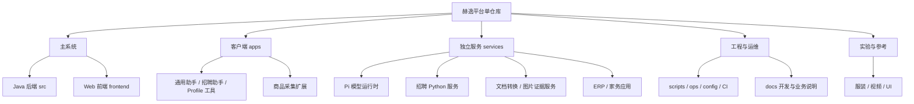
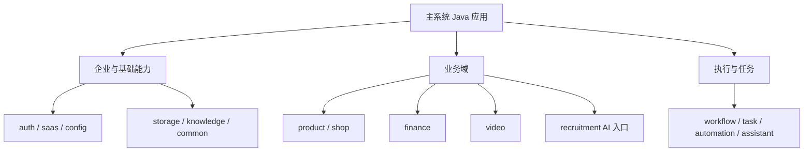

# 项目组织结构与目录约定

更新日期：2026-11-05。本次整理按主系统、客户端、辅助服务、工程工具和实验资料分组，调整的是仓库路径及调用引用；外部 API 路由、服务名、业务数据目录、数据库迁移和生产部署路径保持原有含义。

## 目录图

```text
ai-video/
├── src/                         主系统 Java 后端与测试、Flyway 迁移
├── frontend/                    主系统 Web 静态前端、资源及前端测试
├── apps/                        独立客户端
│   ├── automation-agent/        通用 Electron 自动化助手
│   ├── browser-extension/       商品采集浏览器扩展
│   ├── chrome-profile-manager/  本机 Chrome Profile 工具
│   └── hr-desktop/              招聘桌面壳、工作台与 Python 打包运行时
├── services/                    独立运行或单独部署的服务
│   ├── pi-runtime/              Node.js 模型与图片操作运行时
│   ├── recruitment/             Python 招聘 Connector、业务服务及桌面桥接
│   ├── document-preview/        私有 Office 转 PDF 服务
│   ├── watermark-detector/      可选图片/前景与水印证据服务
│   ├── erp/                     独立 HOYEE ERP
│   └── household/               独立家务应用
├── scripts/                     工程与运维工具，按用途分类
│   ├── release/                 历史及专项发布 helpers
│   ├── finance/                 财务 Java 核对及维护程序
│   ├── qa/                      测试、模拟与冒烟脚本
│   ├── diagnostics/             检查、审计、诊断与样本核对
│   ├── maintenance/             修复、恢复、清理及专项维护
│   ├── local/                   本地回调白名单隧道
│   ├── build/                   静态资源构建工具
│   ├── ci/                      服务/桌面 CI、制品与验收辅助程序
│   ├── video/                   既有视频专项运维入口
│   ├── compact-release-image.py 保持稳定路径的镜像压缩保护
│   └── heyi-mysql-backup.py     保持稳定路径的备份实现
├── experiments/                 隔离实验与参考，非默认生产服务
│   ├── garment-reconstruction/ 服装几何重建与计算实验
│   ├── video/scripts/           MiniMax 实验及提示词
│   └── ui/apple/                保留的视觉参考
├── ops/                         系统服务、备份、反代与管理配置
├── config/                      私有配置的公开模板
├── docs/                        开发、业务、发布、设计、研究与历史文档
├── .github/                     GitHub Actions 服务 CI/CD、巡检与桌面构建
├── .circleci/                   显式触发的备用 Windows 构建
├── pom.xml / maven-settings.xml Maven 构建入口
├── Dockerfile*                  主系统后端镜像入口
├── compose*.yaml                Compose 及场景覆盖入口
├── AGENTS.md                    通用协作与 Gitflow 约束
└── README.md                    项目首页
```

Maven 的 `src/`、`pom.xml` 和主站 `frontend/` 继续留在根目录，便于现有 Java、静态资源及制品发布工具使用既有入口。独立客户端与独立服务归入各自父目录，不用兼容软链接维持一套重复树。

## 模块组织图



## 主系统内部组织

Java 后端是一个 Maven / Spring Boot 应用，不因目录分组就成为多个微服务。`com.yingdao.aicommerce` 下按业务域组织，部分域使用 `web/application/domain/mapper`，财务域主要按功能类组织。



这些是职责分组，尚未通过独立 Maven 模块或自动依赖检查强制隔离。招聘主体业务实际位于 Python 服务；ERP 和家务应用各有独立数据及运行边界。

## 新代码放置规则

- 主系统功能先归入既有业务域；Controller、计算、查询及工作器保持职责清晰，避免继续堆入通用大文件。
- 独立桌面程序或浏览器扩展放 `apps/`，独立进程服务放 `services/`，分别维护清单、依赖、测试和 README。
- 工程脚本放对应 `scripts/` 分类，真实业务服务不得继续混进工具目录。脚本分类不等同执行安全等级，运行前必须核对读写范围与目标环境。
- 原型放 `experiments/`，不进入默认 Compose 或正式产品入口；实验结论与真实业务验收分别记录。
- 源码路径变更同步更新 Compose、Docker、CI、跨模块导入、测试、构建清单及文档。外部路由、服务标识、数据卷和生产目录不能跟随源码改名一起替换。
- 发布及备份的稳定入口暂留根 `scripts/`；服务端已保留的绝对发布依赖不因仓库归类而删除或搬迁。

技术版本见[技术栈](technology-stack.md)，运行数据流见[架构说明](architecture.md)，操作入口见[开发指南](development.md)。

## 迁移边界与核对

本次归类移动 822 个现有源码/工具文件，主要映射如下；每个模块保留其依赖清单、内部测试、运行资源及构建文件。

| 原位置 | 新位置 |
| --- | --- |
| 四个独立客户端根目录 | `apps/` 下对应客户端 |
| `scripts/boss-agent/` | `services/recruitment/` |
| `pi-runtime/`、`document-preview/`、`watermark-detector/` | `services/` 下对应服务 |
| `erphoyee/`、`household/` | `services/erp/`、`services/household/` |
| `garment-reconstruction/` | `experiments/garment-reconstruction/` |
| `scripts/release-*.py` | `scripts/release/` |
| 财务 Java 工具 | `scripts/finance/` |
| 测试、诊断、维护及本地工具 | `scripts/qa/`、`diagnostics/`、`maintenance/`、`local/` |
| MiniMax 实验和提示词 | `experiments/video/scripts/` |

跨模块导入、招聘运行时来源指纹、GitHub/CircleCI 路径、Compose 构建上下文及文档引用同步调整。历史 `git show <提交>:<路径>` 和部署用绝对路径保留对应历史含义；源码指纹 JSON 不改写。前端两个 Dockerfile 原有漏包资源同时补齐。

最初整理阶段未执行 Git 提交、推送或生产发布。2026-11-06 按用户要求将全部本地工作提交到个人 fork，并明确 `main-tree` 发布基线、`develop` 集成和 `feature/*` 开发的 Gitflow 映射，见[协作流程](development.md#gitflow-与个人-fork)。目录调整及代码推送不代表完成生产重新验收。

## 整理验证结果

- 822 个原文件均存在于对应新位置；18 份依赖清单/锁文件/requirements 和 22 份迁移的二进制资源逐项哈希保持。
- 主系统 Java 源码、Flyway 迁移、Maven 依赖没有修改。Compose 静态对比除构建上下文外一致，服务名、环境、端口、网络与数据卷不变。
- Python 341 文件、Node 395 文件、JSON 28 文件和 Shell 19 文件通过语法检查。
- 客户端、Pi Runtime、招聘、ERP、家务、文档转换、构建/导出及恢复的 810 项定向测试通过；采集扩展检查通过。Node 测试使用 24.22.1，Python 使用 3.12.14。
- 前端全量 802 项在迁移前快照有 173 项失败，整理后为 171 项，新增失败 0；修复的两项是 Dockerfile 页面资源打包检查。其余既有失败未通过修改业务代码或测试掩盖，不能宣称全量回归通过。
- 未运行 Java/Maven 全量构建、Windows 整包/真实账号验收、付费模型或官方发布，也未进行生产部署。

小型验证回执见[project-structure-verification.json](project-structure-verification.json)。
