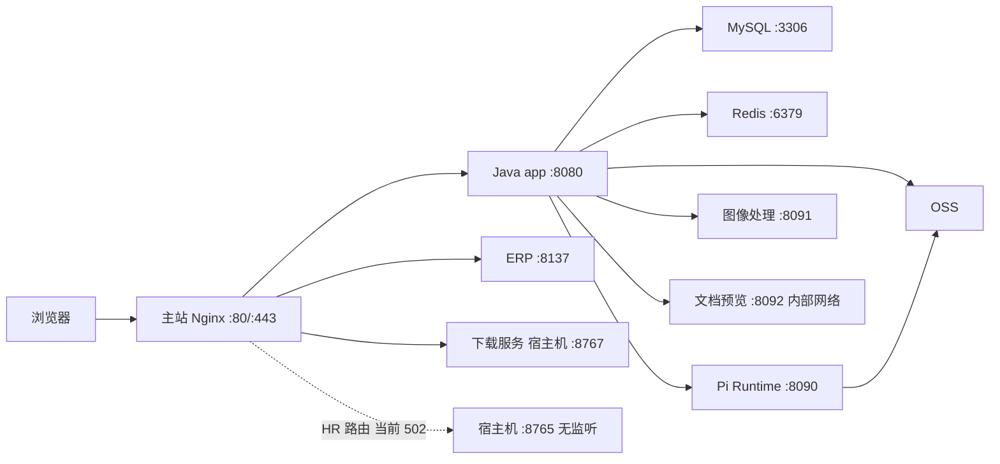

# 阿里云生产部署与运维交接

现场核查：**2026-11-05 18:09—18:19（北京时间）**，服务器 `8.163.34.81`。本文是该时段的运行快照；排队数量、修复进度、磁盘余量和版本会继续变化。接手后的发布规则见[运维指南](operations.md)，本次检查范围见[基础设施核查记录](../releases/infrastructure/server-deployment-audit-20261105.md)，完整的脱敏配置文件路径、镜像 ID、挂载与状态见[机器可读回执](../releases/infrastructure/server-deployment-audit-20261105.json)。

**后续更新：2026-11-06 17:34 已发布后端 `2026.11.6.2`，后端为 `finance-cold-queries-20261106`，前端保持 `brush-source-summary-20261106`。** 最新性能、回滚和清理见[冷查询验收](../releases/finance/finance-cold-queries-20261106.md)。14:30 的[第一轮性能发布](../releases/finance/finance-bi-performance-20261106.md)及 11:33 的[源码同步和备份记录](../releases/infrastructure/project-sync-20261106.md)保留历史事实；以下原核查章节保留原观察时间。

本次通过 SSH 只读检查现场，并从运维机检查主站访问。没有部署、重启、停领任务、修改配置或业务数据，也没有触发备份、续期、恢复、模型调用或平台发布。凭据只用于认证，不写入本文或回执。已有发布回执中的测试结果不是本轮重新执行的测试。

## 1. 接手时先处理什么

主站、Java 健康接口、MySQL、Redis、Pi Runtime、图像处理、文档预览及 ERP 的基础检查正常，但当前不能将“页面可访问”解释为备份、恢复和全部业务都已验收。

| 优先级 | 现场情况 | 接手动作与完成标准 |
| --- | --- | --- |
| 高 | TLS 证书于 **2026-11-18 08:43:01** 到期；Certbot 续期失败，日志命中 80 端口占用错误 | 在到期前修复挑战方式，验证新证书、Nginx 加载和后续自动续期；不能只清除失败状态 |
| 高 | 日常 MySQL 目录只见一份 11 月 3 日完成命名的归档；11 月 5 日备份退出码 75 | 核对容量保护及最近成功时间，在明确的备份任务中验证新归档；补齐异地副本和隔离恢复证据 |
| 高 | 线上已应用 V147，本地最高 V146；当前镜像没有 Git revision 标签 | 取得对应迁移、源码、发布输入及制品与提交的映射，验证后再准备下一次构建或回滚 |
| 先协调 | 两个财务修复容器正在运行，进度回执均为 `complete=false` | 与当前维护负责人交接进度、恢复方式和最终验收；不能按“临时容器”直接停掉或清理 |
| 业务确认 | `/api/v1/hr/health` 返回 502，旧 Linux 招聘 Connector 已屏蔽 | 确认招聘后端的承接方案；旧服务退役有历史记录，不能直接解除屏蔽恢复旧浏览器 |
| 后续完善 | 内部服务有全地址端口映射，云安全组未核实；Aegis 服务失败 | 核实云侧访问策略及安全代理状态，记录责任人、允许来源和验证结果 |

## 2. 主机与运行平台

| 项目 | 现场值 |
| --- | --- |
| 公网地址 / 主机名 | `8.163.34.81` / `iZ7xv22ayi93rf34fgl9fuZ` |
| 系统 / 内核 | Ubuntu 26.04 LTS / `7.0.0-28-generic` |
| 时区 | 主机为 Asia/Shanghai；MySQL 系统及会话时区为 UTC |
| CPU / 内存 | 8 vCPU；30,663 MiB；无 Swap |
| 运行时间与负载样本 | 已运行约 78 天；18:09 的 1/5/15 分钟负载为 6.35 / 7.16 / 6.77 |
| 根盘 | `/dev/vda3`，ext4，`df` 显示 99G 总量、75G 已用、20G 可用、80% 使用率 |
| Docker / Compose | Docker 29.1.3；Compose `2.40.3+ds1-0ubuntu1` |
| 实际运行时 | Java `jdk-21.0.12+8`；Node.js 22.23.2；MySQL 8.4.11；Redis 使用 `redis:8-alpine` 镜像 |
| 容器 / 卷 / 镜像 | 最终快照 11 个运行容器、8 个持久卷、30 个镜像 ID；核查期间新增一个财务修复容器 |

资源只采样了一次：MySQL 约占 14.43 GiB，主应用约 1.67 GiB。主应用、MySQL、Redis、Pi Runtime 和 CloudBeaver 没有容器级内存硬上限；这不表示它们没有程序内部限制。容量规划需结合连续监控，不能用单次样本调低数据库缓存或改变任务并发。

## 3. 服务与访问链路



以下端口列同时区分宿主机映射和仅容器网络使用的端口。`running` 是进程状态；表中另列 HTTP 或 Docker 健康检查，未配置 Docker 健康检查的服务不能仅靠容器状态证明业务正常。

| 容器 / 服务 | 实际镜像或版本 | 端口与现场验证 |
| --- | --- | --- |
| `ai-commerce-frontend` | `ai-commerce-frontend:finance-gift-zero-20261105` | 宿主机全地址 80、443；HTTPS 首页 200；无 Docker 健康检查 |
| `ai-commerce-app` | `ai-commerce-platform:finance-gift-zero-20261105` | 宿主机全地址 8080；`/actuator/health` 为 200 / UP；无 Docker 健康检查 |
| `ai-commerce-mysql` | `mysql:8.4` | 宿主机全地址 3306；Docker healthy；只读 SQL 成功 |
| `ai-commerce-redis` | `redis:8-alpine` | 仅宿主机 `127.0.0.1:6379`；Docker healthy；持久化状态正常 |
| `heyi-pi-runtime` | `heyi-pi-runtime:image-operation-oss-20261020-v2` | 宿主机全地址 8090；容器网络 `/health` 为 200 |
| `heyi-commerce-image-processor` | 镜像 ID `0caa2d97cde6`，标签 `heyi-watermark-custom:drape-source-print-20260922-962f53020cd5968d` | 仅容器网络 8091；`/health` 为 200 |
| `heyi-document-preview` | 镜像 ID `fb7b6dc9a5e1`，标签 `heyi-document-preview:20260922-017b7b73a40aae8a` | 仅 `heyi-knowledge-preview-internal` 网络 8092；Docker healthy |
| `hoyee-erphoyee` | `hoyee-erphoyee:20260908` | 仅容器网络 8137；Docker healthy；主站 `/erphoyee/` 为 200 |
| `heyi-cloudbeaver` | `dbeaver/cloudbeaver:26.1.4` | 仅宿主机 `127.0.0.1:8978`；running；未登录验收管理功能 |
| `finance-report-basis-repair` | `ai-commerce-platform:finance-report-basis-resume-20261105` | 无宿主机端口；维护任务，见第 8 节 |
| `finance-gift-cost-repair` | `ai-commerce-platform:finance-gift-zero-20261105` | 无宿主机端口；维护任务，见第 8 节 |

最终快照中上述容器均 running，重启计数为 0，`OOMKilled=false`。九个常驻容器均使用 `unless-stopped`；两个修复容器使用 `restart=no`。

宿主机另有以下服务：

| 单元 | 状态 / 用途 |
| --- | --- |
| `docker.service`、`containerd.service` | active / enabled |
| `1panel-core.service`、`1panel-agent.service` | active / enabled；1Panel 监听 `0.0.0.0:18443` |
| `heyi-admin-firewall.service` | active / exited，开机执行的管理端口防护 |
| `heyi-desktop-downloads.service` | active / enabled；用户 `heyi-boss`，监听 `172.18.0.1:8767`，失败重启 |
| `heyi-mysql-backup.service`、`certbot.service` | failed，分别见备份和证书章节 |
| `aegis.service` | failed / enabled，`Result=signal`；本轮未确定原因 |
| `heyi-boss-connector/chrome/display/vnc/novnc.service` | 五个旧单元均 masked / inactive；8765 无监听 |

旧招聘服务的停用与 [2026-10-24 退役记录](../releases/infrastructure/2026-10-24-server-slimming.md)一致；但现有 Nginx HR 路由仍指向它。没有发现独立家务服务或独立 Prometheus/Grafana 等监控单元；云侧及外部监控是否存在尚未核实。

## 4. 部署入口、Compose 与版本

### 4.1 实际配置入口

生产是多年历史覆盖文件组合运行，不能直接使用仓库根 `compose.yaml` 重建。

| 服务 | Compose 项目 / 文件数 | 基础入口及说明 |
| --- | --- | --- |
| app | `web_sdk_` / 244 | 起于 `/opt/heyi/deployments/release-20260827-1200/compose.yaml`；末端为 `finance-gift-zero-20261105` 的 app 覆盖及端口文件 |
| frontend | `web_sdk_` / 236 | 起于 `/opt/heyi/releases/hr-manual-scan-20260928/staged/compose.release.yaml`；末端为当前 gift-zero 前端覆盖及端口文件 |
| Pi Runtime / 图像处理 | `web_sdk_` / 69、48 | 仍引用早期 deployments、releases，图像处理链还引用 `/root/drape-source-print-20260922/compose.processor.json` |
| MySQL / Redis | `web_sdk_` / 2、3 | `/opt/heyi/current/compose.yaml` 加 `finance-storage-recovery-20261102` 的对应覆盖 |
| ERP | `hoyee_erp` / 1 | `/opt/heyi/erphoyee/current/compose.yaml` |
| CloudBeaver | `admin-console` / 1 | `/opt/heyi/admin-console/docker-compose.yml` |
| 文档预览 / 两个修复容器 | 无 Compose 项目标签 | 单独创建；不能假定主 Compose 会重建它们 |

共 604 次配置文件引用、483 个去重路径，本轮全部存在。`docker compose ls` 的项目汇总不能替代逐容器标签：它显示的 `web_sdk_` 文件数与 app、frontend 各自的链不同。[JSON 回执](../releases/infrastructure/server-deployment-audit-20261105.json)保存了每个服务的有序完整路径列表。

`/opt/heyi/current` 实际指向 `/opt/heyi/deployments/mobile-shell-20260826-092500`；它是历史基础配置目录，**不是当前应用镜像版本指针**。ERP 的 `current` 指向 `/opt/heyi/erphoyee/releases/20260908`。

再次操作前用非敏感字段重新取证：

```bash
docker inspect --format '{{.Config.Image}} {{.Image}}' ai-commerce-app
docker inspect --format '{{index .Config.Labels "com.docker.compose.project.config_files"}}' ai-commerce-app
docker inspect --format '{{index .Config.Labels "com.docker.compose.project.working_dir"}}' ai-commerce-app
docker inspect --format '{{range .Mounts}}{{println .Type .Source .Destination .RW}}{{end}}' ai-commerce-app
```

对实际要操作的每个服务分别执行。不要输出完整 inspect、环境值或展开后的 Compose；历史覆盖文件本身也可能含私有配置，不能整份复制到 Git。

### 4.2 当前镜像与回滚候选

app 于 17:57:25 启动，frontend 于 17:57:44 启动。当前版本已经晚于仓库上午的原始刷单费模板记录。

| 服务 | 当前标签 / 镜像 ID 前缀 | 最近两个有发布回执的保留版本 |
| --- | --- | --- |
| app | `ai-commerce-platform:finance-gift-zero-20261105` / `e3feb07e208e` | `finance-report-basis-resume-20261105` / `8d0a5cc099d9`；`finance-report-basis-20261105` / `dc169daa93b5` |
| frontend | `ai-commerce-frontend:finance-gift-zero-20261105` / `964389c70971` | `finance-report-basis-20261105` / `d869bdcee534`；`finance-local-month-20261105` / `64f094600faf` |

同一行回滚标签采用当前服务的仓库前缀。这些标签现场存在，gift-zero 的 `activation.json` 明确记录了第一回滚版本；更早版本可沿 report-basis 的回执追溯。本轮没有执行回滚或验证旧镜像在现有数据上的完整兼容性，不能直接承诺一键回滚。旧镜像 `finance-report-basis-resume-20261105` 仍被运行中的修复容器引用，不能删除。

主要回执目录为 `/opt/heyi/releases/finance-gift-zero-20261105/`、`finance-report-basis-20261105/`、`finance-report-basis-resume-20261105/` 及 `finance-storage-compression-20261105/`。保留其 Compose、helpers、小型回执和仍在运行的维护输入。`drain-private.json` 等私有状态不纳入交接文档附件。

本次读取当前 `/app/app.jar` 的 SHA-256 为 `10313d31edd38a18c74f5375503007334cc0a409574088e5c4e85a72112f8418`，与 gift-zero 的 `prepared.json` 一致。首页、`finance-workspace.js`、`finance-charges.js` 的容器文件、gzip 解压内容及 HTTPS 返回内容一致，刷单费 XLSX 模板的 HTTP 字节也一致。完整哈希见回执。

### 4.3 下一次发布前的缺口

- 本地 `main-tree` 的 HEAD 为 `011195ca89280ad8b03527b06eb235b3fecfe597`，并已有大量未提交的目录整理；仅凭它无法证明能重建晚间线上版本。当前生产 app/frontend 镜像均无 `org.opencontainers.image.revision` 标签。
- 本地迁移最高 V146，生产已经成功应用 V147 `finance redundant bill index`。本地也没有本轮现场所见 gift-zero、report-basis、local-month、receipt-resume、storage-compression 对应的新增发布 helpers。需从维护负责人取得正确源码与已应用迁移原件；不能补造迁移或修复校验和掩盖差异。
- 当前 app 为 6 层，image inspect 大小 689,077,614 字节，约 657 MiB，已经超过仓库 600 MiB 叠加保护阈值。下一次叠加之前必须按[运维指南](operations.md#发布准备与激活)执行压缩准备并使用返回的不可变基础镜像。本轮未构建或压缩镜像。
- Gitflow 的生产/集成分支映射尚未在本地确认；不能直接在 `main-tree` 上代替支持分支提交、合并或发布。本次只编辑文档，没有提交、合并、打标签或推送。

## 5. 持久化、目录与私有配置

### 5.1 Docker 卷

以下为 `du` 的实际分配空间近似值；不等同于数据库逻辑统计或 `docker system df` 的卷大小。

| 卷 | 用途 / 容器目录 | 已分配空间 |
| --- | --- | --- |
| `web_sdk__mysql_data` | MySQL `/var/lib/mysql` | 约 57G，是主要占用 |
| `web_sdk__redis_data` | Redis `/data`，会话及运行状态 | 约 31M |
| `web_sdk__video_script_data` | app `/data/video-scripts` 读写；Pi 同路径只读 | 约 585M |
| `web_sdk__ai_video_task_data` | app `/data/ai-video-tasks` | 约 1.1G |
| `web_sdk__automation_skill_data` | app `/data/automation-skills` | 约 8K |
| `web_sdk__automation_attachment_data` | app `/data/automation-attachments` | 约 12M |
| `heyi_image_operation_data` | Pi `/data/image-operations` | 约 13M |
| `heyi_cloudbeaver_workspace` | CloudBeaver `/opt/cloudbeaver/workspace` | 约 120K |

八卷合计约 58G；`docker system df` 显示卷逻辑大小约 75.91GB，两者口径不同，不能相加。数据库 `information_schema` 的数据及索引大小也是统计值，本轮未把它作为物理占用证明。图像处理和文档预览容器无持久挂载。

### 5.2 宿主机目录

| 路径 | 归属与维护边界 |
| --- | --- |
| `/opt/heyi/releases/`、`/opt/heyi/deployments/` | 当前配置链、早期补丁、发布 helpers 和回执；采样约 935M、690M，不能按日期整目录删除 |
| `/opt/heyi/current/.env` | 历史基础运行环境，root 所有、0600；只记录位置，不复制内容 |
| `/opt/heyi/shared/oss-signing.properties` | app 只读密钥挂载，0400，UID 10001；须连同访问身份安全移交 |
| `/opt/heyi/secrets/dayan-oss.properties` | app/Pi 只读配置；文件 0444，父目录 0700，不能只看文件权限判断宿主机可访问性 |
| `/opt/heyi/shared/finance-ads/` | app 只读广告凭据目录，0750；广告账户权限需另外交接 |
| `/opt/heyi/shared/hr-desktop-downloads/` | frontend 的只读 `/downloads` 挂载 |
| `/opt/heyi/desktop-installers/service/`、`venv/` | 正在运行的下载服务及 Python 环境；整个目录约 56M，不能作为旧安装包清理 |
| `/opt/heyi/erphoyee/shared/data` | ERP 的独立 `/data` 绑定目录；不在主 MySQL 卷内 |
| `/opt/heyi/boss-agent/` | 已退役 Linux 招聘端的剩余私有资料及运行目录，约 99M；本轮未打开简历、Cookie 或私有数据库内容 |
| `/opt/heyi/backups/mysql/` | 当前日常 MySQL 备份，约 3.2G |
| `/etc/letsencrypt/` | 证书、续期配置和账户私有材料；frontend 只读挂载 |
| `/usr/local/lib/heyi/compact-release-image.py` | 已安装的镜像压缩保护工具 |
| `/opt/heyi/operations/` | 运维历史回执；与当前变更仍有关的证据保留 |

主应用配置的 OSS Bucket 为 `hoyee`，区域 `cn-guangzhou`；Pi 图像归档 Bucket 为 **`test-hoyee`**，且 `IMAGE_OPERATION_OSS_MIGRATE=true`。后者虽然名字含 test，仍被当前生产运行时引用，不能当测试桶删除。未访问阿里云控制台核验桶版本、生命周期、跨区域副本、ECS 实例角色或授权账户归属。

保留已有加密密钥及 Agent、Runtime、预览和图像服务令牌。密文、数据库、文件、OSS 对象和解密密钥必须配套交接；仅把数据库导入新机器不能证明历史授权可恢复。密钥值及 1Panel 安全入口通过公司凭据渠道移交。

## 6. 数据库、Redis 与日志

| 项目 | 现场状态 / 运维含义 |
| --- | --- |
| 主库 | `ai_commerce`，148 张表；本轮只在只读事务中查询元数据及小型队列聚合 |
| Flyway | 146 条应用记录、失败记录 0；最高版本 V147，安装时间为 UTC 2026-11-05 06:20:50，即北京时间 14:20:50；记录数与最高版本号不同是编号存在缺口 |
| MySQL 缓存 / 连接 | `innodb_buffer_pool_size=12 GiB`；`max_connections=151` |
| MySQL binlog | `log_bin=OFF`；虽然保留参数为 2,592,000 秒（30 天），该参数不能证明存在可用的时间点恢复日志链 |
| Redis 持久化 | AOF 开启；RDB 最近状态、AOF 写入和重写状态均为 ok；数据目录有持久卷 |
| Redis 容量策略 | `maxmemory=0`、`noeviction`；不是已经配置了内存上限 |
| 核心容器日志 | app、frontend、MySQL、Redis 及两个修复容器均为 `none`；无法依靠 `docker logs` 找回其历史输出 |
| 其他容器日志 | Pi、图像处理、CloudBeaver 为 `json-file` 且未配置单容器轮转上限；文档预览为 10m × 3，ERP 为 2m × 2；daemon 默认驱动是 `json-file` |
| 系统日志 | Journald 为 volatile，`RuntimeMaxUse=32M`、`RuntimeKeepFree=128M`、不转发 syslog；Rsyslog disabled / inactive；journal 样本约 25.9M |

Pi 日志样本约 254KB，CloudBeaver 约 42KB，未发现当前日志大量占盘；但这些辅助服务没有显式轮转上限，需在独立日志维护任务中核定容量和保留期。排障沿用状态表、限量脱敏输出和小型回执，不长期开启核心持久日志。

## 7. 网络、证书与管理访问

`hoyee.org.cn` 与 `www.hoyee.org.cn` 的本次 DNS 结果均为 `8.163.34.81`。Nginx 配置检查通过；www 有独立 server，业务请求由主站配置承接。

| 路由 / 端口 | 当前承接方或边界 |
| --- | --- |
| `/api/`、`/actuator/` | `app:8080`；匿名财务 charges 接口返回 401 |
| `/api/v1/hr/` | `172.18.0.1:8765`；当前无监听，实测 502 |
| `/erphoyee/` | `erphoyee:8137`；首页 200，不代表全部 ERP 功能验收 |
| 两个招聘桌面安装包下载路由 | `172.18.0.1:8767`；本轮只核对服务、路由和目录，未下载/安装完整安装包 |
| `/.well-known/acme-challenge/` | `/opt/heyi/shared/certbot-webroot` 的只读前端挂载；已有 webroot 路由 |
| 3306 / 8080 / 8090 | Docker 发布到 IPv4/IPv6 全地址；需要核对云安全组，不能只看 UFW |
| 6379 / 8978 | 仅 IPv4 回环发布 |
| 18443 | 1Panel 的 IPv4 全地址监听；宿主机 INPUT 有允许回环、丢弃其他来源的专用规则 |

UFW inactive，IPv4 INPUT 默认 ACCEPT，DOCKER-USER 无额外限制；IPv6 INPUT 默认 ACCEPT。云安全组没有控制台权限核查。运维机的 TCP connect 探测可返回成功，但对 3306、8080、8090、18443 的后续协议读取均在 3 秒内超时；本轮**不能据此认定这些端口已向公网开放，也不能认定已被所有网络安全隔离**。

建议通过 SSH 隧道管理数据库、CloudBeaver 和 1Panel，具体账号与安全入口另行交接：

```bash
ssh -N -L 13306:127.0.0.1:3306 -L 18978:127.0.0.1:8978 -L 18443:127.0.0.1:18443 root@8.163.34.81
```

这是访问方式示例，本轮未创建常驻隧道。数据库客户端连接本机 13306；CloudBeaver 使用本机 18978；1Panel 的协议和私有安全路径沿用现有设置，不把其安全路径写进公开文档。

证书覆盖 `hoyee.org.cn`、`www.hoyee.org.cn`，当前 HTTPS 信任校验通过。证书有效期为北京时间 **2026-08-20 08:43:02 至 2026-11-18 08:43:01**。

续期配置 `/etc/letsencrypt/renewal/hoyee.org.cn.conf` 仍使用 `authenticator=standalone`，与 Nginx 占用 80 端口冲突；本次读取的短期日志命中端口占用错误。`certbot.service` 最近于 11 月 5 日 06:11:39—06:11:41 失败，退出码 1；timer 为 active / enabled，当时下一次为 11 月 5 日 19:04:46。已有可执行 deploy hook `/etc/letsencrypt/renewal-hooks/deploy/reload-heyi-nginx`。

修复时可审阅现有 webroot 路由与权限，准备不中断主站的挑战方案，再在明确的证书维护任务中执行验证、正式续期及 Nginx 重载。不要为续期直接停掉当前前端；本轮未执行 renew 或 dry-run。

## 8. 自动任务与正在进行的维护

主应用确实运行在正式业务模式：Shopee 与 TikTok Shop 开启、Shopee sandbox-only 为 false、实际发布开启，provider 为 OFFICIAL；素材归档和 OSS 开启，调度器开启。诊断调用不能使用会提交官方操作或付费生成的接口。

配置样本：dispatch 8 线程、最大活跃任务 80、模型调用 20、视频并发提交 500、脚本分析并发 4。这些是不同层级的上限，不能把其中一个数当作全部上游允许吞吐。

18:15 的只读聚合：

- 启用且 ACTIVE 的财务连接为 86 个：Shopee 46、TikTok Shop 40。连接数不是全店对账完成数。
- 同步状态表仍有 SUCCESS、SYNCING、RUNNING 和 3 条 REFUND / RATE_LIMITED；该表包含既有历史状态，不能按状态行数推导当前店铺数。全局 TikTok REFUND pacing 为 60 秒，当时 `next_allowed_at` 为北京时间 19:00:06，保留其冷却。
- 成本队列样本 44 项；36 个成本重建记录为 DONE。贴单状态样本没有待应用 revision 或错误。千易账户正常，连接样本有 72 个 SUCCESS、2 个 SYNCING。上述都是时点运行状态，不证明官方账单完整、收货证据齐全或独立对账完成。

| 维护容器 | 开始时间 / 限额 | 当时进度与交接要求 |
| --- | --- | --- |
| `finance-report-basis-repair` | 17:05:47；1 CPU、768 MiB；`restart=no` | `/opt/heyi/releases/finance-report-basis-20261105/date-repair-verification.json` 于约 18:16 仍为 `complete=false`，已完成 24 个店铺阶段；不是全任务完成 |
| `finance-gift-cost-repair` | 18:10:41；0.5 CPU、512 MiB；`restart=no` | `/opt/heyi/releases/finance-gift-zero-20261105/gift-repair-verification.json` 于约 18:16 仍为 `complete=false`，已完成 18 个店铺阶段；核查期间新启动 |

两个任务都把各自发布目录读写挂载为 `/qa`，并使用生产网络；它们是正在处理业务的维护任务，不是可销毁测试库。进度回执虽报告未改同步检查点，也不能理解为“任务没有业务写入”。本轮没有触碰这些任务。接手需取得负责人的结束条件、可续跑方式和最终验收，再清理维护输入；主机重启后它们不会按策略自动续跑。

## 9. 备份、恢复与容量边界

### 9.1 日常 MySQL 备份

| 项目 | 当前现场 |
| --- | --- |
| 执行脚本 | `/usr/local/sbin/heyi-mysql-backup`；与仓库 `scripts/heyi-mysql-backup.py` 的 SHA-256 一致 |
| 调度 | `heyi-mysql-backup.timer`，北京时间每天 03:20，最多随机延迟 15 分钟 |
| 最终生效配置 | drop-in 设定 `Persistent=false`；主 unit 原文虽为 true，应看合并后的生效值 |
| 运行边界 | 服务超时 3900 秒；脚本 dump/压缩阶段预算 3600 秒；单归档最多 6 GiB；运行中保留至少 8 GiB；启动要求至少 14 GiB；最多保留 2 份完成命名的归档 |
| 日志 / 互斥 | stdout、stderr 均为 null；使用 `.backup.lock`，不并发备份 |
| 现存归档 | `ai-commerce-20261102T193057Z.sql.gz`，3,421,870,878 字节，0600；文件名时间为 UTC，最后修改时间为北京时间 **2026-11-03 03:43:59** |
| 最近一次运行 | **2026-11-05 03:28:58** 当秒退出，`Result=exit-code`，状态码 **75**；服务 failed |
| 当时下一次计划 | **2026-11-06 03:34:17**；timer 仍 active / enabled |

现存完整命名归档只有一份；“保留 2 份”是数量上限，并不保证实际已有两份可用备份。本轮没有全量读取归档、验证 gzip CRC、导入恢复或检查异地副本。

安装脚本的 75 对应空间/时长保护：启动可用空间不足 14 GiB，或运行中跌破 8 GiB、超过阶段时限。此次同秒退出与启动保护吻合，但当时剩余空间没有留存，不能宣称已证实唯一原因。核查结束时剩余约 20.17 GiB，高于启动门槛，不代表下一次一定成功。不能放宽保护上限或只执行 `reset-failed` 就宣布修复。

### 9.2 恢复范围与未验证边界

- 此脚本只备份容器配置的主 MySQL 数据库，不覆盖全部 Docker 卷、OSS、证书和私有密钥。
- Redis 有持久化，但本轮没有发现其独立、已验证的备份/恢复回执。主站会话与任务状态也需纳入恢复计划。
- ERP 有独立 data 目录及 `/opt/heyi/erphoyee/backups/20260908-101126/` 历史目录；该目录存在不能证明当前恢复能力。
- 旧招聘私有资料、桌面发行配置、签名身份、业务素材和解密密钥需要分别确认备份负责人、保存位置和恢复证据。
- 当前主库 `log_bin=OFF`，未证明可以做时间点恢复；同机归档也不能应对整机或系统盘丢失。

恢复演练应在隔离环境进行：先验证归档与权限，使用匹配的数据库版本导入，再恢复必要文件和解密配置，检查解密、素材引用、登录权限、关键只读页面和导出。演练环境必须关闭正式同步、官方写入、自动消息和付费模型调用。未经独立任务授权，不在生产导入旧库、启动备份或触发补跑。

## 10. 日常巡检与故障处理

以下命令只读，不依赖把全部历史 Compose 链重新加载。登录正确主机后执行：

```bash
date -Is
uptime
df -h /
docker ps --format '{{.Names}}\t{{.Image}}\t{{.Status}}'
systemctl --failed --no-pager
systemctl show heyi-mysql-backup.service -p Result -p ExecMainStatus -p ExecMainStartTimestamp -p ExecMainExitTimestamp
systemctl show heyi-mysql-backup.timer -p ActiveState -p Persistent -p LastTriggerUSec -p NextElapseUSecRealtime
find /opt/heyi/backups/mysql -maxdepth 1 -type f -name '*.sql.gz' -printf '%f %s bytes %TY-%Tm-%Td %TH:%TM\n'
openssl x509 -in /etc/letsencrypt/live/hoyee.org.cn/fullchain.pem -noout -dates
curl -fsS https://hoyee.org.cn/actuator/health
curl -sS -o /dev/null -w '%{http_code}\n' https://hoyee.org.cn/api/v1/finance/charges
```

健康预期为 UP，匿名财务接口预期为 401。不能把最后一条命令的进程退出码当作 HTTP 验收结果。常驻容器和维护容器分别核对；修复任务完成后，运行容器总数可以减少。

建议每天确认主站/鉴权、容量、备份新鲜度、证书到期、失败单元及同步冷却；发布后核对镜像 ID、配置链、挂载、制品哈希、工作器恢复及相关业务抽样。定期在独立任务中验证隔离恢复、云资源权限和访问策略。现有外部告警、值班人及通知渠道未移交，需补齐。

| 故障 | 处理顺序 |
| --- | --- |
| 主站 502 / app 健康失败 | 对比当前容器状态、Nginx 上游、网络、内存和迁移；按当前回执定位候选回滚；不直接整套 Compose 重建 |
| HR 502 | 先确认退役后端的承接方案；当前 8765 无监听是已知现场状态，不通过解屏蔽旧浏览器试错 |
| 备份没有新文件 / 75 | 查服务时间、容量门槛、当前任务负载和互斥；安排有界备份验证并保留成功回执；不改为漏跑补备份 |
| 续期失败 / 临近到期 | 查证书日期、standalone 与 80 端口冲突、现有 webroot 与 deploy hook；在明确维护任务中验证续期 |
| 磁盘逼近容量门槛 | 按归属检查卷、镜像与发布暂存；保留业务卷和正在运行的维护输入；只清理经过引用核对的任务产物，不手动删 Docker 目录 |
| 同步等待 / RATE_LIMITED | 查看通道、租约、最近进度和平台 pacing；保留检查点、冷却和人工优先级；不清队列或重置游标 |
| 容器重启后看不到旧日志 | 核心日志驱动为 none、journal 为易失存储；依赖小型回执及状态，不临时长期打开完整请求日志 |

下一次改动仍遵守 [AGENTS.md](../../AGENTS.md) 和[发布、回滚流程](operations.md)。本文记录的是可核查的接手基线；云控制台权限、原负责人任务交接、恢复演练和全部业务验收仍需分别完成。

## 11. 2026-11-06 发布后的现状

- 当前前后端均为 `brush-source-summary-20261106`，源提交 `7ccbd80108651878dbcdcaa3e68c5d0115df61cc`；镜像 ID、回滚和配置链以[当前验收回执](../releases/infrastructure/project-sync-20261106.json)及[运维指南](operations.md)为准。app/前端分别引用 246/238 份 Compose，历史依赖位置保留。
- 完整源码和文档入口为 `/opt/heyi/source/current`，版本目录 `/opt/heyi/source/releases/v2026.11.6/`，外部校验清单 `/opt/heyi/source/manifests/v2026.11.6.json`。它与 `/opt/heyi/current` 的历史 Compose 角色不同；真实私有环境和业务目录不随源码同步。
- 本地已补齐 V147，Gitflow 已明确 `main-tree` 发布基线、`develop` 集成和支持分支映射；原第 4.3 节的缺口描述属于 11 月 5 日快照。
- 先前两个一次性财务修复容器已结束。现有成本队列仍有积压，切换前 162,059、11:36 样本 173,883；工作器线程已启动，原计划与预留恢复，检查点未重置。不能宣称全队列或全店对账已完成。
- 11 月 6 日例行 MySQL 备份在发布前于 03:51:10 成功退出，现存两份归档；本轮没有触发备份，没有验证恢复或异地副本。
- Certbot 与 Aegis 仍 failed；证书 11 月 18 日到期、HR 承接方案、云权限与恢复演练仍需跟进。本次部署没有处理这些独立运维事项。
- 本轮构建及 QA 暂存和私有停领状态已清理，Compose、发布 helpers、小型回执、活动与两个近期回滚版本保留；源码与凭据没有混放。


## 2026-11-06 14:30 性能发布更新

后端已更新至 `finance-bi-performance-20261106` / `8e23c7c1036c`，前端和其余服务的容器保持。保留后端回滚 `brush-source-summary-20261106` 与 `finance-gift-zero-20261105`；无容器引用的更早后端 report-basis-resume 标签已移除，其历史 Compose/helper 目录继续保留。

实际运行制品重复月查询为 171 ms、店铺切换 204 ms；未缓存新月份首次计算仍约 50 秒。成本任务从切换前 71,753 项在 14:44 观测为 0，锁等待为 0。316 个原同步计划已恢复，检查点未改；本次所有预留和 marker 已释放。15:06 清理约 165 MB 自有暂存后，根盘可用约 19.27 GiB，未扩盘。详情与验证边界见[发布回执](../releases/finance/finance-bi-performance-20261106.md)。

本版源码按 `v2026.11.6.1` 留存，仍从 `/opt/heyi/source/current` 进入。旧日期章节描述当时状态，不能用其中的活动镜像、修复进程或积压数替代新的现场检查。
