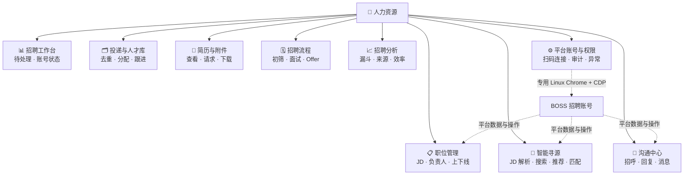
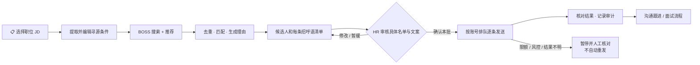

# 人力资源招聘系统：BOSS 直聘接入设计（待确认）

日期：2026-09-24  
状态：产品与技术设计，尚未实施、尚未连接真实招聘账号

## 1. 目标与范围

在现有 Hoyee 系统增加独立的「人力资源」主菜单，支持 HR 在 Web 页面处理 BOSS 直聘招聘账号的职位、候选人、投递、沟通和简历，并在本系统维护跨平台可扩展的招聘流程。首个平台为 BOSS 直聘招聘方；不复用「BD 建联」达人数据表，也不把求职者自动投递命令放进 HR 页面。

「全功能」在本设计中指项目当前公开的招聘方命令，以及系统自行实现的招聘台账、权限和分析。项目底层客户端虽然有面试邀请、标记不合适的方法，但当前 `boss hr` 命令没有公开这两项；BOSS 新建职位也没有现成命令。界面会标明能力边界，不能用本地状态冒充平台操作成功。

## 2. 确定的 Linux CDP 路线

```text
HR 的浏览器
    └─ Hoyee Web ──HTTPS──> 现有 Spring Boot API
                                  ├─ MySQL：职位、人才、跟进、权限、日志
                                  ├─ 私有 OSS：获授权保存的简历附件
                                  └─ 服务器内调用连接器工作进程
                                         └─ boss-agent-cli（固定版本）
                                                ├─ httpx：部分只读网页接口
                                                └─ CDP：127.0.0.1 上的专用 Chrome
                                                            └─ BOSS 招聘者页面
```

每个 BOSS 招聘账号分配独立 Linux 用户或等效的进程隔离、持久化 Chrome profile、`boss --data-dir` 目录、CDP 端口和串行任务队列。不能把多个账号放在同一 Chrome context：项目 `login --cdp` 会复用扫描到的第一个有效登录 context，混用可能连错账号。

**多人使用时的 Cookie 边界**：Hoyee 用户登录不会直接修改 BOSS Cookie。若多名 HR 共用**同一个**企业 BOSS 账号，他们使用同一份平台会话，但所有平台任务按账号串行，并在 Hoyee 审计中分别记录是哪位 HR 发起；其中一人重新扫码会使这个共享账号的连接状态变化。若每人绑定**不同**的 BOSS 账号，后端必须按授权的 `platform_account_id` 唯一映射到对应 `data-dir`、Chrome profile、CDP 端口和 Linux 进程，禁止两个账号共享其中任何一项。创建或重登连接后检查平台返回的账号身份与绑定记录；不匹配则暂停任务。绝不因为 HR 在页面切换账号就对其他 profile 运行 `login --force`，也不允许用户传入任意目录或 CDP 地址。

服务器使用 Xvfb 等虚拟显示运行**有界面模式** Chrome。仅在账号登录或人工排障时，由已授权管理员打开限时的远程桌面会话扫码；会话结束即撤销访问。HR 日常只用 Hoyee 网页。CDP、VNC、MCP 均只监听本机或私有网络，绝不开放公网端口。

项目文档中的 Linux 示例为 `google-chrome --remote-debugging-port=9222 --user-data-dir=/tmp/boss-chrome`，然后 `boss --cdp-url http://localhost:9222 login --cdp`。生产环境沿用这个 **CDP 登录方式**，但把 `/tmp` 改为账号专属的持久目录，并为每个账号分配不同端口；不使用 `--remote-allow-origins=*`。业务命令显式指定 `--data-dir`、`--browser-source stored-cookie`、`--cdp-url` 和 `--json`，使 CDP 不可用时返回错误而不是偷偷降级到 Bridge/headless。登录或切换账号只通过受控的管理员流程执行，不自动运行 `login --force`。

连接器选用后端调用 CLI 并解析 JSON 信封的方式；先不对外开 MCP HTTP 服务。调用必须由固定命令白名单组装参数，不通过 shell 拼接任意用户输入。上游版本、命令 schema 和字段映射要锁定并做兼容验证。仓库现成 Docker 镜像没有登录浏览器，不能直接当作全功能运行环境。

## 3. 页面和用户操作

### 功能总览



### 一份 JD 到招呼发送



| 主菜单「人力资源」下的页面 | 主要内容 | 关键操作 |
| --- | --- | --- |
| 招聘工作台 | 待处理投递、未读沟通、待跟进、账号状态、同步异常 | 按职位/负责人进入待办 |
| 职位管理 | BOSS 职位列表、JD、状态、负责人、各阶段人数 | 同步、查看；确认后上线/下线；新建职位暂跳官方页 |
| 找人才 | 按职位 JD 智能寻源、关键词和城市等筛选；按职位看推荐人选 | 查看匹配依据、加入人才库；审核候选人及首次招呼 |
| 投递与人才库 | 投递列表、来源、去重提示、负责人、阶段、备注、下一次跟进时间 | 分配、筛选、批量导出有权限的台账 |
| 沟通中心 | 会话列表、最近消息、消息记录和候选人侧栏 | 编辑/预览/确认回复；记录发送结果 |
| 简历与附件 | 在线简历、候选人已授权的附件、下载记录 | 请求简历、确认接收、预览/下载、交换联系方式 |
| 招聘流程 | 本地初筛、沟通、面试、Offer、入职看板 | 记录评价、面试安排和跟进；不伪造 BOSS 平台动作 |
| 招聘分析 | 来源、职位漏斗、响应时间、跟进完成率 | 按组织/部门/负责人查看 |
| 平台账号与任务（管理员） | 账号归属、登录健康、最近同步、任务状态和审计 | 开启限时扫码、暂停/恢复连接、查看失败原因 |

候选人详情采用「基本信息 / 对应职位与投递 / 简历 / 沟通 / 跟进记录」页签。顶部始终显示来源账号、最近同步时间和当前数据是否来自平台；本地流程状态与 BOSS 原始状态并列显示，不相互冒充。敏感联系方式默认遮盖，查看和下载均留痕。

## 4. 上游能力对应

| 系统功能 | 当前公开命令 | 接入状态 |
| --- | --- | --- |
| 职位列表、详情、上线和下线 | `boss hr jobs list/detail/online/offline` | 接入；变更职位须二次确认 |
| 投递申请 | `boss hr applications` | 接入只读 |
| 搜索候选人与职位推荐 | `boss hr candidates/recommendations` | 接入只读；保留分页和请求预算 |
| 沟通列表、历史、最近消息 | `boss hr chat/chatmsg/last-messages` | 接入只读 |
| 在线简历 | `boss hr resume` | 按平台权限展示；缺失不自行补造 |
| 首次招呼 | `boss hr greet --dry-run`，确认后 `--yes` | HR 可一次审批具体名单和每条原文，后台按人逐条发送；不自动重发 |
| 回复消息 | `boss hr reply` | HR 确认具体对象和内容后单次发送 |
| 请求/接收/下载附件简历 | `boss hr request-resume/accept-resume/download-resume` | 逐项确认、检查消息 ID，结果不确定时人工核对 |
| 请求交换电话/微信 | `boss hr resume --exchange` | 权限控制和明确确认，默认关闭 |
| 新建职位、BOSS 平台邀约面试、平台标记不合适 | 无对应的现成公开 `boss hr` 命令 | 先在系统记录流程或跳官方页面；单独验证并扩展连接器后才能开放平台写入 |

系统自有的职位负责人、候选人去重提示、面试日程、流程看板和统计是 Hoyee 能力，并非声称由上游自动提供。AI 初筛/回复草稿可以作为后续附加能力，但不得自动拒绝候选人或自动发送；发送给模型的个人信息需要单独的访问与数据范围控制。

## 5. 三条主要流程

1. **接入账号**：管理员创建账号记录并指定负责人 → 分配隔离运行环境 → 临时开放远程桌面 → HR 在服务器专用 Chrome 扫码 → 执行 `login --cdp`、`doctor`、`status --live` → 只读探测成功后显示「已连接」。登录过期时状态改为「需重新登录」，不清空本地人才台账。
2. **人才同步**：按账号串行执行职位、投递、消息等有限分页读取 → 规范化字段并按平台 ID 幂等写入 → 对候选人及职位关系建立本地申请记录 → 只更新平台来源字段，不覆盖 HR 的负责人、评价和本地流程状态。同步失败显示上次成功时间和明确错误，可从游标恢复。
3. **对外操作**：HR 打开候选人和目标职位 → 预览具体内容/动作 → 二次确认 → 写入唯一操作请求并执行一次 → 核对平台结果后记审计。若请求超时或结果不确定，标为「待核对」，先查会话/平台页面，不自动重复发送。

### JD 智能寻源与招呼

HR 选择已有职位或粘贴 JD，系统提取岗位名称、核心技能、经验、城市、薪资范围和加分项，先生成可编辑的寻源条件。连接器按岗位调用 `boss hr recommendations --job-id`，再以数个关键词调用 `boss hr candidates`；分页和运行预算有明确上限。平台返回的候选卡及有权限查看的简历进入候选池，按职位与平台身份去重；本系统给出基于可见资料的匹配理由及“不确定/资料不足”，不把 AI 评分当作客观事实或自动淘汰依据。

系统为候选人生成与 JD 和已见资料相关、**不虚构个人经历**的招呼语。界面一次展示本批每个候选人、目标职位、匹配理由及最终要发出的原文；HR 可逐个删除、编辑或勾选，并对这一批**具体人选和具体文案**一次确认。确认后工作进程自动按账号串行发送，无需 HR 逐条点击；每个候选人单独执行一次 `boss hr greet --yes`，保存候选人+职位的幂等键及平台结果。`--dry-run` 仅用于预览，不能视为批准。额度或风控拦截、响应丢失、结果不确定均停止后续发送并待人工核对；不会改换账号、换通道或自动重发。

可选「每日自动寻源」只更新待审清单及提醒，不自动发送。**仅输入 JD 后完全无人审核地对未知候选人发招呼**不属于此版：上游命令要求操作者明确批准具体候选人与话术，且平台的免费沟通数量、账号风控不可由系统保证。

## 6. 数据与权限

建议独立表：`hr_platform_accounts`、`hr_jobs`、`hr_candidates`、`hr_applications`、`hr_conversations`、`hr_messages`、`hr_resumes`、`hr_followups`、`hr_sync_runs`、`hr_action_requests`、`hr_audit_events`。所有记录带 `organization_id`；外部身份键至少包含平台、招聘账号与平台 ID。一个人可应聘多个职位，不把候选人与投递记录合并为一行。相似姓名仅提示可能重复，不自动合并简历。

角色默认：管理员管理账号和全局权限；HR 负责人处理其职位及候选人；招聘主管可看所属部门；其他用户默认无招聘数据权限。单独设置「查看简历」「下载附件」「查看联系方式」「发送消息」「职位上下线」「账号管理」「查看审计」权限。简历附件如需落库，放在**私有** OSS 区域，使用短时受控预览/下载，不复用知识库的全员阅读权限；设置可配置保存期限和删除流程。

会话 Cookie、stoken、CDP 地址和原始简历不进入普通业务日志、浏览器前端或导出。服务器磁盘上的 Chrome profile 与 CLI 数据目录由专用用户持有，备份和权限单独管理。系统记录操作者、时间、账号、候选人/职位、动作、结果与上游错误码，但不记录完整凭据。

## 7. 任务状态、异常与上线验收

任务状态：`排队中 → 运行中 → 成功/失败/需重新登录/风控暂停/结果待核对`。账号级任务串行，读操作可有上限的超时与重试；有不确定副作用的发送、接收简历、职位上下线不自动重试。`ACCOUNT_RISK`、`ENVIRONMENT_RISK` 或安全验证页触发账号级暂停，必须由管理员在官方页面确认后人工恢复。前台显示任务进度、上次同步时间和可操作的错误提示，不能无限转圈。

验收次序：

1. 隔离环境中完成一个招聘账号扫码、重登与 CDP 断线恢复；证实不会读到另一账号。
2. 用一个真实职位跑通职位、投递、候选人、会话和在线简历的只读字段映射；确认权限不足或空数据时 UI 如实显示。
3. 在操作者批准的测试候选人与测试职位上分别验证一条消息和一次招呼；核对 BOSS 官方页面，不以 CLI 返回作为唯一依据。
4. 验证重复点击、超时、进程重启不会造成二次发送；账号过期、限流、风控均能停止并提示。
5. 验证普通用户不能跨组织/部门读取简历或打开扫码桌面；下载、发送和职位变更均可审计。

## 8. 建议默认值和待确认项

建议默认值：一个招聘账号一个独立运行环境；只读同步先上线；JD 自动寻源生成待审清单；HR 可以一次审批一批明确的人选及原文，系统随后自动逐条发送；简历下载只限授权角色；账号异常停止自动化。

实施前需要定下：是一个企业共享 BOSS 招聘账号，还是每位 HR 各自绑定账号；候选人和附件的保存期限；是否需要对接现有日历/飞书面试安排。以上不影响先按单账号完成 Linux CDP 验证和只读功能设计。

## 参考

- [boss-agent-cli Linux CDP 登录与通道选择](https://github.com/can4hou6joeng4/boss-agent-cli/blob/master/docs/troubleshooting.md)
- [招聘者公开命令和写入结果语义](https://github.com/can4hou6joeng4/boss-agent-cli/blob/master/docs/commands.md)
- [招聘者能力矩阵](https://github.com/can4hou6joeng4/boss-agent-cli/blob/master/docs/capability-matrix.md)
- [平台风险与账号隔离要求](https://github.com/can4hou6joeng4/boss-agent-cli/blob/master/docs/platform-risk.md)
- [Docker 浏览器能力边界](https://github.com/can4hou6joeng4/boss-agent-cli/blob/master/docs/integrations/docker.md)
