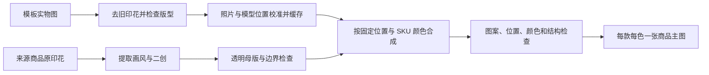

# 商品套版准确性：现状核查与改造设计

日期：2026-09-14。基于本地归档图片、现有代码和官方产品资料完成设计，`LOCAL_PHOTO_V1` 主流程现已接入批次执行器。已完成本地部署，本文区分已实现能力、历史问题和后续设计；归档图片仍需视觉质量复核。

## 结论

采用“现有商品照片做底图、独立透明印花、固定位置合成”的流程。AI 负责来源画风提取与新印花创作；系统保存位置和图案组绑定，复用同一份图案。当前商品主图在固定正面照片上本地合成；现有 3D 编辑器继续保存位置，但新主流程不会默认重绘四面商品图。

用户追加的成本与效果要求：优先参照现有商品，每个 SKU 颜色一张主图，普通裂变不再先生成左右、背面等整套参考。已选择版型模板时以模板底图为版型依据；直接改原商品时以采集的同色商品图为底图。不能混用两件不同衣服。

## 已实现范围与边界

| 环节 | 当前实现 |
| --- | --- |
| 批次策略 | 新建草稿及重新保存的、尚未绑定执行的草稿，冻结 `renderPolicy=LOCAL_PHOTO_V1` 和 `outputPolicy=SOURCE_SKU_COLORS`。启动沿用已保存配置；旧冻结任务保留原策略、素材和调用记录，不静默升级或重画。 |
| 唯一底图 | 固定模板正面实物底图；原位换花路径在没有上传底图时，要求先保存旧印花清理范围。照片提供外观和几何，模型只提供印花坐标。 |
| 提取与清理复用 | 来源 `EXTRACT`、去花 `BLANK` 按输入、提示词、清理范围及算法版本缓存；同公司内相同输入可复用，原始资产仍保留。缓存结果仍需视觉复核。 |
| 共享母版 | 每款、每个图案组生成一次，另存透明母版；相同组的多个位置和不同 SKU 颜色复用它。测试位置图案不成为正式画风来源。 |
| SKU 颜色 | 同色多尺码合并，只做每款每色一张主图。布色从有可靠前景的 SKU 图取样并核对，不能仅按色名臆造颜色；无独立颜色维度的“原图色”直接复用模板底色。 |
| 本地合成 | 使用透明图案、固定位置、服装前景及布料明暗合成；母版分离、布色处理和商品合成本身不调用生图模型。保护背景和识别出的非布料细节。 |
| 当前支持范围 | `FRONT`、轮廓完整且背景干净、可可靠分离的服装照片。照片与模型会做映射预检；当前连续轮廓配准不是对所有内部缝线、遮挡的精确标定。 |
| 明确停止 | 复杂背景、白衣白底无法分离、取色不可靠、多色衣片、色名与图片冲突、透明背景证据不足、映射偏差或缺失图案都会说明原因；已完成素材保留。 |
| 归档与质量 | 本地结果记录 `LOCAL_PHOTO_REVIEW_REQUIRED`，`productionReady=false`。机器检查、文件 `READY` 与“可量产/可上架的合格图”不是同一结论，仍需用户检查版型、布色、图案与位置。 |

分辨率已按代码核实：照片与模型映射的 `CommercePhotoMockupComposer.compose` 保留底图宽高；传统二维照片印区的 `composePlanar` 仍使用既有 1024×1024 等比容纳画布。当前并非所有导出固定为 1024，也并非所有路径都保留原始尺寸。

可选 AI 局部融合、多面商品成品、自动精确缝线标定和任意背景的语义分割属于后续能力，不是 `LOCAL_PHOTO_V1` 当前默认已实现的行为。

## 已接入的省成本主流程

1. 从保存的模板和来源确定唯一正面底图。模板决定版型；SKU 图片只提供原色证据，不在最终步骤重新混合两件衣服的结构。
2. 已上传纯色底图时直接使用；原位换花缺少底图时，按保存的清理范围生成并缓存 `BLANK`。固定输入的 `EXTRACT` 同样可缓存复用。预检先验证正面映射和颜色底图，无法可靠处理时在新印花调用前停止。
3. 提取来源商品画风。每款、每个图案组生成一份新印花，再生成透明母版；仅分离边缘连通白色画布，保留图案内部白色与可信的半透明原稿。
4. 本地准备各 SKU 原色底图，根据固定正面位置合成同一份母版。照片映射和传统二维印区分别使用自己的坐标约定，主图只使用实际可见位置。
5. 归档每款每色一张主图及输入、算法和检查记录，交由用户视觉复核。尺寸处理遵循上表所述两条路径；当前不追加左右、背面商品成品，也不把背面印花挪到正面。

缓存按公司隔离，使用固定输入资产键及对应算法版本；不同阶段纳入提示词、清理范围、颜色、图案绑定或模板位置数据。透明母版、各色底图和合成结果分别复用。新草稿只改图案时可复用已有底图；相同颜色、位置、图案重试可复用本地结果，重复打开页面不重新调用模型。

当前原位换花要求保存明确的清理范围和正面印区，没有范围时明确停止。自动检测任意来源照片的准确印区、复杂遮挡修正属于后续设计，不能把不确定位置当作已校准位置。

成本应优先省掉重复步骤，而非降低关键母版质量：

| 成本项 | 新规则 |
| --- | --- |
| 四面或更多参考生图 | 普通主图裂变为 0；使用现有主视图 |
| 去旧印花 | 每张可信底图首次处理，检查后缓存复用 |
| 画风提取 | 每个固定来源一次，后续款式复用 |
| 独立印花 | 每款每组一次，保留细节质量 |
| 多颜色、多尺码 | 每色本地合成；尺码不增加图片 |
| 摄影感润色 | 当前默认只做本地合成；可选 AI 局部融合尚未作为新流程能力接入 |
| 请求失败 | 保留前面完成的母版、底图和合成，不从头运行 |

对每个来源商品，用 `V` 表示款式数、`G` 表示独立图案组数，基底准备完成后的模型生成任务数量为 `1 + V × G`（首次来源提取 1 次）；商品合成在本地执行，仍消耗本机算力与存储。复用已归档来源提取时再减 1 次。首次底图清理另计；将来若接入可选局部融合，也必须另计。生成任务数量不包含供应商兜底或重试的额外请求，不能当作费用上限。

例如 2 款、2 个图案组、3 种 SKU 颜色：先生成 4 份图案母版，再本地合成 6 张商品图。母版和图案提取共 5 次生成调用，商品合成本身为 0 次生图调用；不包含首次底图清理与可选融合。每次请求可能有供应商兜底、重试及不同费率，调用次数不是最终货币账单。

最终成本和质量比较使用同一批商品实测：记录供应商实际调用、耗时、通过检查的结果张数、人工修正次数，比较每张合格图的成本。避免用“返回了图片”计算成功率。

## 改造前：这批为什么出错

已检查批次 `7e617c29-e5dd-4b86-9b29-038d74a386c5` 的真实归档文件：

- 正面定位图上是粉色兔子，新图案外围有不透明的白色矩形画布，覆盖了模型布料明暗。
- 左侧定位图包含新图案；左侧重试结果 `e25d9e2d-138c-4da0-87d0-0e72c0211007` 却画回了模板原来的红色人物印花。该旧图案来自同一次请求的第一张模板原图，输出与它相似；这是参考污染的强证据，不能据此推断模型内部注意力。
- 正面生成图采用了模板原照片的背景和姿态，侧面定位图则来自另一机位和比例的粗模。请求同时要求保留原照片结构并遵守粗模构图，输入没有统一坐标基准。
- 核查时调用额度已用尽，批次停在 `WAITING_INPUT / MOCKUP`。这是旧冻结批次的历史状态；图片 `READY` 仅表示文件归档，不能代表套版合格。

对照图：[当前参考与结果](../output/mockup-accuracy-design-20260914/current-reference-comparison.jpg)。各原图、底图、定位图、输出均保存在同目录，未覆盖原批次素材。

改造前的代码依据（保留用于说明问题来源，不代表新主流程仍沿用这些步骤）：

| 环节 | 改造前相关代码 | 当时的缺口 |
| --- | --- | --- |
| 独立印花 | `CommerceSampleService.printPrompt` | 要求白底且说明后续需分离，但执行链没有正式透明母版阶段 |
| UV 合成 | `CommerceSurfaceMockupComposer.compose` | 按原 alpha 覆盖 RGB，没有分离外围画布、保留布料明暗；UV 为 8 位通道且最近邻采样 |
| 请求参考 | `CommerceBatchArtworkService.execute / surfacePrompt` | 带旧印花实物图、纯色图、粗模定位图共同约束整张照片；新图案细节主要压在定位图的小区域内 |
| 验收 | `CommerceSurfaceMockupComposer.check` | 只统计印区外像素变化；没有判断新图案是否真的出现、是否画回旧图案、位置是否正确 |

## 参考的公开做法

1. [Printful Mockup Generator API](https://developers.printful.com/docs/#tag/Mockup-Generator-API)：固定目录产品与 variant，给定印花文件、placement、印区及图片宽高、top/left，再异步生成。官方建议只请求实际使用的样式，并降低预览输入尺寸以减少处理时间。
2. [Printify Product Properties](https://developers.printify.com/#product-properties)：固定 blueprint、provider、variants；`print_areas → placeholders → images(id,x,y,scale,angle)` 明确保存图案与位置。
3. [Photopea Smart Objects](https://www.photopea.com/learn/smart-objects)：共享一份图像源，各实例保留独立变换；更新图像源，各处同步更新。[Free Transform](https://www.photopea.com/learn/free-transform) 提供透视和 Warp 变形。
4. [Three.js DecalGeometry](https://threejs.org/docs/pages/DecalGeometry.html)：模型、位置、方向、大小是明确参数；官方提醒跨转角投影可能失真。跨袖缝、跨前后面的大图案不能靠一个投影盒保证正确。

这些资料支持“产品模板、独立图样、位置参数分开”的设计。Printful/Printify 使用自己的产品目录，其公开 API 不能证明任意实物图能自动准确套版，也没有披露全部内部渲染算法。

## 完整目标设计与后续计划

以下保留研究阶段的完整目标。共享母版、正面本地合成和保守 SKU 调色已落地；精确相机/网格校准、复杂遮挡与缝线处理、多面成品及可选 AI 融合仍需继续实现和验证，不能把本节的目标要求都视为已交付能力。

### 模板准备：一次投入、重复使用

- 冻结模板原图、可信的去印花实物底图、同面相机、服装分区、遮挡、布料明暗和照片映射。AI 生成的其他面标明来源，不当成真实拍摄证据。
- 保留现有 3D 拖放、缩放、旋转、多图案、撤回。每处保存稳定的 `placementId`、表面坐标、大小、方向和 `artworkGroupId`。
- 同款测试图案仅标记组别；例如前后都用棋盘，两处引用同一 `artworkGroupId`。正式二创始终从来源商品画风提取。
- 照片和模型不能直接按同一像素坐标叠加。先校准相机，再按衣身、袖子等部位建立网格变形或稠密映射，检查轮廓和关键缝线对齐。单个四点透视只适合近似平面。
- 若模型结构不准，不把粗模轮廓烘焙进商品实物主图。照片路径以可信底图为几何基准；模型路径用于预览，待模型验收后再承担多角度成品。
- 前后、左右都保存定位；只有用户指定的主展示视角导出商品主图，多面仍可在模型中查看。主图无法展示的背面印花不能被搬到正面。

### 印花生成：先得到可复用的独立母版

- 一款的一个图案组只生成一次，所有位置、颜色都引用其内容哈希。前后同组不分别生图。
- 保留 AI 原始输出，新增透明母版。使用边缘连通画布分离与透明度细化；白色动物、眼白、文字内部的白色不能一并删除。前景与白底无法区分时记录具体原因，进入背景分离处理，不把白框传入成品步骤。
- 不强制把所有图案转成矢量，以免破坏颗粒、刺绣等原画风。高分辨率图样单独保留；当前照片映射结果保留底图尺寸，传统二维印区仍使用 1024×1024 画布，统一导出尺寸可作为后续明确配置。
- 带旧印花的模板原图只参与前期结构分析和去印花，不传给最后的套版润色。来源商品画风图也不再参与最后商品结构重绘。

### 准确套版：由数据决定图案和位置

- 3D 路径：透明印花写入服装材质或按稳定表面坐标投影，参与同一法线、粗糙度、灯光和遮挡计算；避免不透明覆盖底图的光照。
- 照片路径：将透明印花通过已验收的映射变形，再与照片的服装遮罩、明暗、高光及遮挡层合成。袖口、折叠和缝线遵守真实可见范围。
- 深色衣物上的白色印花不能只用 Multiply；需要分别处理墨色、底色、布料明暗和不透明度，保留印花中的白色。
- 跨前后或袖缝的图案使用分区 UV 或多个共享实例；检测过度拉伸，不能靠单个 Decal 投影跨转角。
- SKU 色名和原色参考属于衣服底色层，模板决定版型与材质。相同印花、相同位置，按来源商品真实 SKU 颜色各输出一张；尺码不重复生图。色样受照片光照影响，不宣称像素色值等同真实标准色号。
- 每色优先复用一次验收的底图或受限调色结果。黑色、浅色等布料外观差异明显时，需要独立颜色底图或可靠材质参数，不能强行全图染色。

### AI 融合：后续可选能力，尚未接入默认流程

- 默认候选来自确定性合成。若摄影感不足，才请求小范围的布料融合，不重新创作图案、衣服和背景。
- 仅接收与底图对齐且通过检查的候选；印花主体、衣服轮廓、领口袖型属于锁定内容。局部模型即使返回整图，也只能按已验证的照片坐标使用允许区域。
- 失败保留准确合成图，标记“融合未通过”，不覆盖母版。不能在照片未对齐时套用粗模 mask，避免剪碎衣服。

## 检查与失败说明

已落地的记录区分文件归档与待视觉复核：`READY` 仅表示归档，`LOCAL_PHOTO_REVIEW_REQUIRED`、`PHOTO_COMPOSITED_REVIEW_REQUIRED` 和 `productionReady=false` 明确保留质量待确认状态。完整设计中的 `generationStatus` / `validationStatus` 分离属于进一步统一状态模型的方向，当前不声称新增了这两个通用字段。

- 输入检查：底图仍有旧印花、透明背景分离不确定、照片与模型映射失败、某印花组缺少母版。
- 可确定的检查：图案组哈希相同、实例数量完整、变换参数未改、无越界 UV、固定背景及保护区域不被覆盖。
- 需要视觉验证的检查：图案遗漏/旧图案残留、位置与尺寸、布料颜色、领口与袖型。逆向映射后的图案一致性自动验收属于后续验证能力；用实际坏样本校准阈值，轮廓分数不能代替图案正确性。
- 被遮挡的背面和内部细节不记为已验证。截图相似度不能当作实物还原率。
- 拒绝文案例子：“左侧仍出现模板旧印花，未使用本款新图案”“袖子位置映射偏移，保留定位数据，未生成合格商品图”“图案外围背景未分离，避免生成白色贴片”。

## 验证与后续工作

当前已实现透明母版分离、正面照片映射与布料明暗合成、保守 SKU 取色和调色、缓存及批次接入。新主图合成不再向模型提交旧印花模板照片与粗模定位图共同重绘商品，从结构上消除该步骤的参考污染。

已进行 Java 回归及现有米色正面底图的无付费处理验证，涵盖白色主体、真实半透明稿、伪透明白框、共享母版确定性、复杂背景拒绝、深浅色、领标保护、映射与批次策略。测试总数及部署记录见文末；跳过的测试单独标明，文件归档不代表视觉质量通过。

后续先用真实商品照片继续校准前景和映射，补齐袖缝、折叠、遮挡与准确印区的视觉验收，再扩展到背面、侧面和受限 AI 局部融合。对目前不可靠的输入继续明确停止，不能为扩大支持范围而忽略失败阈值。

验收集至少包含：当前粉色兔子/红色旧印花冲突、图案内部纯白、相同图案前后重复、不同组并存、侧面遮挡、深浅色衣服、同色多尺码。图案身份和位置必须分别通过；保持用户原始素材与所有候选可追溯。

新建或重新保存未绑定草稿使用版本化的新流程，旧批次保留既有素材和调用记录，不静默重画、不覆盖结果；旧结果要用新逻辑处理时应建立明确的新创作任务，关联质量修复入口仍可进一步完善。调用继续沿用额度、断点和重复请求保护。本地部署与文件核验已完成；后续应在视觉质量确认后量化 AI 调用减少量和处理耗时，不预先承诺费用比例或自动一比一还原。

## 本地部署与验证结果

2026-09-14 已更新本地后端和前端，Docker 持久镜像同步构建；后端健康状态 `UP`，Flyway V97 已成功执行。只替换本次关联类、迁移、三个页面脚本、图片预览尺寸样式和缓存版本，保留其他已部署内容。

- Java 测试共 169 项：168 通过，0 失败，1 项需要专用浏览器导出素材的可选测试跳过。其中 5 项新工作流真实 MySQL 集成测试和 2 项启动集成测试均已实际运行通过。
- 前端 59 项测试通过。隔离浏览器使用本批真实归档素材合成的两款结果，验证商品主图计数、过程素材默认收起、图片放大，以及 1440/390 像素布局无横向溢出。测试页执行状态为明确标注的测试数据。
- 已核对五份服务端静态文件哈希与新源码一致、运行 JAR 与本次构建一致。独立浏览器访问应用时是登录页，因此没有宣称验证过登录后的真实新批次操作。
- 验证没有新增收费生图调用，没有启动或覆盖现有旧批次；原执行仍是 `WAITING_INPUT / MOCKUP`。
- [验证清单](../output/local-photo-workflow-20260914/verification.json)、[真实合成结果 V1](../output/local-photo-workflow-20260914/v1-local-photo.png)、[真实合成结果 V2](../output/local-photo-workflow-20260914/v2-local-photo.png)。
