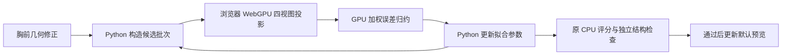

# GPU 实际拟合接入与胸前凹带修复

> 研究或实验记录；样本、限制及未确认项按文中日期适用，不作为生产能力承诺。 当前入口见[业务说明](../../business/README.md)与[运维指南](../../guides/operations.md)。

当前预览默认显示通过本轮检查的胸部修复版。原 v2、袖子细节候选和已归档证据继续保留。

- [查看修复模型](http://127.0.0.1:8767/garment-reconstruction/viewer.html?version=2&model=gpu-repaired)
- [运行 GPU 拟合](http://127.0.0.1:8768/garment-reconstruction/gpu-fit.html)
- 同相机、同灯光的前后对照（历史产物未随源码入库：`output/garment-gpu-repair-runs/20260911-160721-9c23a3/browser-visual-check/comparison-gray.png`）

## 胸前为什么像瘪进去

原先用“到侧缝、肩缝的距离”控制衣身前后厚度。侧缝在腋下结束后，距离计算从到一条侧缝变成到它的端点；同时，胸部厚度参数小于腰部厚度参数。两者叠加，在胸前靠两侧的位置产生横向凹带。中央线没有同样的谷值，所以整体加厚或加一个中央凸包会改错部位。

新的 `geometry_v3.py` 对确实存在凹带的前片区域作连续局部修正，幅度受上下既有曲面约束；前片中央线、后片、领口、袖子、袖根、下摆、XY 坐标和拓扑保持不变。横向连续函数避免修补本身造出两条竖向鼓包。`chest_relaxation=1` 是本轮固定的几何修正，不交给仅能看外轮廓的优化器随意取消。

独立验收器对实际三角面在固定世界坐标中取截面，同时检查左右两侧：

| 固定截面指标 | 原 v2 | 修复版 |
| --- | ---: | ---: |
| 最大异常谷深，相对模型单位 | 0.024455964 | 0.006934701 |
| 本次减少比例 | — | 71.64% |

这是局部凹带的量测变化，不能解释为服装还原率。还有残余过渡，原图不能提供标定后的真实深度。本轮没有更换灯光或材质来掩盖几何问题。

## GPU 现在实际参与什么

原型增加本地 `gpu_fit_server.py`，由 Python 批量构造候选、更新参数，浏览器用标准 WebGPU/WGSL 执行投影和加权误差归约。评分真正返回给 `fit_stage`，影响下一步搜索。当前仍由 CPU 构造几何，GPU 不是整套重建程序的唯一执行器。



损失使用原 `fit_stage` 的定义：每个视角 `sum(像素不一致 × (1 + abs(目标距离场))) / 目标面积`，再平均四个视角。GPU 的边缘覆盖与 OpenCV 不完全相同，最终检查仍使用冻结的 CPU 相机、参考掩膜和阈值。GPU 与同一 GPU 掩膜上的 CPU 权重计算，最大归一差约 `1.75e-9`。

本机记录 `20260911-160721-9c23a3`：

- 154 个候选由真实 Apple M4 WebGPU 评分，无 CPU 回退。
- 四视图、256×256 拟合；含最终验收的本轮总耗时约 6.97 秒。
- GPU 目标值 0.14932258 → 0.14512289。
- 进一步改变体积的候选未通过最终四视图保护条件，因此最终选用局部胸前修复的初始候选。GPU 搜索没有被冒充为已通过验收的体积改进。

这轮只有 154 个候选、4 个局部参数，与此前 2445 次全形状拟合任务不同，不用 7 秒与此前 28.8 秒计算整体加速倍数。

另一次明确从客户端点击开始的完整复测 `20260911-161422-fc08ca` 用时 7.31 秒：1 次配置＋69 批评分，154 个候选与服务、trace 和测量记录全部吻合；无回退、无客户端错误，最终产物哈希与上一轮一致。17 项客户端/服务一致性检查保存在该任务的 `browser-client-verification.json`，完成状态及截图一并归档。

## 复检与失败处理

正面、背面、左侧、右侧的 512px 轮廓掩码与原 v2 逐像素一致。正背仍通过原阈值，左右仍有此前的偏差；上下和四斜角参考不足的状态保留。结构、限定袖身碰撞和实际开口非退化检查通过。最终一共保存 10 方位 × 灰模/白线框 × 新旧模型的 40 张浏览器截图，20 组相机和观察目标完全一致。

GPU 断开或评分超时会使整段搜索失效，并从固定初值用 CPU 完整重启该阶段，明确记录 `cpu_fallback`；不会混用两种渲染器的分数继续选优。过期/重复任务回包被拒绝。最终产物每次写入独立目录，发布前核对来源、网格哈希和独立检查，失败保留原默认模型。缺少 WebGPU 的浏览器会显示不可用，不伪造 GPU 完成。

本轮 102 项 Python 测试通过，并完成浏览器加权计算和实际 HTTP 拟合验证。Windows/Mac 使用同一 WebGPU 接口；Windows 尚未实机测量。完整材料、隐藏结构、实物尺寸和一比一还原仍未验收。

查看器另检查了 390px 窄屏无水平溢出，以及实际鼠标按下/移动/抬起后 OrbitControls 相机变化。首次高级拖动 helper 没有观测到相机变化，该记录未计为通过；后续 CDP 鼠标事件验证记录在 `browser-visual-check/pointer-drag-check.json`。

## 启动与代码入口

安装原型原有 Python 依赖后，在项目根目录运行（Windows 同样使用此命令）：

```bash
python experiments/garment-reconstruction/gpu_fit_server.py --port 8768
```

该服务只绑定本机，`http://127.0.0.1:8768/garment-reconstruction/viewer.html?version=2` 也可直接显示预览，无须另外启动 8767。通过页面“GPU 重新拟合”进入任务页，点击开始后保持计算页打开。

| 文件 | 用途 |
| --- | --- |
| `geometry_v3.py` | 胸前局部凹带修正、诊断与参数边界 |
| `fit_v2.py` | 批量候选评分接口，保留原 CPU 实现 |
| `gpu-silhouette.js` | 标准 GPU 光栅与加权误差归约 |
| `gpu-fit-client.js`、`gpu-fit.html` | 真实任务请求、GPU 执行、进度和结果入口 |
| `gpu_fit_server.py` | 本地任务与严格回包匹配 |
| `run_gpu_repair.py` | 实际拟合、CPU 复检选优与默认产物更新 |
| `validate_gpu_repair.py` | 冻结参考的四面评分、十方向投影、结构及固定截面验收 |

最新产物入口为 `output/garment-gpu-repair-latest.json`。每次拟合的 trace、GPU 请求与耗时、最终候选选择理由、独立检查均在对应 `output/garment-gpu-repair-runs/<jobId>/` 中保存。
