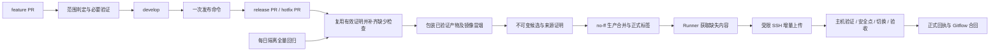

# 大陆服务器场景下的 CI/CD 提效总体设计

日期：2026-11-10。状态：**方案已整理，尚未实施**。配套[实施计划](../plans/2026-11-10-cicd-network-acceleration.md)列出任务、接口、验证和切换条件。

## 1. 目标与已确认的选择

将快速迭代阶段的常规发布收敛为一次命令，优先消除依赖重复下载、重复验证、重复编译和整包跨境传输。继续沿用当前 Gitflow、不可变候选、来源证明和生产恢复机制。

用户已确认：

- 优先零新增付费资源，使用现有 GitHub Actions、私有 GHCR 和阿里云服务器；不购买构建机、代理或国内镜像仓库。
- 日常按风险分级验证，财务后端、权限、迁移和公共基础设施变更进行完整回归，每晚补充全量检查。
- 使用一条发布命令，复用现有 `gh` 登录完成 PR、合并、标签、部署、验收和合回，不新增长期自动化凭据。

本文交付的是设计，不表示命令、协议、验证复用或网络修复已经上线。

## 2. 基线与证据

### 2.1 仓库和生产快照

- 本地核查提交：`b0faf26ce52100b8df0caeb88462ff8155222752`，工作区为 detached HEAD，并有另一项广告前端/文档工作未提交。
- 2026-11-10 16:58（Asia/Shanghai）读取生产入口时，应用为 `v2026.11.10.3`，维护标记关闭，无未完成主机操作；同时 Production deployment `42786326589` 正在运行。
- 该快照会过期。实施前必须重新读取远端分支、正式 Release、运行容器、完整 Compose 链、镜像摘要、配置、迁移和并行维护，不能把本文版本写进发布脚本。
- 当前角色映射：个人仓库 `Gotit-zhx/ai-video`，远端 `fork`；生产 `main-tree`，集成 `develop`。两分支要求 `CI required`、严格基线检查，禁止 squash/rebase 合并与强推。
- 现有入口：[CI/CD 指南](../../guides/cicd.md)、[工作流 CI](../../../.github/workflows/ci.yml)、[候选](../../../.github/workflows/candidate.yml)、[部署](../../../.github/workflows/deploy.yml)。

### 2.2 已观察到的耗时

| 位置/对象 | 证据 | 可以得出的结论 |
| --- | --- | --- |
| Candidate run `42755031230` | 总计 18 分 52 秒 | 候选全程很长，需继续拆分具体环节 |
| 其中 container job `129627366895` | Ubuntu 包 192 MB，下载 12 分 32 秒，日志速率 256 kB/s；对应层 767.3 秒 | 该轮容器构建被依赖下载显著拖慢 |
| 其中 database(2) job `129627367018` | npm 完成至首次系统包安装输出间隔 656.5 秒 | 长等待在 APT 准备阶段；该处没有逐子命令计时，不能把全部间隔进一步精确分配 |
| 同轮 unit job `129627366981` | 对应 APT 阶段间隔 401 秒 | 不是单个测试分片独有的现象 |
| 较早 run `42743848344` | database(0) 对应间隔 464.4 秒 | 该类下载/安装等待跨多轮出现 |
| Production run `42760560053` | 总计 612 秒；预取/传输/校验步骤 581 秒；主机实际激活 26 秒 | 激活占比小；581 秒尚不能全部归因于 SSH 网络 |
| 同一个候选提交 | 候选 verify、生产 PR CI、合回 PR CI 重复验证 | 存在独立于网络的重复工作 |

2026-11-10 的源码清点为 333 个 Java 测试类，其中数据库类 42 个、单元类 290 个，另有显式排除类；前端 QA 脚本 35 个。数量用于说明规模，实际执行必须重新清点并保留现有跳过审计。

### 2.3 大陆服务器网络短采样

| 路径 | 结果 |
| --- | --- |
| GitHub API / GitHub 页面 | 约 0.30 秒 / 0.74 秒完成小请求 |
| GHCR `/v2/` | 约 0.49 秒返回正常的 401 认证挑战；这不证明私有镜像大文件下载速度 |
| 项目 GitHub Release 源码文件 | 两次约 24,447 / 32,493 bytes/s；35 秒截止时分别仅收到约 0.86 / 1.14 MB |
| JDK Release 文件 | 两次约 18,532 / 26,602 bytes/s；35 秒截止时均未读完采样范围 |
| Maven 二进制文件 | 两次前 8 MiB 约 940,955 / 301,611 bytes/s，波动明显 |
| 同一源码文件的本机对照 | 两次前 2 MiB 约 758,015 / 774,155 bytes/s；本机路径不同，不能替代 GitHub Runner 测速 |
| Docker Hub | 三次直连在 8 秒 TCP 连接预算内失败，包含 IPv4 复测 |
| Docker Hub 系统解析 | 曾返回 `104.244.43.128`，后返回 `31.13.84.34`；未发现 hosts 覆盖 |
| 官方 ARIN 对首个地址的查询 | 网络名称为 `TWITTER-NETWORK`，表明存在可疑解析 |
| Cloudflare HTTPS DNS 对照 | TLS 失败，未取得可信回答；尚未验证任何 DNS 修复方法 |

采样使用公开地址、范围请求和字节/时长上限，未改 DNS、代理或生产设置。达到采样截止时间表示采样未完成，不能一概等同于服务完全不可达。这些速率不代表全天平均值。

### 2.4 优先级结论

1. GitHub Runner 的 APT/FFmpeg 下载与大陆服务器的访问路径是两个独立问题，必须分别处理。
2. 现有“Runner 下载，再通过受限 SSH 上传”的方向继续使用，避免把大文件拉取转移到大陆生产机。
3. 首先固定运行时并缓存依赖，其次减少传输字节，再去除重复验证；同时补充真实链路分段计时。
4. Docker Hub 的解析异常作为独立网络维护项，不直接修改全局 DNS，也不将全局代理作为默认方案。

## 3. 目标架构



正常路径保留现有三个发布工作流，通过命令串联；Operations 继续承担巡检和回滚。候选不再因支持分支每次 push 都无条件启动整套验证与构建。

## 4. 网络与构建设计

### 4.1 网络计时与诊断预算

每次发布按阶段记录 `registryResolve`、`registryDownload`、`ociExport`、`sourceDownload`、`sshUpload`、`serverReceive`、`sourceAndProofVerify`、`ociVerify`、`imageLoad`、`businessDrain`、`containerStart`、`postVerify`。

- 各机使用单调时钟计算本机耗时；UTC 时间仅关联事件，不直接相减不同机器的时间戳计算带宽。
- 记录完整逻辑镜像大小、实际上传字节、缓存命中字节和速率，明确等待首字节、连接、传输、校验与解包。
- 计时不能通过 `subprocess.run` 的总耗时冒充纯上传时间；客户端最后写入与服务端接收完成分别记录，实际吞吐以服务端接收字节/接收时长计算。
- 原始下载地址中的签名查询、令牌和原始认证错误不进入输出。只保留主机名、分类错误、状态码、字节数和时长。
- 网络诊断按需运行，不进入每次发布的必跑清单：并发最多 2，最多 3 个下载端点、每端点 2 次、每次最多 8 MiB，总下载预算 48 MiB；连接 8 秒、单次 35 秒、总计 150 秒。范围请求不符合约定时提前退出。
- 下载重试仅用于可恢复传输错误：每个文件总预算 300 秒、最多 3 次尝试、单次最多 120 秒并受剩余总预算约束。业务测试失败不自动重试掩盖。

### 4.2 DNS 与国内源策略

先只读检查 hosts、NSS、实际解析器来源、宿主机与 Docker 命名空间解析及 TLS；保留 GitHub、GHCR、Docker Hub 和实际业务域名的对照。

- 默认不改系统全局 DNS，不写死公共 CDN IP，不关闭 TLS 校验。
- 对照必须来自可达且完成证书验证的可信解析通道；Cloudflare 通道当前失败，不能作为已验证备用。未形成可信对照时，诊断返回 `unresolved`，禁止自动套用 DNS 变更。
- 确认修复方案后，在独立维护中保存原解析配置、应用最小范围变更，并检查镜像预取及业务域名。失败按原快照恢复；不顺带调整广告 API 出网通道、容器环境或授权。
- 构建源按实际 Runner 网络选取：优先现有官方源与稳定缓存，不因为生产机在大陆就把 GitHub Runner 全部改为国内源。确需更换源时，保留 HTTPS、APT 签名和包校验，验证性能及依赖版本一致后固定配置。
- 不新增付费仓库、构建机、代理或订阅。以后如评估国内中转，先单独确认费用、权限、可用性及实际收益。

### 4.3 固定运行时与分任务工具链

- 前端任务安装 Node 和前端依赖；Java 任务安装 JDK/Maven；根据明确的测试清单，仅为实际需要媒体能力的任务提供 FFmpeg。
- JDK/Maven 的缓存键包含系统、架构、锁定版本和校验值；Maven/npm 缓存按其依赖输入区分。缓存损坏删除本任务缓存并重新校验下载，不能以缓存命中代替正确性。
- 把 JRE、FFmpeg 和字体制作为固定摘要的 runtime 基础镜像，放在现有私有 `app` 仓库，不增加仓库产品或公开应用内容。发布清单记录 runtime digest 与 recipe digest，依赖输入未变时复用已验证版本。
- 首次制作核对当前已验 Java、FFmpeg、字体与依赖清单；本任务不顺带升级运行依赖。后续依赖升级走高风险完整验证。
- 应用继续使用 `/app/app.jar`，兼容当前诊断和迁移程序。常规后端更新的目标是约 69 MB 应用层加约 30 MB 源码，而不是每次传约 409 MB 后端镜像。
- Buildx 使用现有私有 GHCR 下前后端独立构建缓存标签；缓存标签可更新，发布与 runtime 身份保持不可变。缓存写权限仅给受信任候选任务。
- 前端在保持资源清单、固定 gzip 和引用校验的前提下，将稳定 vendor/assets 与经常修改的 JS/CSS/HTML 分层；不能因此遗漏运行文件。

## 5. CI 选择、构建与证明

### 5.1 分级规则

| 改动 | 验证范围 |
| --- | --- |
| 纯文档 | Gitflow、格式和链接；不单独启动应用部署，随下一版本同步源码 |
| 前端独立模块 | 本模块前端回归、通用资源校验和候选容器冒烟 |
| `frontend/finance-workspace.js` 等财务公共前端 | 完整财务 UI 回归，包括金额、筛选、权限展示、分页、导出和来源状态 |
| 普通后端模块 | 所有 Java 单元测试、该模块数据库集成测试和候选冒烟 |
| 财务后端、权限/身份、迁移、共享基础代码 | 完整回归 |
| 流水线、构建/依赖/测试选择规则、运维基础设施 | 完整回归；涉及主机输入时还需独立维护 |
| 无法识别或没有测试映射的路径 | 完整回归，不静默忽略 |

固定轻量检查始终包括 Gitflow、差异格式、策略/运维单元测试与报告完整性审计。保留 `CI required`，通过任务条件选择范围，不以整个工作流 paths 跳过造成必需检查悬空。`services/`、`apps/`、Compose 等现有不支持自动发布的范围仍独立处理。

每日 02:00（Asia/Shanghai，UTC cron 为 `0 18 * * *`）在隔离环境对远端 `develop` 完整回归。最近全量失败或 48 小时没有有效全量结果时，下次候选强制全量；候选通过后恢复分级。夜间测试失败本身不触发生产回滚。

### 5.2 只复用证明充分的结果

CI 记录实际测试合并树、原始 head、base、suite 集合及各自输入摘要、工具链摘要、规则摘要、产物摘要和真实 Actions run/attempt。policyDigest 覆盖选择规则、工作流与执行/构建脚本；测试源码和夹具归入 suiteInputDigests，普通套件增补不会仅因测试文件改变就把全部发布升级为高风险。

复用需要同时满足：同仓库、相同有效树、相同工具链与规则、所需 suite 被完整覆盖、报告存在、无非预期跳过、真实 run 成功、producer workflow 属于受信任策略。CI 产物本身不能宣称自己可信，候选必须经 GitHub API 核对来源与摘要。

- PR 合成树与分支 head 树不同，不能把两者结果混用；先完成支持分支的基线整合，再验证候选树。
- 开发或合回产生新组合、规则更新或缺少 suite 时补跑相应检查，不按“同 SHA 曾经绿过”直接通过。
- 外部 fork 和未经信任的工作流不进入有写权限的发布阶段，不使用 `pull_request_target` 检出外部分支再发布。
- Java 编译输出和 JAR 作为有摘要的工作流产物共享。测试分片运行编译后的测试；保留每类隔离数据库和账号。候选包装该 JAR，减少重复 Maven 编译及容器构建。
- 数据库仍使用 3 个分片，依据完整报告中的历史类耗时做确定性均衡；不得通过合并测试库或放弃隔离换取速度。

### 5.3 清单兼容与门禁

采用 `release.json` schema v2；保留 source、images、摘要和预算语义，增加 `validation.profile`、`policyDigest`、`toolchainDigest`、`suiteInputDigests`、`requiredSuites`、`evidence[]` 和构建产物证明。

- v1 保留完整验证语义，用于已有发布、回滚和过渡期全量候选；不能给旧清单填上未经验证的快速证明。
- 新控制面先支持 v1/v2 双读，再允许流水线生成 v2。首个 v2 候选完整回归；旧格式缺少构建证明的组件默认重建一次。
- 对生产 PR 增加 `Release ready`：候选工作流取消重复 verify，接收已核对的验证 run，包装/复用合格镜像，完成实际 digest 冒烟、来源证明及不可变候选后才通过。
- Candidate 改为发布命令在 CI 就绪后显式 dispatch；提交者仍可手动 dispatch，但服务端执行相同核验。校验 exact head、repo、ref、tree 和 run 身份后才授予发布任务写权限。
- 缓存与制品复用键均包含构建 recipe 摘要；源码相同而打包规则变化也会失效。候选不覆盖，同提交已生成应用制品后不通过重跑覆盖原对象。

## 6. 增量传输接口与信任边界

保持现有受限 SSH、固定仓库和单个 JSON 结果，不开放 shell、任意路径或任意镜像操作。

### 6.1 协议 v2

`status` 增加 `transferProtocols: [1, 2]`；没有此字段的旧主机按 v1 处理。

新增 `stage-plan VERSION PLAN_ID`：`PLAN_ID` 为 32 位小写十六进制。标准输入接收短期拉取令牌、固定名 release/source 文件以及有大小上限的 OCI graph metadata；认证数据不写入命令行、目录或回执。

计划阶段核对正式标签、当前生产 HEAD、候选来源证明、source 校验值、root manifest/config/layer 描述符、平台和固定仓库，然后通过受支持容器工具读取并校验本地缓存。只对清单引用的 digest 做协商，返回：

```json
{
  "protocol": 2,
  "planId": "aaaaaaaaaaaaaaaaaaaaaaaaaaaaaaaa",
  "version": "v1.0.0",
  "manifestSha256": "bbbbbbbbbbbbbbbbbbbbbbbbbbbbbbbbbbbbbbbbbbbbbbbbbbbbbbbbbbbbbbbb",
  "transferMode": "delta",
  "missingBlobs": [{"digest": "sha256:cccccccccccccccccccccccccccccccccccccccccccccccccccccccccccccccc", "size": 1234}],
  "uploadBytes": 1234,
  "temporaryPeakBytes": 5678,
  "expiresInSeconds": 1800
}
```

`stage VERSION` 保留原有 v1 形状，新增标准输入形状 `{protocol:2, planId, blobs:[{digest,size}]}`，后接 digest 升序的精确长度内容。计划已完成来源证明，不要求上传阶段保存或再次提交令牌。计划文件仅保存非敏感验证信息和恢复状态。

- 计划有效期 30 分钟，绑定版本、manifest 摘要及生产基线；过期或基线变化返回 `needs_replan`，不部署旧目标。
- 去重摘要必须尺寸一致，拒绝越界、截断、额外数据、重复成员、未知 blob 和任意文件名。
- 上传后再次核对缓存；若缓存被回收，返回明确缺失清单重新协商，不能跳过该层。
- 已存在缓存的哈希或长度错误返回 `needs_repair`，不按命中放行，也不直接改写底层内容；只能通过标准完整导入尝试恢复，仍不一致则保持旧服务并交接。
- 用已验证缓存与新上传内容重建完整 OCI 归档，沿用完整 graph/摘要/名称校验与标准镜像导入，再核对实际 manifest 和 config digest。
- containerd 内容读取不可用时返回 `transferMode: full`，使用现有完整 OCI 通道。不能直接写 Docker/containerd 数据目录。
- 旧主机仅能回退部署完整验证的 v1 候选；v2 快速候选要求新控制面，不能借协议降级绕过门禁。

### 6.2 生命周期和存储

两把共享锁的顺序保持：`/run/lock/heyi-application-release.lock` → `/opt/heyi/operations/.project-release.lock`。网络准备与安装仍串行核对生产资源，不持生产锁等待整个 CI。

中间内容放在本操作拥有的私有 staging 目录，结束或经过归属、进程和 TTL 校验后清理。当前及两个已验近期回滚、所有容器引用、运行配置、业务卷和迁移恢复输入继续保护。

安全余量继续为 10 GiB，另加接收、缓存读取、完整归档重建、导入、源码解包的峰值空间；上传字节下降不意味着临时磁盘预算可以同比下降。

## 7. 一条命令的状态机

```bash
python3 scripts/ci/release_flow.py --source develop --dry-run
python3 scripts/ci/release_flow.py --source develop
python3 scripts/ci/release_flow.py --source hotfix/已存在的主题
python3 scripts/ci/release_flow.py --resume 发布ID
```

默认个人 fork，普通发布从远端 `develop` 创建 `release/<版本>-<主题>`；hotfix 输入必须已经来自对应生产历史。版本按上海日期和远端正式标签生成，当天首版为 `v年.月.日`，后续序号递增；同名活动分支也占用版本，不覆盖或强推。

状态顺序为：`planned → pr_open → validating → candidate_ready → production_merged → tagged → deploying → accepted → backmerging → complete`。

- Git common dir 保存本地非敏感 journal 和进程锁；同机多工作区共用锁。远端每个副作用前检查 exact head/base，不能把本地锁宣称为跨主机分布式锁。跨主机仍遵守项目发布协调规则。
- 不切换共享工作区分支、不自动提交未提交内容；默认拒绝脏工作区发布。dry-run 只读，给出将发布的远端提交和现有脏文件。
- 相对当前正式版本只有文档变化时，返回 `no_runtime_release`，文档留在 develop 随下一次应用发布同步；不创建正式标签，也不声称已经更新生产源码。
- 缺少主机维护回执时进入 `requires_maintenance`，提前准备可信候选与精确变更说明，但不合入生产或打标签。未知迁移不自动套用 V148 专用执行器。
- 发布前再次核对 main-tree，使用匹配 head 的 no-ff 合并；确认第二父和树一致，再创建标签。基线变化或冲突停止，不选择财务冲突的业务结论。
- 断开后优先读取同一部署 operation 的最终结果；成功则继续合回，不重复切换。失败保留明确阶段和失败回执，再按现有兼容机制恢复。
- 主机验收成功但 GitHub 回执附件上传失败时进入 `receipt_pending`，从受信任部署 run 的产物核对并补传回执，不重新部署或重建镜像。
- 普通 release 合回 develop；hotfix 同时进入活动 release 分支及 develop。合回树发生新组合时重新按范围验证，不无条件轻量通过。
- 只有验收成功、所有必要合回和回执完成才进入 complete。清理已合并临时分支在最后执行。

## 8. 目标、验收与失败处理

### 8.1 指标目标

| 指标 | 优化目标与边界 |
| --- | --- |
| 工具链准备 | 热缓存 P50 不超过 30 秒、P95 不超过 60 秒 |
| 常规后端传输 | 稳定 runtime/依赖未变时约 100 MB 以内，包括当前约 30 MB 完整源码包；以真实字节记录为准 |
| 常规前端上线 | 热缓存 P50 目标≤5 分钟，参考区间 2～5 分钟 |
| 普通后端上线 | 热缓存 P50 目标≤10 分钟，参考区间 5～10 分钟 |
| 高风险完整上线 | 热缓存 P50 目标≤15 分钟，参考区间 8～15 分钟 |
| 服务激活 | 单独统计安全点、启动、校验，目标沿用现有几十秒级，不能为追求秒数跳过安全点 |
| 用户操作 | 正常路径只发出一次命令；维护、冲突及外部授权作为必要例外 |

上线时长 `timeToAcceptedMs` 从命令开始到客户端观察到可信主机成功回执，包含排队、CI、构建和网络等待。完整流程 `flowCompleteMs` 另计必要合回与回执归档，完成前不能提前报告整条流程已结束。

耗时目标尚未验证。首次基础镜像、外部明确平台事故、必要维护和人工冲突单独分组，仍保留原始记录；普通网络波动和正常下载重试不得事后剔除。每个拟宣称达标的发布类型至少积累 10 个可比热样本，使用 nearest-rank 百分位报告 P50/P95；P95 先报告实测值，不虚构当前缺少数据的承诺。样本不足不宣称达标。若传输目标未达到，先用分段指标定位，不立刻增加付费资源或降低验证。

### 8.2 验收覆盖

范围选择、未知路径回退、规则变化、PR 合成树变化、伪造 run、外部 fork、缺失报告、意外跳过、构建摘要不符、runtime 缓存损坏、增量/全量一致、缓存回收、上传中断、大小溢出、标签漂移、旧协议兼容、超时恢复、迁移门禁和清理保护均必须验证。

正式验收检查实际镜像、配置、鉴权、静态文件/gzip、维护解除和工作器恢复。财务数据只确认本次发布没有改变业务计算与覆盖语义，不宣称正在后台回补的数据已经完整对账。

### 8.3 回退

- CI 阶段可切回完整验证，保留新证明和新制品，不重写已发布候选。
- 传输异常可在完整验证与兼容条件下退回全量 OCI；不改 manifest digest。
- 控制面异常按独立维护前快照恢复兼容程序和配置，不恢复旧 SQL 或伪造 migration 基线。
- 应用不健康仅回到仍有资格且与数据库兼容的已验版本；不删库、不清同步进度、不改租约。
- DNS 调整失败恢复本次原设置。备份数量、容量、Persistent=false 和限时策略不随发布提效改变。

## 9. 分阶段实施与范围

1. **P0：证据与边界**。固化基线、指标结构、只读网络诊断和 DNS 变更停止条件。
2. **P1：减少联网与重建**。分任务工具链、固定 runtime、跨发布构建缓存与稳定前端分层；仍用现有完整验证/传输发布首轮。
3. **P2：受控增量通道**。完成 v1/v2 双读、计时和增量传输隔离测试，独立升级控制面，保留 v1 默认路径。
4. **P3：减少重复验证与手工步骤**。范围/证明机制先影子运行，再启用分级验证、候选门禁、一条命令与夜间全量。
5. **P4：实测收尾**。按发布类型验收正确性、完整恢复和性能指标，更新常驻运维说明及回执。

本轮不迁移技术栈、不改变财务/权限/同步语义，不在生产机安装 CI Runner，不购买云资源，不因历史“备份空间不足”记录主动清理当前备份。网络问题与业务 API 的出网修复分开维护。

## 10. 依据

- 当前源码与规则：[AGENTS.md](../../../AGENTS.md)、[CI/CD](../../guides/cicd.md)、[运维](../../guides/operations.md)、[存储保护](../../../ops/heyi-ops/heyi_ops/storage.py)。
- 下载证据：Actions run `42755031230`、`42743848344`；部署证据：run `42760560053` 与对应主机操作时长。它们是历史样本，不是当前运行句柄。
- 官方技术参考：Docker registry cache `https://docs.docker.com/build/cache/backends/registry/`；OCI descriptor `https://github.com/opencontainers/image-spec/blob/main/descriptor.md`；GitHub workflow artifacts `https://docs.github.com/en/actions/how-tos/writing-workflows/choosing-what-your-workflow-does/storing-and-sharing-data-from-a-workflow`；GitHub token 触发边界 `https://docs.github.com/en/actions/how-tos/write-workflows/choose-when-workflows-run/trigger-a-workflow`。实施时复核当前文档，不据参考页面绕过本项目来源证明或分支规则。
